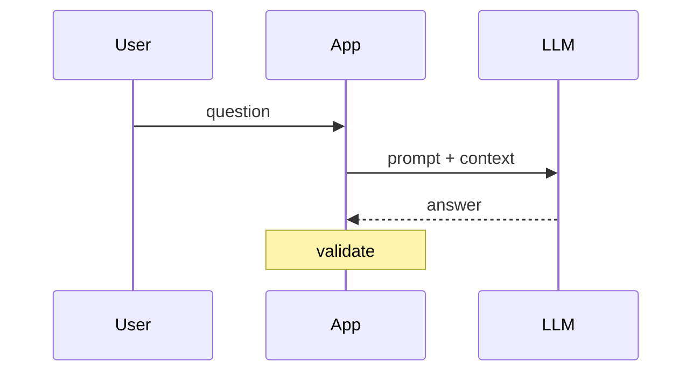

# AI Engineering lessons: authoring spec

Each lesson is ONE markdown file at `content-src/ai/lessons/<id>.md`. A build script merges these files into the app's seed, so the file format below is strict.

## File format

```
---
id: ai-tokens
chapter: ai-foundations
title: Tokens, context windows, and cost
minutes: 7
---
<body markdown>

===DEEPER===
<optional deeper-dive markdown>
```

- `id`, `chapter`, `title`, `minutes` are required. `minutes` = round(words / 180), counting body + deeper.
- Titles: 4 to 8 words, no quotes or apostrophes. Section headings (`##`, `###`): 2 to 6 words, no apostrophes or quotes. The display font has a tiny glyph set.
- Chapter ids: `ai-foundations`, `ai-patterns`, `ai-agents`, `ai-production`, `ai-stack`, `ai-design`.
- Write plain ASCII punctuation in prose: use `->` for arrows, `<=` `>=`, straight quotes, and a spaced hyphen or a comma instead of an em dash. No emojis. No decorative headers. No preamble like "In this lesson".

## What a lesson must do

The reader is a mid-level software engineer preparing for AI-engineering interviews and for building real systems. They study from this page, so it has to teach, not just name things. Every lesson:

1. Opens with 2 to 4 sentences that state the core idea and why an interviewer cares. No throat-clearing.
2. Has 3 to 6 `##` sections. Typical order: how it works, a worked example with concrete numbers or a short code sketch, trade-offs (a table), failure modes, interview angle.
3. Contains at least ONE diagram block in the body and at least one more block of a different type somewhere in body or deeper (types below). Prefer a diagram wherever a process, a data flow, a budget, or a comparison can be drawn.
4. Ends the body with exactly one `recall` block of 3 to 5 self-check questions. Questions must test understanding (why, when, what breaks), not vocabulary.
5. Has a `===DEEPER===` section with 250 to 700 words of extra depth: internals, formulas, a second diagram or code, edge cases, or how the claim was measured. Omit it only if the topic truly has nothing deeper.
6. Body length: 650 to 1100 words (diagrams and code not counted).

Accuracy rules (the reader will repeat this in interviews):

- Verify any specific claim, number, API behaviour, or benchmark with `web_search` / `web_fetch` against a primary source (vendor docs, the paper, the spec). Name the source in prose or in `deeper` ("Anthropic, Building effective agents, 2024").
- Never invent statistics, prices, or benchmark results. If a figure is an order of magnitude or an illustrative assumption, say so ("illustrative numbers"). Do not quote current per-token prices as fact; express cost in ratios or in clearly labelled illustrative figures.
- Avoid naming specific model versions as "the best". Say "a frontier model", "a small fast model", "a reasoning model".
- Mark fast-moving facts: "(as of 2026, re-check)".
- If the existing lesson at `content-src/ai/existing/<id>.md` has correct facts, keep them and build on them. Correct anything wrong.
- Code: Python, 25 lines max per block, provider-neutral (`client.generate(...)` style sketches are fine, call them sketches). It must be logically correct.

## Rich blocks (fenced code blocks with these exact info strings)

### `flow`: boxes and arrows with animated data flow

```flow
dir: LR
user: User | actor
embed: Embed query | model
db: Vector index | store
llm: LLM | model
user -> embed : question
embed -> db : vector
db -> llm : top-k chunks
user -> llm : question
llm -> user : answer
```

- Optional first line `dir: LR` (left to right, default) or `dir: TB`.
- Node line: `id: Label | kind`. Kinds: `step` (default, plain processing), `actor` (user/client), `model` (LLM, embedder, reranker), `store` (database, cache, queue, index), `tool` (API, function, external service), `gate` (check, decision, human approval). Labels at most 28 characters. At most 12 nodes.
- Edge line: `a -> b` or `a -> b : label` (label at most 24 characters). Use `a --> b` for a dashed (async or optional) edge. One hop per line. Loops (back edges) are allowed, for example an agent loop.
- Every id used in an edge must be declared as a node first.

### `mermaid` sequence diagrams: who says what, in order

````

````

- Only `participant`, `->>`, `-->>`, and `Note over X: text` are supported. At most 6 participants, messages at most 40 characters.

### `stack`: a budget split into parts (one bar, segments sized by value)

```stack
title: What fills a 200k-token window (illustrative)
unit: k tokens
System prompt | 2 | fixed, cacheable
Tool schemas | 6 | fixed, cacheable
Retrieved chunks | 24 | per query
Chat history | 40 | grows every turn
User message | 1
Output reserve | 8
```

- Rows are `Label | number | optional note`. Numbers only (no units in the number). 2 to 8 rows.

### `bars`: compare magnitudes (horizontal bars)

```bars
title: Relative cost of the same request (illustrative)
unit: x
Uncached input | 10
Cache write | 12.5
Cache read | 1
```

- Same row syntax as `stack`. Use it for latency, cost ratios, recall@k, accuracy before and after, etc. 2 to 8 rows.

### `steps`: an ordered process, revealed one step at a time

```steps
Chunk | Split each document into 300-500 token pieces with 10-15% overlap
Embed | Turn every chunk into a vector with the same model you use for queries
Index | Store vectors plus metadata in an ANN index
```

- Rows are `Title | one-sentence description`. 3 to 8 rows.

### `recall`: self-check cards (question, then reveal the answer)

```recall
Q: Why can a 1M-token window not replace retrieval?
A: Cost and latency scale with every token sent each call, accuracy drops on long inputs, and permissions/freshness still need a retrieval layer.
Q: Next question?
A: Answer, can span several lines until the next Q:.
```

### Callouts: a blockquote whose first words are a bold label

```
> **Pitfall.** Text that explains a specific mistake and its symptom.
> **Interview.** The exact framing a strong answer uses.
> **Rule of thumb.** A heuristic with its limit.
> **Numbers.** Orders of magnitude, labelled as illustrative where needed.
> **Key idea.** The one sentence to remember.
```

Allowed labels: Pitfall, Interview, Rule of thumb, Numbers, Key idea. One callout per blockquote. Use them sparingly (at most 4 per lesson).

### Tables and code

GFM tables (keep cells short). Fenced code with a language (`python`, `json`, `text`).

## Tone

Direct, specific, technical. Teach the mechanism, then the decision rule, then the failure mode. Short sentences. No marketing language, no filler ("it is important to note"), no hedging stacked on hedging. When something is genuinely unsettled, say what is settled and what is not.

## Delivery

Write each lesson to its file as soon as it is finished (one file per lesson, created with the write tool). Do not batch. After writing all your lessons, re-read each file once to confirm the front matter, that every block uses exactly the syntax above, and that every `flow` edge references declared node ids. Reply with only the list of files written and any lesson you could not finish.
