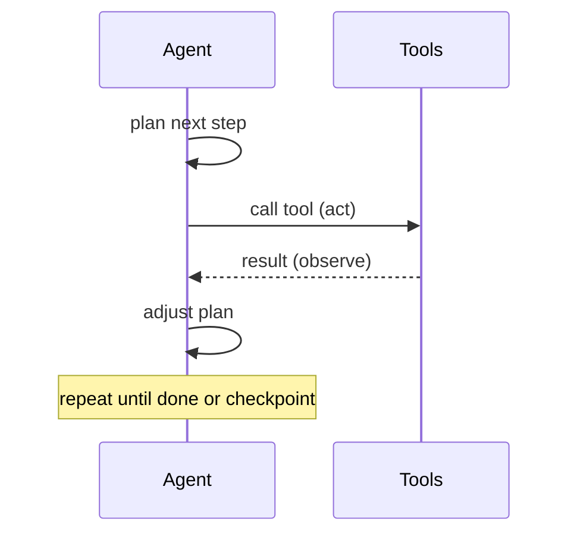
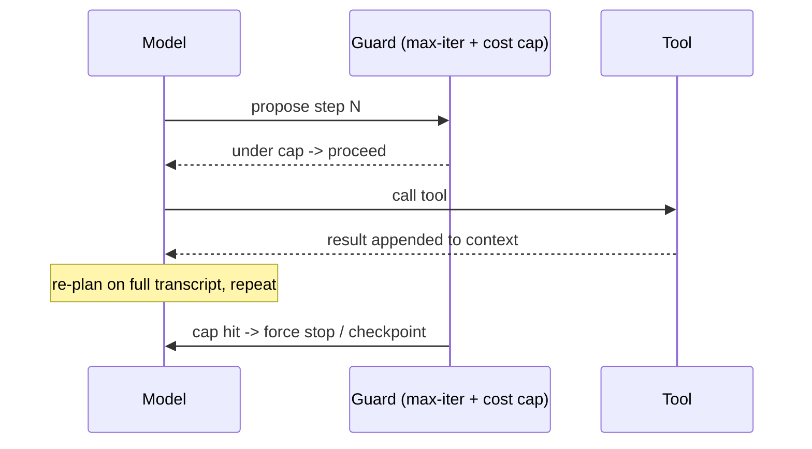

The classic agent loop is **plan → act → observe → adjust → repeat** until the task is done or the agent needs to check in.

Two things separate agents that ship from agents that thrash:

- **The agent-computer interface (ACI).** Anthropic's three principles: *simplicity*, *transparency* (show planning steps explicitly), and treating tool definitions with the same design care as a human-facing API — minimal overlap between tools, unambiguous descriptions, and error-prevention baked into the tool. A documented real mistake: relative filepaths broke once the agent changed directories; switching to always-absolute paths fixed it.
- **Stopping conditions.** Autonomous loops don't reliably self-terminate. Set explicit max-iteration and cost caps rather than trusting the loop to stop itself.

For interviews this maps onto ReAct-style "reason + act" loops if you need the academic vocabulary, though Anthropic describes the same mechanism in plainer language.

===DEEPER===
**Deeper mechanism.** The loop is a state machine over the context window, not magic. Each iteration appends: the model's reasoning, the tool call it chose, and the tool result — then re-invokes the model on the whole growing transcript. Three forces govern whether it converges:

- **Context growth.** Every observation is appended, so a 20-step loop can 10x the token count. Uncurated, this hits context rot (see the context-engineering lesson) and the agent starts ignoring early instructions.
- **Error compounding.** If each step is 95% reliable, a 10-step chain is 0.95¹⁰ ≈ 60% end-to-end. Autonomy multiplies per-step error rates, which is why more steps is not free.
- **Tool interface (ACI) design.** Ambiguous or overlapping tools make the model pick wrong. Anthropic's principles: simplicity, transparency (surface the plan), and treating tool defs like a human API — minimal overlap, unambiguous descriptions, error-prevention baked in (e.g. absolute paths, since relative paths broke once the agent changed directories).

**Worked example.** A coding agent asked to "fix the failing test": plan → run tests (act) → read the traceback (observe) → open the offending file → edit → re-run tests → observe green → stop. The ACI matters: a `run_tests` tool that returns only pass/fail forces guesswork; one that returns the failing assertion and line lets the model act directly. Absolute paths in every tool arg prevent the classic "cwd changed, path broke" failure.

**The pitfall.** Loops don't reliably self-terminate — a confused agent will retry the same broken action forever or declare victory prematurely. You must impose an explicit max-iteration count *and* a cost/token cap externally; never trust the model to stop itself.

**Common follow-ups**

- *ReAct vs. this?* Same mechanism — ReAct is the academic name for interleaving reasoning and acting; Anthropic just describes plan→act→observe→adjust in plainer terms.
- *How do you stop runaway loops?* External caps: max iterations, token/cost budget, and a checkpoint that hands back to a human on high-blast-radius actions.
- *Why do good tool descriptions matter so much?* The model routes purely on the tool schema and description; overlap or ambiguity is the single biggest driver of wrong tool calls.
- *(2026, fast-moving)* Native "agentic" loop support in provider SDKs (server-side tool loops, computer-use) is evolving quickly — check current SDK capabilities before hand-rolling the loop.
