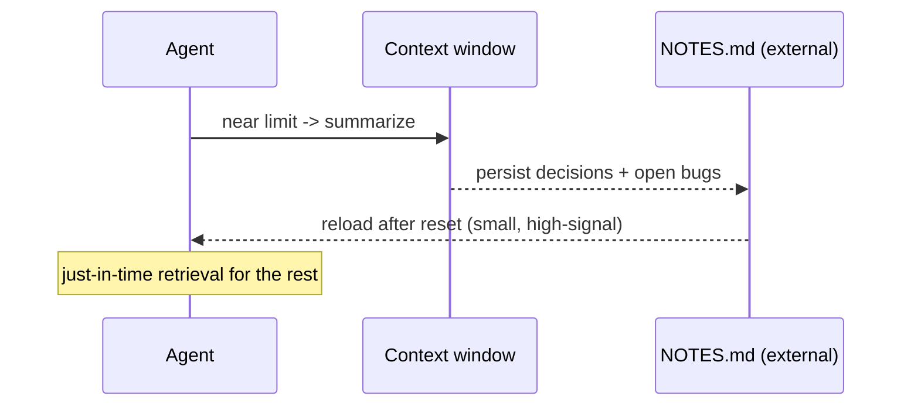

The single most important 2025 terminology shift. Anthropic's definition (Sep 29, 2025): *the set of strategies for curating and maintaining the optimal set of tokens during inference* — everything that lands in the window, not just the prompt.

Prompt engineering is about *writing* one instruction well. Context engineering treats the **entire** context window — system prompt, tools, MCP-supplied data, retrieved documents, message history — as a finite, degrading resource you curate *iteratively*, at every turn of an agent loop.

Why it matters: **context rot.** As token count grows, recall accuracy degrades *even well within* the advertised context limit. Transformer attention is O(n²) in pairwise token relationships and training skews toward shorter sequences, so models have an effective "attention budget" that depletes — a gradient, not a hard cliff. The guiding principle, verbatim: *"finding the smallest possible set of high-signal tokens that maximise the likelihood of some desired outcome."*

Concrete techniques for long-horizon tasks:

- **Compaction** — near the limit, summarise the conversation and restart from the summary plus recently touched state. The hard part is choosing what to keep (decisions, open bugs) vs. discard (stale tool output).
- **Structured note-taking** — the agent writes persistent notes outside the window (a `NOTES.md`, a to-do list) and reads them back after a reset.
- **Sub-agents** — offload deep exploration to a clean context window that returns a condensed summary.
- **Just-in-time retrieval** — hand the agent lightweight references (file paths, queries) and let it load data on demand, like a human using an index instead of memorising everything.

One-liner: prompt engineering optimises the words in one instruction; context engineering curates a finite, degrading window at every turn, because "just add more information" loses past a point.

===DEEPER===
**Deeper mechanism — the window budget.** Treat the context window as a fixed byte budget you allocate deliberately, not a bucket you fill. A rough allocation for a working agent turn (illustrative, tune to your model):

- **System prompt + tool definitions** — stable, cacheable, keep first. ~5–15% of the budget; bloated tool schemas quietly eat this.
- **Retrieved documents / RAG context** — variable, the biggest swing. Cap it: 3–8 reranked chunks, not 50.
- **Message history** — grows every turn; the first thing to compact.
- **Scratch / working state** — the current file, the plan, open bugs. Protect this.
- **Headroom for the response** — reserve output tokens; a full window with no room to answer fails.

The reason budgeting matters is **context rot**: recall degrades *within* the advertised limit because attention is O(n²) over token pairs and training skews to shorter sequences — an effective "attention budget" that depletes gradually, not a hard cliff. The verbatim principle: *"finding the smallest possible set of high-signal tokens that maximise the likelihood of some desired outcome."*

**What to keep vs. drop when compacting:** keep decisions made, unresolved bugs, the current goal, and file/line anchors; drop stale tool output, superseded plans, and verbose intermediate reasoning. The whole skill of compaction is that choice.

**Worked example.** A coding agent 40 tool-calls into a refactor nears the limit. Compaction: summarise "migrated auth module to new API; tests X and Y still failing; do NOT touch config.ts" into ~300 tokens, write it to `NOTES.md`, restart from that summary plus the two files currently open. The agent keeps momentum without re-reading 40 stale observations.

**The pitfall.** "Just add more context" — dumping the whole codebase, all history, every retrieved doc into one giant window. Past the effective attention budget, accuracy *drops*; the model buries your actual instruction under low-signal filler. More tokens can make it worse.

**Common follow-ups**

- *Isn't a bigger window the fix?* No — context rot means recall degrades before the advertised limit. Curation beats capacity.
- *How do you handle a task longer than the window?* Compaction (summarise + restart), structured note-taking (external memory), sub-agents (isolated windows returning digests), and just-in-time retrieval (pass references, load on demand).
- *Prompt vs. context engineering?* Prompt engineering writes one instruction well; context engineering curates the *entire* window — system prompt, tools, RAG data, history — iteratively, every turn.
- *(2026, fast-moving)* Window sizes and prompt-caching economics keep shifting; the curation discipline holds even as the specific numbers move.
