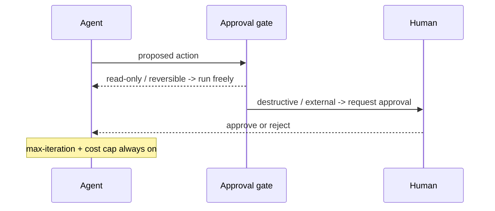

Agents must operate autonomously — that's the point — but humans should keep control over *how* goals are pursued, especially before high-stakes or irreversible actions.

The design lever is **irreversibility and blast radius**, not action type:

Concretely: read-only or easily reversible actions (searching, reading files) run without asking. Destructive or externally visible actions (sending an email, deleting data, spending money) require explicit approval. And regardless of action, always attach a stopping condition — a max-iteration count or cost cap — so a confused loop can't run away.

This is a design principle, not a library. You build the checkpoints; the model doesn't provide them.
