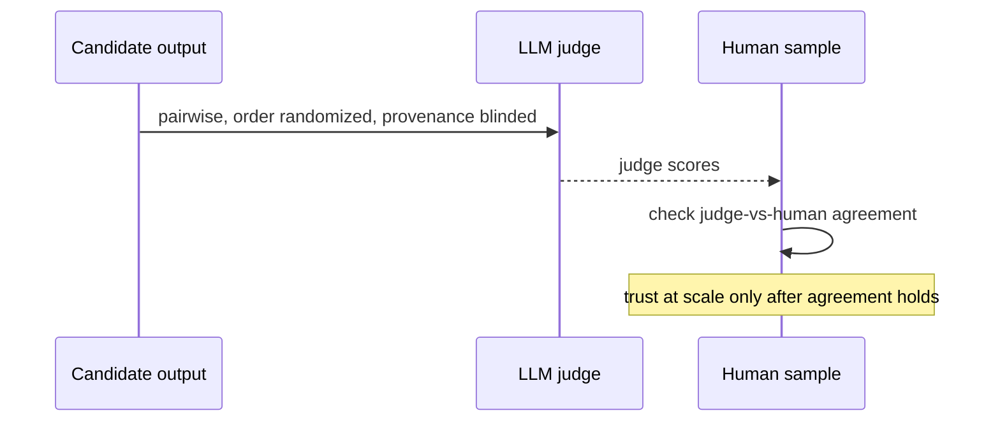

Using an LLM to score another LLM's output is now standard — human review of every output doesn't scale. But 2024–2025 research documents specific, reproducible failure modes, so treat judge scores as a measurement instrument that needs calibrating, not as ground truth.

Documented biases (all paper-backed):

- **Position, verbosity, self-preference** — judges favour a position, longer answers, or outputs resembling their own style.
- **Recency and provenance** — judges systematically favour "new" over "old" responses, and rate the *same* content differently depending on whether they're told the source is Expert > Human > LLM > Unknown.
- **Fragility** — a judge can flip its verdict on repeated evaluation of the same case, and cosmetic prompt edits or rubric wording can swing outcomes.

Mitigations that follow directly from the research: prefer **pairwise** comparison over pointwise scoring; **randomise order and blind provenance** before judging; **validate judge-vs-human agreement** on a labelled sample before trusting it at scale; and **re-run the judge on identical inputs** to measure its own variance before shipping it as a gate.
