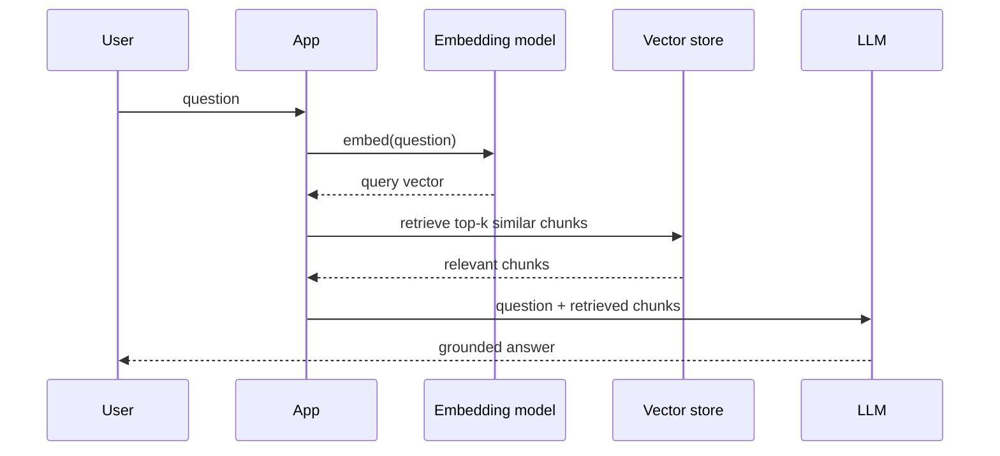
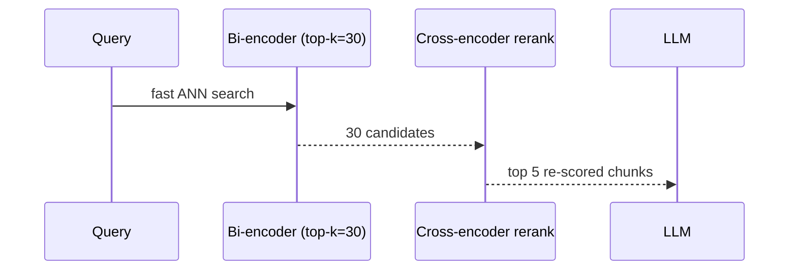

Retrieval-Augmented Generation is still the default way to ground a model in private or fast-changing data. The shape is: embed your corpus offline, then at query time retrieve the most relevant chunks and feed them to the model alongside the question.

Two parts of the pipeline decide quality more than the choice of vector DB does:

- **Chunking.** How you split documents. There is no single confirmed "best" strategy — it is empirically tuned. Chunking plus metadata often matters more than which store you pick.
- **Contextual retrieval** (Anthropic, 2024). Prepend a short LLM-generated explanation of *where a chunk came from* before embedding it, so a chunk like "revenue grew 3% this quarter" doesn't lose the company and quarter when read out of context. This cut failed retrievals by ~49%, and ~67% when combined with reranking.

The honest interview line: the retriever is the product. Most RAG failures are retrieval failures, not generation failures.

===DEEPER===
**Deeper mechanism.** The pipeline has knobs that matter far more than the vector DB brand:

- **Chunking.** A common baseline is ~200–500 token chunks with ~10–15% overlap so a sentence split across a boundary still lands whole in at least one chunk. Fixed-size is the naive floor; recursive/structural splitting (respect headings, paragraphs, code blocks) beats it. Too small → each chunk lacks context; too large → the embedding averages many topics and retrieval gets fuzzy.
- **Embedding dimensions.** Typical production models sit at 768–1536 dims (e.g. many OpenAI/open models land near 1536; 2025 Matryoshka-style embeddings let you truncate to 256–512 to save memory/latency with modest recall loss). Higher dims ≠ strictly better — they cost more RAM and ANN index time.
- **top-k.** Retrieve k≈20–50 candidates cheaply, then **rerank** down to the 3–8 you actually put in the prompt. A cross-encoder reranker re-scores each (query, chunk) pair jointly — 10–50 ms per candidate but far more accurate than the bi-encoder that produced the initial list.

**Worked example.** 2M-doc support KB. Chunk articles at 400 tokens / 60 overlap → ~2.5M chunks, embed at 1536 dims. Query flow: retrieve top-30 by cosine, rerank to top-5, prompt the model with those 5 plus the question. Contextual Retrieval (prepend an LLM-written "this chunk is from the Q3 refund-policy article" line before embedding) cut failed retrievals ~49%, and ~67% stacked with reranking (Anthropic, 2024).

**The pitfall.** Teams tune the generation prompt for weeks while the real defect is that the right chunk never made it into top-k. If the answer text isn't in the retrieved context, no prompt can save it — measure recall@k *first*.

**Common follow-ups**

- *How do you pick chunk size?* Empirically, on your own eval set — there's no confirmed universal best. Start 300–500 tokens with overlap, measure recall@k, adjust.
- *Why rerank if the vector search already ranks?* The bi-encoder embeds query and chunk separately; a cross-encoder reads them together, catching relevance the separate embeddings miss — but it's too slow to run on the whole corpus, only the small candidate set.
- *Where do most RAG systems fail?* Retrieval, not generation. Evaluate the two halves separately (recall@k / MRR vs. faithfulness).
- *(2026, fast-moving)* Embedding models and reranker choices churn fast — re-benchmark on your data before quoting a specific model or dimension.
