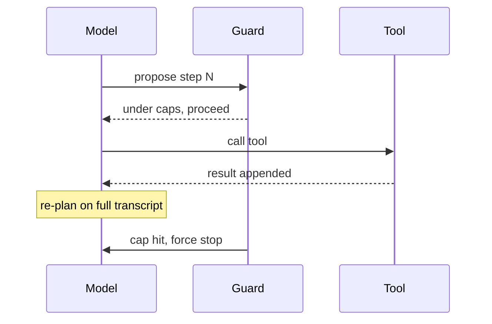

An agent is an LLM running tools in a loop until the task is done or it must check in. The loop itself is simple; what makes one agent ship and another thrash is the interface you give it to the world and the limits you impose from outside. Interviewers probe stop conditions and tool design because those, not the model, decide whether an autonomous loop converges.

## The loop anatomy

The classic cycle is plan, act, observe, adjust, repeat. The model proposes a step, your code runs the tool, the result returns as a new observation appended to the context, and the model re-plans on the whole growing transcript.

```flow
dir: LR
plan: Plan next step | model
cap: Under budget? | gate
act: Run tool | tool
obs: Observe result | step
done: Answer | step
plan -> cap : propose
cap -> act : within caps
act -> obs : result
obs -> plan : append, re-plan
cap -> done : task complete or cap hit
```

The back edge from observe to plan is the loop: every observation feeds the next plan. There is no magic, it is a state machine over the context window that keeps re-invoking the model on a transcript that grows by one reasoning step, one tool call, and one result each iteration.

## Stop conditions

Autonomous loops do not reliably self-terminate. A confused agent will retry the same broken action forever or declare victory early. You must impose limits from outside the model.

- A maximum iteration count, so the loop cannot run unbounded.
- A cost or token budget, checked before each step, so spend is capped even if iterations are not the binding limit.
- A checkpoint that hands control to a human before any high-blast-radius action (the human-in-the-loop lesson covers this).

Never trust the model to stop itself. The caps are infrastructure you build around the loop, enforced in your code, not an instruction in the prompt.

## Step and cost budgets

The two budgets answer different questions. The iteration cap bounds how many times the model may act; the cost cap bounds how much it may spend. A task can blow the cost budget in few iterations if each step stuffs the window, so check both. A clean design surfaces how much budget remains to the model as an observation, so it can prioritise, and forces a graceful stop or a checkpoint when a cap is reached rather than a hard crash.

```python
# Sketch: the agent loop with external caps
msgs = [system, user]
spent = 0
for step in range(MAX_STEPS):          # iteration cap
    resp = client.generate(msgs, tools=TOOLS)
    spent += resp.cost
    if spent > COST_CAP:               # cost cap
        return checkpoint(msgs, "budget hit")
    if not resp.tool_calls:
        return resp.text               # model answered, stop
    for call in resp.tool_calls:
        out = run_tool(call.name, call.args)
        msgs.append(tool_result(call.id, out))
```

## Tool set design: the agent-computer interface

The model routes entirely on tool names, descriptions, and schemas, so the tool set is the agent's interface to the world, the ACI. Anthropic's three principles: simplicity, transparency (surface the plan explicitly), and treating tool definitions with the same care as a human-facing API, minimal overlap and unambiguous descriptions, with error prevention baked in. A documented real failure: relative file paths broke once the agent changed directories, and switching every tool to absolute paths fixed it.

Designing a tool set for a coding agent makes the principles concrete. Keep the set small and orthogonal: read, search, apply-patch, run-command, run-tests. Make returns something the model can act on, a run-tests tool that returns the failing assertion and line lets the model fix it directly, while one that returns only pass or fail forces guesswork. Gate the destructive tools (apply-patch, push) behind approval or a sandbox; let the read tools run freely.

> **Pitfall.** Overlapping or vaguely described tools. If two tools could both plausibly apply, the model picks wrong, and this is the single biggest driver of bad tool calls. Fewer, sharper tools beat a large catalogue.

> **Rule of thumb.** Design each tool as the interface a careful but literal collaborator will use, because that is exactly what the model is. If a human would need to guess what a tool does from its name and description, so will the model.

## Interview angle

If pressed for academic vocabulary, this is a ReAct-style loop, interleaving reasoning and acting; Anthropic describes the same mechanism in plainer terms. The questions that matter are how you stop a runaway loop (external caps plus a human checkpoint), why tool descriptions carry so much weight (the model selects purely on the schema), and why more steps is not free (error compounds per step).

```recall
Q: Why must stop conditions come from outside the model?
A: Autonomous loops do not reliably self-terminate; a confused agent retries forever or stops early. Max-iteration and cost caps are enforced in your code around the loop, not trusted to the prompt.
Q: What is the agent-computer interface and why does it dominate tool-selection accuracy?
A: It is the tool names, descriptions, and schemas the model routes on. The model has nothing else to choose by, so overlapping or ambiguous tools cause wrong calls regardless of model quality.
Q: Why check a cost budget separately from an iteration cap?
A: A task can exhaust the cost budget in few iterations if each step stuffs the context. The caps bound different things, how often it acts versus how much it spends, so both must be checked.
Q: Why should a run-tests tool return the failing assertion rather than pass or fail?
A: The richer return lets the model act directly on the error; a bare pass or fail forces it to guess the cause, wasting iterations and inviting wrong edits.
```

===DEEPER===

### The loop is a state machine over the context window

Each iteration appends three things: the model's reasoning, the tool call it chose, and the tool result. Then the whole transcript is re-sent. This has a direct consequence that the plan-act-observe picture hides: context grows every step, so a twenty-step loop can multiply the token count several fold. Uncurated, the loop walks straight into context rot, recall degrading within the advertised window, and the agent begins ignoring its earliest instructions. This is why the agent loop and context engineering are the same problem viewed twice: the loop produces the growth that context engineering must manage with compaction and note-taking.

### Error compounding, quantified

Autonomy multiplies per-step error. If each step is 95% reliable and nothing checks intermediate state, a ten-step chain is roughly 0.95^10, about 60% end to end; at twenty steps it is near 36%. More steps is not free, and this is the number to cite when asked why you bound the loop aggressively. The mitigation is twofold: fewer, more reliable steps (better tools and clearer returns raise per-step reliability), and gates or checkpoints that catch a bad state before it propagates.



### Worked example

A coding agent told to fix the failing test: plan, run tests (act), read the traceback (observe), open the offending file, edit, re-run tests, observe green, stop. The ACI decides whether this is three clean iterations or ten flailing ones. Absolute paths in every tool argument prevent the classic failure where the working directory changed and a relative path broke. A test tool that returns the assertion and line collapses the guess-and-check loop into a direct fix.

### Source and currency

The plan-act-observe loop, the three ACI principles, the absolute-paths anecdote, and the self-termination warning are from Anthropic, "Building effective agents" (Dec 2024). As of 2026 provider SDKs increasingly offer server-side tool loops and computer-use, so check current SDK capabilities before hand-rolling the loop (fast-moving, re-check).
