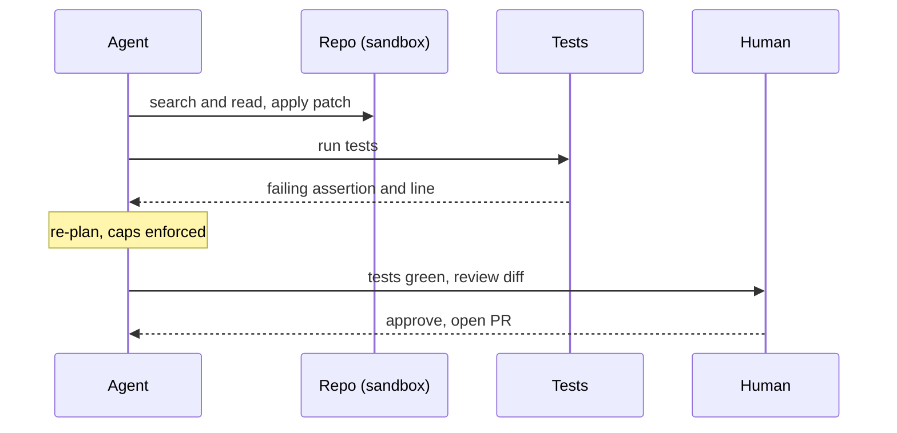

A coding agent is the canonical agent design question because it exercises every part of the stack at once: a tool set, an autonomous loop, context management over a long task, real evals, and safety around actions that change a live codebase. The interviewer is not testing whether you can describe an agent; they are testing whether you reach for autonomy only where it is earned and whether you can name how the system fails. Work through requirements, tools and sandbox, the loop, context, evals, safety, and cost, in that order.

## Requirements

Pin the scope before designing. A coding agent that resolves a described issue in an existing repository has concrete requirements: read the issue, locate the relevant code, make a change, verify it with the test suite, and produce a patch, without breaking unrelated code or touching things it was not asked to. The acceptance signal is objective, the existing tests that were failing now pass and the ones that passed still pass, which is exactly how SWE-bench scores a run (2,294 real GitHub issue and pull-request pairs from 12 Python repositories; Jimenez et al., 2023). That objective signal is what makes coding a good agent domain: the environment grades the work.

## Tools and sandbox

The tool set is the agent-computer interface; keep it small and orthogonal.

| Tool | Risk tier | Policy |
|---|---|---|
| read_file, search | Read-only | Run freely |
| run_tests | Reversible (sandboxed) | Run freely |
| apply_patch | Reversible with undo | Run freely in sandbox, gated to prod |
| run_command | Varies by command | Sandboxed; gate network and destructive |
| open_pr, push | External | Require approval |

Everything runs in a sandbox: an isolated checkout with no network by default and no access to production credentials. The sandbox is what lets read, edit, and test run freely, because a mistake is contained to a throwaway environment. A run_tests tool must return the failing assertion and line, not just pass or fail, so the model can act on the error directly rather than guess.

## The architecture

```flow
dir: TB
issue: Issue text | actor
loop: Agent loop | model
search: Search and read | tool
edit: Apply patch | tool
test: Run tests | tool
cap: Caps and gate | gate
pr: Open PR | gate
issue -> loop : task
loop -> search : locate code
search -> loop : files and context
loop -> edit : change
edit -> test : verify
test -> loop : failures as observations
loop -> cap : propose next step
cap -> loop : under budget, continue
cap -> pr : tests green, request approval
```

The loop is plan, act, observe, adjust: locate the code, read it, edit, run tests, read failures, re-plan. Failures return as observations so the model corrects itself. The cap-and-gate node enforces a max-iteration count and a cost budget on every step, and routes the final patch to a human approval before any PR or push.

## Context management

A real repository does not fit in the window, and a multi-file change can run dozens of iterations, so context engineering is central. Use just-in-time retrieval: hand the agent search and read tools rather than the whole codebase, and let it pull only the files a step needs. Protect working state, the issue, the plan, the files currently open, the failing tests, and compact the loop history when it nears the limit, keeping decisions and open failures while dropping stale tool output. For a very large task, a sub-agent can explore a subsystem in an isolated window and return a digest, keeping the lead's context small.

## Evals

Two layers. A SWE-bench-style end-to-end eval scores whether the agent's patch makes the previously failing tests pass on a held-out set of real issues; this is the outcome metric. Your own evals cover what the public benchmark does not: your repositories, your languages, your common issue types, plus regressions you have seen the agent cause. Gate changes to the agent (prompt, tools, model) behind these evals in CI, so a tweak that helps one case but breaks three is caught before it ships. Measure not just resolve rate but also cost per resolved issue and the rate of unrequested changes.

## Safety and approvals

Gate on blast radius. Read and sandboxed test runs are free; applying a patch inside the sandbox is reversible; opening a PR, pushing, or running a networked command is external and requires human approval. The sandbox plus the caps plus the approval gate are three independent containments: the sandbox limits where damage can reach, the caps limit how long a confused loop runs, and the gate puts a human in front of anything that escapes the sandbox.

> **Pitfall.** Letting the agent push or open a PR without a human reviewing the diff. The tests passing does not mean the change is correct or scoped; a patch can make tests green by deleting the test or by a change far broader than the issue. The approval gate must show the exact diff.

> **Interview.** The strong design names the objective signal (tests the environment grades), keeps the tool set small with rich error returns, contains everything in a sandbox, caps the loop, gates external actions, and evals on your own repos, not just the public benchmark.

## Failure modes

| Failure | Cause | Mitigation |
|---|---|---|
| Thrashing loop | No stop condition, poor error returns | Max-iteration and cost caps; return assertion and line |
| Context rot | Loop history fills the window | Compaction, just-in-time retrieval, protect working state |
| Tests gamed | Change passes by editing or deleting tests | Freeze the test files; human reviews the diff |
| Scope creep | Patch touches unrelated code | Measure unrequested-change rate; approval gate |
| Sandbox escape | Networked or credentialed command | No network and no prod creds by default; gate run_command |

```recall
Q: Why is a coding agent a good domain for autonomy?
A: The environment supplies an objective grade: the previously failing tests pass and the passing ones still pass. That lets the agent verify its own work in a loop instead of relying on a model to judge correctness.
Q: What three independent containments keep a coding agent safe?
A: A sandbox (limits where damage reaches), caps on iterations and cost (limit how long a confused loop runs), and a human approval gate on external actions (reviews anything leaving the sandbox).
Q: Why eval on your own repositories and not just SWE-bench?
A: SWE-bench covers specific public Python repos and issue types. Your evals cover your languages, repos, common issues, and regressions you have observed, and gate agent changes in CI so a tweak that helps one case but breaks others is caught.
Q: How can passing tests still be a failure?
A: The agent can game the tests by editing or deleting them, or make a change far broader than the issue that happens to keep tests green. Freeze test files and have a human review the exact diff before any PR.
```

===DEEPER===

### Why the test suite is the design keystone

Most agent domains lack a cheap, objective verifier, which is why they lean on an LLM judge and inherit its bias. A codebase ships its own verifier: the test suite. This single fact reshapes the whole design. The loop can run act-observe tightly because run_tests gives ground truth each iteration; the eval is objective because the environment grades the patch; and the safety story has a sharp edge because "tests pass" is checkable. The catch is that the verifier is only as good as the tests, which is why gaming the tests (deleting a failing test, over-fitting to it) is the signature coding-agent failure and why the test files are frozen and the diff is human-reviewed. A design that treats the test suite as the keystone, and names its limits, is the one that reads as senior.

### Context over a long task, concretely

An issue touching four files across a 200k-line repository cannot pre-load the code, so the agent navigates like a developer: grep for a symbol, open the file the match points to, read the surrounding function, follow a call. This is just-in-time retrieval, and it keeps the window on the few files that matter instead of the whole tree. As the loop runs long, history accumulates: twenty tool results, several failed edits, the running plan. Near the limit the agent compacts, writing "changed the auth signature in modules A and B; test_login still failing on the token path; config.ts is off-limits" and restarting from that plus the open files. Without this the earliest instruction gets buried and the agent regresses on something it already got right.



### Cost shape

Cost is dominated by the loop length and the context carried each step, not by the one final answer. A task that converges in five tight iterations with a small working set is cheap; one that thrashes for forty iterations with a bloating window is expensive and more likely to fail, so cost and reliability move together. The levers are the same ones that improve correctness: better tool returns (fewer wasted iterations), aggressive context curation (smaller per-step cost), and tight caps (a hard ceiling on a runaway). Measure cost per resolved issue, not cost per call, because the number that matters is what a correct outcome costs end to end.

### Source and currency

The objective-grading setup, 2,294 real GitHub issue and pull-request pairs across 12 Python repositories, and the fail-to-pass scoring are from the SWE-bench paper (Jimenez et al., "Can Language Models Resolve Real-World GitHub Issues?", 2023); SWE-bench Verified is a human-vetted subset. The tool, loop, context, and safety design draws on Anthropic's agent-building guidance. Benchmark numbers and agent harnesses move fast as of 2026, so cite the benchmark structure as stable and treat any resolve-rate figure as a snapshot to re-check.
