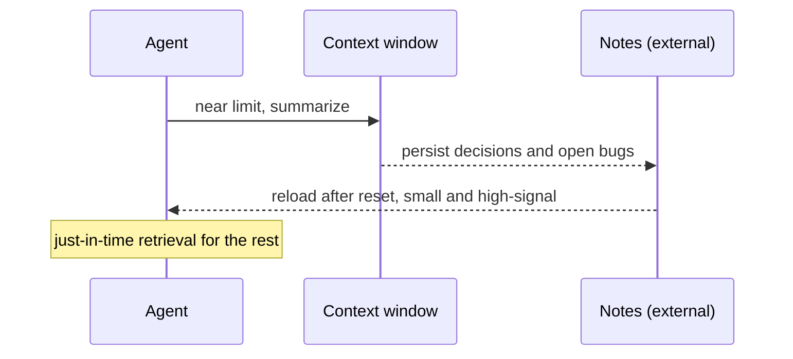

Context engineering is the 2025 reframing that interviewers now expect you to know by name. Anthropic's definition (Sep 29, 2025): the set of strategies for curating and maintaining the optimal set of tokens during inference, everything that lands in the window, not just the prompt. The reason it matters is that the context window is a finite, degrading resource, and "just add more information" stops helping and starts hurting past a point.

## Prompt engineering versus context engineering

Prompt engineering is about writing one instruction well. Context engineering treats the entire window, system prompt, tool definitions, MCP-supplied data, retrieved documents, and message history, as a finite resource you curate iteratively, at every turn of an agent loop. The shift is from authoring a static string to managing a budget that changes each turn as observations accumulate.

```flow
dir: TB
turn: Each agent turn | step
sys: System prompt | step
tools: Tool schemas | step
rag: Retrieved docs | store
hist: Message history | step
scratch: Working state | step
win: Context window | gate
turn -> win : assemble
sys -> win : stable, cacheable
tools -> win : stable, cacheable
rag -> win : capped, reranked
hist -> win : compacted
scratch -> win : protected
win --> turn : curate again next turn
```

The back edge is the point: curation is not a one-time setup, it repeats every turn because the window's contents change every turn.

## Why it matters: context rot

As token count grows, recall accuracy degrades even well within the advertised context limit. Transformer attention is O(n^2) in pairwise token relationships and training skews toward shorter sequences, so a model has an effective attention budget that depletes, a gradient, not a hard cliff. The guiding principle, verbatim from Anthropic: finding the smallest possible set of high-signal tokens that maximise the likelihood of some desired outcome.

```bars
title: Recall as context grows (illustrative shape, not a benchmark)
unit: relative recall
Window 20% full | 10
Window 60% full | 9
Window near limit | 6
```

The numbers above are an illustrative shape, not measured results; the point is the decline begins before the advertised limit, so capacity is not the fix.

## Techniques for long-horizon tasks

Four strategies keep a long task inside a healthy window.

```steps
Compaction | Near the limit, summarize the conversation and restart from the summary plus recently touched state
Note-taking | The agent writes persistent notes outside the window and reads them back after a reset
Sub-agents | Offload deep exploration to a clean context window that returns a condensed summary
Just-in-time retrieval | Hand the agent references (paths, queries) and let it load data on demand, like using an index
```

The hard part of compaction is the choice of what to keep (decisions, open bugs, the goal) versus discard (stale tool output, superseded plans). Note-taking externalises state so it survives a reset. Sub-agents isolate context so the lead window stays small. Just-in-time retrieval avoids pre-loading everything by passing lightweight references the agent resolves when needed.

## The window as a budget

Treat the window as a fixed budget you allocate deliberately, not a bucket you fill.

| Segment | Share | Discipline |
|---|---|---|
| System prompt and tools | Small, stable | Keep first, cacheable; watch bloated schemas |
| Retrieved context | The biggest swing | Cap to a few reranked chunks, not fifty |
| Message history | Grows every turn | First thing to compact |
| Working state | Protect | The current file, plan, open bugs |
| Output headroom | Reserve | A full window with no room to answer fails |

> **Pitfall.** "Just add more context", dumping the whole codebase, all history, and every retrieved doc into one window. Past the effective attention budget accuracy drops, and the model buries your actual instruction under low-signal filler. More tokens can make it worse.

> **Key idea.** Curation beats capacity. A bigger window does not fix context rot because recall degrades within the advertised limit; the smallest high-signal set wins.

```recall
Q: How does context engineering differ from prompt engineering?
A: Prompt engineering writes one instruction well. Context engineering curates the entire window, system prompt, tools, retrieved data, history, iteratively every turn, because the contents change each turn as observations accumulate.
Q: What is context rot and why does a bigger window not solve it?
A: Recall degrades as the window fills, even within the advertised limit, because attention is O(n^2) and training skews short, giving an effective attention budget that depletes. More capacity does not stop the decline, so curation is the fix.
Q: Name the four long-horizon techniques and what each solves.
A: Compaction (summarize and restart when near the limit), note-taking (external state surviving a reset), sub-agents (isolated windows returning digests), just-in-time retrieval (load data on demand via references).
Q: What makes compaction hard?
A: Choosing what to keep. Keep decisions, the goal, and open bugs; drop stale output and superseded plans. Keeping the wrong tokens loses the thread while still spending budget.
```

===DEEPER===

### The window budget, concretely

A rough allocation for a working agent turn (illustrative, tune to your model): system prompt and tool definitions stable and cacheable at roughly 5 to 15% of the budget, with bloated tool schemas the quiet eater of this slice; retrieved documents the biggest swing, which you cap to three to eight reranked chunks rather than fifty; message history growing every turn and the first thing to compact; scratch and working state (the current file, the plan, open bugs) protected; and reserved headroom for the response, because a full window with no room to answer simply fails. The reason to budget rather than fill is context rot: recall degrades within the advertised limit because attention is O(n^2) over token pairs and training skews to shorter sequences, an effective attention budget that depletes gradually.

### What to keep versus drop when compacting

Keep decisions made, unresolved bugs, the current goal, and file or line anchors. Drop stale tool output, superseded plans, and verbose intermediate reasoning. The whole skill of compaction is that choice: a summary that keeps the right 300 tokens lets an agent run for hundreds of steps, while one that keeps the wrong tokens strands it. This is also where context engineering and agent memory meet, compaction decides what gets promoted to a durable note and what is discarded.



### Worked example

A coding agent forty tool-calls into a refactor nears the limit. Compaction: summarise "migrated auth module to the new API; tests X and Y still failing; do not touch config.ts" into about 300 tokens, write it to a notes file, and restart from that summary plus the two files currently open. The agent keeps momentum without re-reading forty stale observations. Contrast the naive path, carrying all forty observations forward, where by step sixty the earliest instruction ("do not touch config.ts") is buried and the agent violates it.

### Source and currency

The definition, the smallest-high-signal-set principle, context rot, and the four techniques (compaction, note-taking, sub-agents, just-in-time retrieval) are from Anthropic, "Effective context engineering for AI agents" (Sep 29, 2025). The term was popularised more broadly in 2025 and platforms have since added primitives such as context editing and memory tools. Window sizes and prompt-caching economics keep shifting, but the curation discipline holds even as the specific numbers move (2026, re-check).
