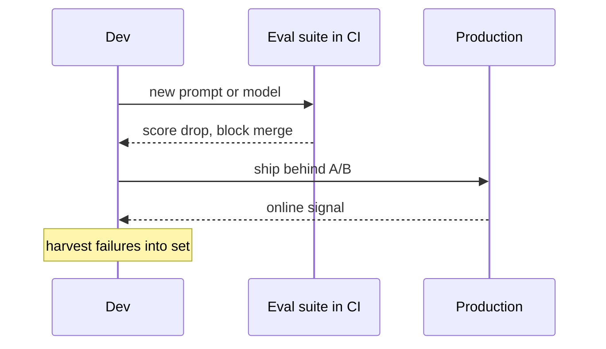

An eval is a repeatable test that scores your system's output against known-good behaviour. Every primary source names evaluation as the hard part of AI engineering, and the reason is structural: an LLM feature has no compiler and no deterministic unit test to tell you it still works after you change a prompt or swap a model. The eval suite is that signal. Interviewers probe this because an engineer who ships prompt changes without an eval gate is flying blind, and they can usually tell within one question whether you have actually run one.

## Why evals come first, not last

With ordinary code you write the function, then test it. With an LLM feature the output space is open and the failure modes are unknown until you look, so you build the eval set first and let it define what good means. Chip Huyen puts it directly: there is no single simple solution to evaluation, a combination of methods is required, and the highest ratio of value still comes from manual inspection of real outputs. Build the dataset, look at failures by hand, and only then automate the scoring. The eval is not a formality you add before launch, it is the instrument you steer with from the first prompt.

> **Key idea.** You cannot improve what you cannot measure, and with LLMs you cannot measure without first building the set of cases that define correct.

## Unit-style vs end-to-end

Two granularities, and strong answers name both.

- **Unit-style** evals test one component in isolation with a tight assertion: does the extractor return valid JSON, does the router pick the right branch, does retrieval return the gold chunk in the top k. Fast, cheap, and they localise the failure.
- **End-to-end** evals run the whole pipeline on a realistic input and score the final answer. They catch interaction bugs a component test misses, but when they fail they do not tell you which stage broke.

Run both. Unit evals keep each stage honest, end-to-end evals catch the seams between stages.

## Offline vs online

```steps
Offline | Run before deploy against a fixed set of golden, adversarial, and regression cases
Online | Measure live traffic with user signals, sampled human review, and production metrics
Harvest | Turn every real production failure into a new permanent offline case
```

Offline eval is cheap and repeatable and gates every change, but it is only as good as its coverage and it goes stale as real inputs drift. Online eval sees the true input distribution but is slower and noisier to attribute. Neither replaces the other, and neither replaces looking at real outputs by hand.

## Regression gating in CI

The payoff of an offline set is that it becomes a gate. Wire it into CI the way you wire unit tests: a prompt or model change runs the suite, and a drop past a threshold blocks the merge. The subtlety is that LLM scores are noisy, so gate on an aggregate over a set large enough that normal variance does not trip it, not on a single case flipping.



## Trade-offs

| Choice | Cheap and fast | Catches real failures | Localises the bug |
|---|---|---|---|
| Unit-style offline | yes | partly | yes |
| End-to-end offline | medium | yes | no |
| Online metrics | no, needs traffic | yes, true distribution | no |
| Manual inspection | no, does not scale | yes, highest value | yes |

The decision rule: lead with offline unit and end-to-end as the pre-merge gate, confirm with an online metric on rollout, and never stop sampling real outputs by hand.

## Failure modes

The classic mistake is a single blended is the answer good score. When it dips you cannot tell whether retrieval missed the document or the model reasoned badly over a good one, and those have opposite fixes. Decompose instead: for a RAG system, score retrieval and generation separately. The second trap is trusting offline numbers alone, they cannot anticipate the live input distribution, which is why the online signal is the real rollout gate.

```recall
Q: Why build the eval set before writing the final prompt, not after?
A: An LLM feature has no deterministic test, so the eval set is the only signal that a change helped. It also defines what good means for an open output space, which you cannot know until you look at real cases.
Q: An end-to-end eval score drops. Why is that not enough to act on?
A: It tells you the pipeline got worse but not which stage, since retrieval, generation, and tool use all feed the final answer. You need unit-style evals per stage to localise the fix.
Q: Why gate a merge on an aggregate over many cases instead of any single case regressing?
A: LLM scores are noisy, so a single case can flip from run to run without a real regression. Gating on an aggregate over a large enough set keeps normal variance from blocking good changes.
Q: Offline eval said plus five percent but the online A/B is flat. What happened?
A: The offline set does not match the production input distribution, so the gain did not generalise. The live metric is the real gate because it sees the true traffic.
Q: What does harvesting regressions buy you over time?
A: Every fixed production bug becomes a permanent test, so the suite grows toward real failure coverage and the same bug cannot silently return.
```

===DEEPER===

### What a case looks like

A good offline case is a triple: input, expected behaviour, and a scorer. The expected behaviour is rarely an exact string, so the scorer is the design decision. For extraction, assert on a parsed field and compare structurally, so wording does not matter. For classification, compare the label and compute precision, recall, and F1 over the set. For retrieval, record the gold chunk id and check whether it appears in the top k. For open-ended generation, you usually need an LLM judge, validated against human labels before you trust it, covered in its own lesson. The rule is to make the scorer as deterministic as the task allows and reach for a judge only when nothing cheaper captures correct.

### Metrics by task type

| Task | Metrics |
|---|---|
| Classification | precision, recall, F1 |
| Retrieval | recall@k, MRR, nDCG |
| Extraction | field exact match, schema validity rate |
| Open generation | faithfulness, answer relevance, judge score |

Naming the right metric for the task is a fast way to show you have actually measured one. A follow-up often asks why not accuracy for everything, and the answer is that accuracy hides class imbalance and ignores ranking, so a retriever with 0.95 accuracy on a mostly-irrelevant corpus can still bury the one relevant chunk below k.

### Dataset construction, the part people skip

Seed with golden examples of known-good input and output. Add adversarial cases: edge inputs, empty inputs, prompt-injection attempts, inputs in the wrong language. Then continuously harvest regressions from production so every real failure becomes a case. Aim for coverage of the real usage distribution, not raw volume, a few hundred well-chosen cases that span your actual traffic beat ten thousand near-duplicates. This is the manual work Huyen calls the highest value per unit effort, and it is also the part an interviewer uses to separate people who have run an eval from people who have read about one.

### Worked example

A RAG support bot. Build 200 triples of question, expected answer, and expected source document. Retrieval eval: does the expected source appear in the top k, giving recall@5 = 0.86. Generation eval, run only on the cases where retrieval succeeded so you isolate the generator: is the answer faithful to the retrieved chunk, scored by an LLM judge plus 50 human-labelled spot checks. Splitting them surfaces a result like generation looks 92 percent faithful but recall@5 is only 0.71, which tells you the fix is chunking or reranking, not the prompt. A single blended score would have hidden exactly that.

### A fast-moving caveat

Eval and tracing tooling churns, names like RAGAS, DeepEval, LangSmith, Braintrust, and Phoenix come and go in capability (as of 2026, re-check). Pick by whether the tool fits the taxonomy above, offline and online, per-component and end-to-end, not by a blog ranking. The taxonomy is stable, the tools are not.
