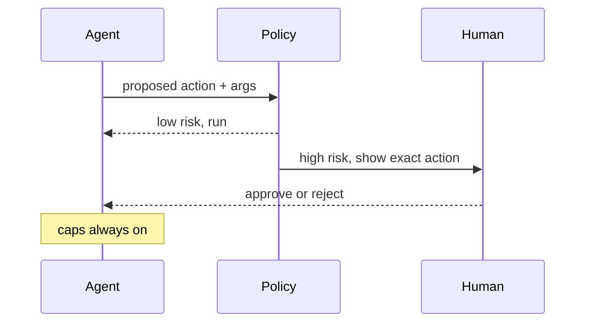

An agent is supposed to act on its own, but autonomy and safety are not opposites. The design question is not whether a human reviews the agent, it is which actions need review and how to insert the checkpoint without destroying the agent's usefulness. Interviewers probe this because the wrong policy either lets an agent delete production data or buries the user under approval prompts until they rubber-stamp everything.

## The lever is irreversibility and blast radius

Gate on consequences, not on action type. The question for any action is: if this goes wrong, how hard is it to undo and how far does the damage reach? Read-only and easily reversible actions run freely. Destructive, externally visible, or expensive actions require explicit approval.

```flow
dir: LR
agent: Agent | model
gate: Risk check | gate
run: Run freely | tool
human: Request approval | gate
act: Execute | tool
agent -> gate : proposed action
gate -> run : read-only or reversible
gate -> human : destructive or external
human -> act : approved
human --> agent : rejected, re-plan
```

Concretely: searching, reading files, and running a sandboxed query run without asking. Sending an email, deleting data, spending money, or pushing code require a human to approve first. And regardless of action, a max-iteration and cost cap is always on, so a confused loop cannot run away even inside the allowed-freely tier.

## Risk tiers

Sort every tool into a tier up front, so the policy is a property of the tool, not a judgment the model makes each time.

| Tier | Examples | Policy |
|---|---|---|
| Read-only | Search, read file, fetch | Run freely |
| Reversible write | Draft, write to scratch, local edit | Run freely, keep an undo |
| Irreversible or external | Send email, delete, charge, deploy | Require approval |
| High blast radius | Bulk delete, production change | Approval plus a second check |

## Interrupt and resume with durable state

A checkpoint is only useful if the agent can pause and later continue without losing its place. That requires durable state: when the agent hits a gated action, it serialises its context (the plan, what it has done, the pending action) to a store, surfaces the approval request, and halts. When the human approves or rejects, the agent rehydrates that state and resumes from the exact point, applying the decision. Without durable state, an approval that arrives minutes later finds the agent's context gone and the task has to restart.

```steps
Reach gate | Agent proposes a destructive or external action
Persist | Serialize plan, history, and the pending action to durable state
Request | Surface the approval to the human with enough context to decide
Resume | On a decision, rehydrate state and continue from the exact point
```

## Approval fatigue

The failure that undoes a good policy. If the agent asks for approval too often, the human stops reading and approves reflexively, which is the same as having no checkpoint. The fix is to gate on real risk only, batch related approvals into one decision where possible, give the human enough context to decide quickly, and let trusted low-risk actions run freely. A policy that interrupts on everything is not safer, it trains the reviewer to ignore interrupts.

> **Pitfall.** Gating on action type instead of consequence, so a harmless read behind a confirmation and a destructive delete behind the same confirmation train the user to click through both. Gate on blast radius, not category.

> **Rule of thumb.** If a human will approve an action without reading it, that checkpoint is doing nothing. Reserve interrupts for decisions a human would actually stop and think about.

## This is design, not a library

The model does not provide checkpoints; you build them. The approval gate, the risk tiers, the durable state, and the caps are infrastructure in your application around the loop. The model proposes an action; your code decides whether it needs a human before it runs.

```recall
Q: Why gate on irreversibility and blast radius rather than action type?
A: Consequence is what matters. A read and a delete sorted into the same confirmation train the user to click through both; gating on how hard it is to undo and how far damage spreads targets the interrupts where they count.
Q: What does interrupt-and-resume require, and what breaks without it?
A: Durable state: the agent serializes its context and pending action, halts, and rehydrates on a decision. Without it, a delayed approval finds the context gone and the task must restart.
Q: What is approval fatigue and how do you prevent it?
A: Asking so often that the human approves reflexively, which nullifies the checkpoint. Prevent it by gating on real risk only, batching approvals, and giving enough context to decide fast.
Q: Why keep caps on even for freely-run actions?
A: A confused loop can run away within the allowed tier (endless cheap reads, runaway spend). Max-iteration and cost caps bound the loop regardless of per-action approval.
```

===DEEPER===

### Why consequence beats category

Action type is a poor proxy because the same category spans wildly different blast radii. "Write to a database" is reversible against a scratch table and catastrophic against the production users table; "run a command" is harmless as a read and destructive as a recursive delete. Sorting by category forces you to gate the whole category at its worst case, which over-gates the safe uses and breeds fatigue, or at its average, which under-gates the dangerous ones. Sorting by consequence, computed from the specific target and reversibility, lets the harmless uses run and reserves the interrupt for the genuinely risky call. In practice this means the gate inspects the arguments, not just the tool name: delete with a narrow, scoped target may be reversible; delete with a wildcard is high blast radius.

### Durable state and the confused-deputy risk

Interrupt-and-resume introduces a subtle security concern. The serialised state and the approval request can themselves carry injected instructions if any of the agent's context came from untrusted content. A human who approves "send the summary email" without seeing that the agent also queued an exfiltration call has been turned into a confused deputy. So the approval surface must show the human the exact action and its arguments, resolved, not a model-written paraphrase of what it intends. The checkpoint protects you only if the thing approved is the thing that runs.



### Calibrating the tiers

The tiers are not fixed, they are a risk budget you tune from observed behaviour. If the agent is reliably correct on reversible writes, widen the freely-run tier; if a class of action keeps causing incidents, pull it up a tier and add a second check. The goal is the minimum interruption that still catches the actions a human would want to stop, measured against real outcomes rather than guessed in advance. This mirrors the guardrails discipline: start conservative, watch false positives (needless interrupts) and false negatives (missed risky actions), and move the line.

### Source and currency

The irreversibility-and-blast-radius framing, the read-freely versus approve-destructive split, and the always-on caps are drawn from Anthropic's agent-building guidance. The confused-deputy concern connects to the prompt-injection and guardrails lessons. Platform support for durable interrupt-and-resume is maturing as of 2026, so check what your framework provides before building the state machine yourself (fast-moving, re-check).
