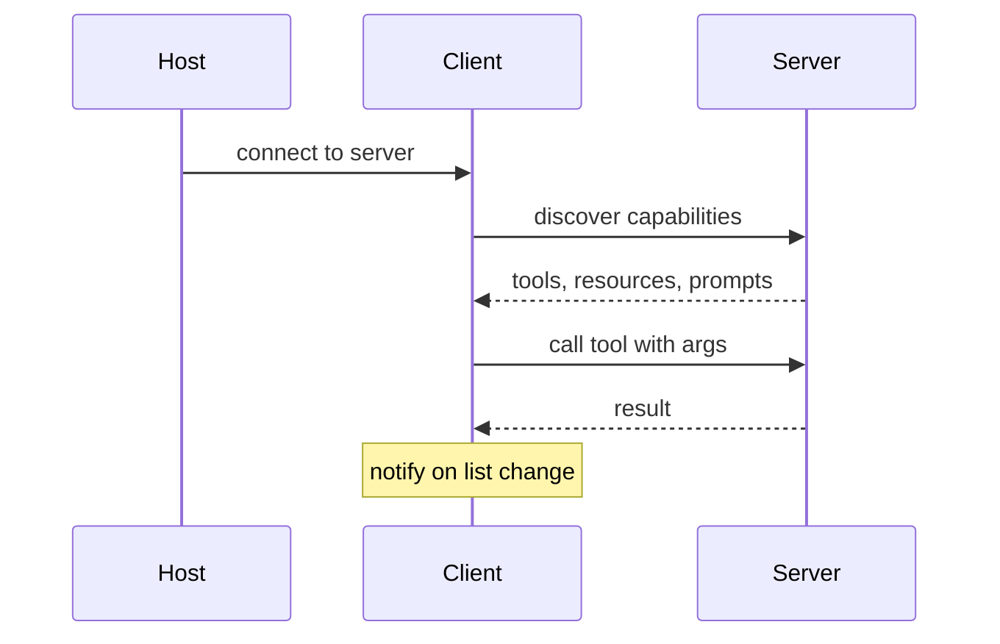

MCP is an open standard, introduced by Anthropic in Nov 2024, for connecting AI applications to external tools, data, and workflows through one client-server protocol, often described as a USB-C port for AI applications. The distinction interviewers test is that tool calling is the mechanism, while MCP standardises the transport and discovery layer around it, so one integration serves every compatible client. Verify specifics against modelcontextprotocol.io, which is the primary source for the architecture below.

## Host, client, server

MCP follows a client-server architecture with three named participants.

- The host is the AI application that coordinates one or more clients, for example an IDE or a desktop assistant.
- A client is a component inside the host that maintains one connection to one server and fetches context from it.
- A server is a program that exposes context to clients. It can run locally or remotely; "server" names the role, not the location.

The host creates one client per server. Connect an IDE to a monitoring server and a filesystem server and it instantiates two clients, one per connection.

```flow
dir: LR
host: Host app | actor
c1: Client 1 | step
c2: Client 2 | step
s1: Tool server A | tool
s2: Tool server B | tool
host -> c1 : one per server
host -> c2 : one per server
c1 -> s1 : JSON-RPC
c2 -> s2 : JSON-RPC
s1 --> c1 : tools, resources, prompts
s2 --> c2 : tools, resources, prompts
```

## Tools, resources, prompts

A server exposes three primitives, and knowing the split is a common question.

- Tools are actions the model can invoke (run a query, send a message), the model-controlled primitive.
- Resources are context data the client can read (a file, a record), application-controlled.
- Prompts are reusable interaction templates a user or app can select.

The data layer is JSON-RPC 2.0: clients and servers exchange requests and responses, with notifications when no response is needed (for example, a server telling the client its tool list changed).

## stdio versus streamable HTTP

MCP defines two transports, and the choice follows where the server runs.

| Transport | Mechanism | Fits |
|---|---|---|
| stdio | Standard input/output between local processes | Local servers, one client, no network overhead |
| Streamable HTTP | HTTP POST with optional Server-Sent Events | Remote servers, many clients |

Streamable HTTP supports standard HTTP authentication (bearer tokens, API keys, custom headers), and MCP recommends OAuth to obtain tokens. stdio has no network surface because it is process-to-process on one machine.

## Why the protocol pays for itself

The payoff is combinatorial. Without MCP you write a bespoke integration per tool per application, an N-clients times M-tools problem. With MCP a server exposes its capability once, and any compatible host connects, so the work grows with N plus M, not N times M.

```steps
Expose once | A server defines its tools, resources, and prompts a single time
Discover | Any MCP host connects and queries the server for its capabilities
Reuse | Every other compatible host reuses the same server with no new wiring
Scale | New clients and new servers compose without per-pair integration work
```

For a true one-to-one integration, one agent and one internal API you own, the protocol overhead may not pay off yet; the counter-argument is optionality for future clients and a uniform auth and discovery story.

## Security risks

Connecting a host to third-party servers widens the attack surface. An untrusted server can return tool descriptions or resource content that act as injected instructions (indirect prompt injection), a malicious server can impersonate a trusted one, and over-broad tool scopes let a compromised server reach more than it should. Defences are least-privilege tool scoping, authenticating and pinning server identity, isolating untrusted content, and human approval before destructive tool calls. Treat a tool server's output as untrusted data, not as instructions.

> **Interview.** Tool calling is the mechanism; MCP is the standard for discovery and transport around it. The value is combinatorial reuse across clients and servers, and the main risk is that connecting untrusted servers imports a prompt-injection and permission surface you must contain.

```recall
Q: What is the difference between tool calling and MCP?
A: Tool calling is the mechanism, the model emits a call and the app runs it. MCP standardises the transport and discovery layer so a server exposes its tools, resources, and prompts once and any compatible host connects, without the mechanism changing.
Q: Name the three MCP participants and the one-client-per-server rule.
A: Host (the app coordinating clients), client (one connection to one server, inside the host), server (exposes context). The host creates one client per server it connects to.
Q: When does stdio beat streamable HTTP?
A: stdio fits a local server serving one client with no network overhead; streamable HTTP fits remote servers serving many clients and carries HTTP auth. The transport follows where the server runs.
Q: Why can connecting a third-party MCP server be dangerous?
A: Its tool descriptions and returned content are untrusted and can carry injected instructions, it may impersonate a trusted server, and over-broad scopes let a compromised server overreach. Scope least privilege, pin identity, isolate content, and gate destructive calls.
```

===DEEPER===

### The two layers

MCP is a data layer over a transport layer, and keeping them separate explains why the same tools work over stdio and HTTP. The data layer is the JSON-RPC 2.0 protocol: capability and version discovery, the primitives (tools, resources, prompts), and notifications. The transport layer handles connection, message framing, and authentication, and comes in the two mechanisms above. Because the transport is the outer layer and the data layer is inner, the same JSON-RPC messages ride either transport unchanged, which is why a server written once is reachable both locally and remotely. The primitives are where most developer interest sits, because they define exactly what context a server can share.

### Discovery is what makes it a protocol, not an SDK

The feature that separates MCP from "just call the API" is runtime discovery. A client queries a server for its supported protocol versions, capabilities, and identity, then lists its tools, and can subscribe to notifications when that list changes. This is why a host can connect to a server it was not built against and still use it: the capabilities are discovered, not compiled in. The same mechanism is the security hinge, discovered tool descriptions are attacker-controllable if the server is untrusted, so discovery is both the value and the risk.



### Governance moved to a neutral foundation

On Dec 9, 2025 Anthropic donated MCP to the Agentic AI Foundation, a directed fund under the Linux Foundation, co-founded by Anthropic, Block, and OpenAI, with other companies joining as members. MCP became a founding project alongside Block's goose and OpenAI's AGENTS.md, and changes now go through a community Specification Enhancement Proposal process rather than a single vendor. The governance transfer is well corroborated across the Linux Foundation, Anthropic, and the MCP project itself. Adoption counts (one announcement cited more than 10,000 published servers as of Dec 2025) vary by source and methodology, so cite the governance fact as settled and treat raw adoption percentages as directional, not exact (2026, re-check against modelcontextprotocol.io and the Linux Foundation announcement).
