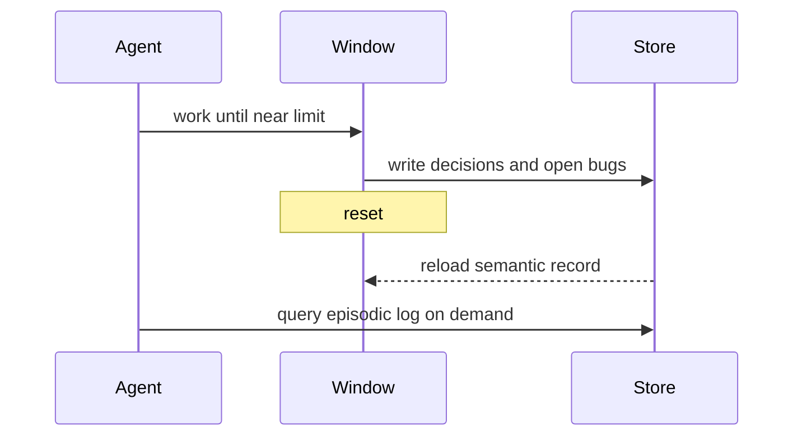

A model has no memory between calls; the only thing it knows is what sits in the context window right now. Agent memory is the set of strategies that let a task outlive one window, by deciding what to carry in-context, what to persist outside it, and when to read each back. Interviewers probe it because a multi-day agent that remembers nothing repeats work and contradicts itself, while one that remembers everything drowns in its own history.

## Working context versus long-term store

Two tiers, with different costs and lifetimes.

- Working context is what is in the window this turn: the system prompt, tools, recent messages, the current file or plan. Fast to use, but finite and degrading, every token competes for the attention budget.
- A long-term store lives outside the window: files, a database, a vector index. Unbounded and durable, but every fact in it costs a retrieval step and a context slot to bring back in.

```flow
dir: LR
agent: Agent | model
win: Working context | step
store: Long-term store | store
agent -> win : reads every turn
win --> store : write durable facts
store --> win : retrieve on demand
agent -> store : query
```

The whole discipline is the traffic between these two: promote a fact to the store before the window evicts it, and pull it back only when the current step needs it.

## Scratchpad and notes

The cheapest memory is a note the agent writes to itself outside the window and reads back later. A scratchpad holds within-task state, the plan, open bugs, decisions made, and survives a context reset because it is a file, not a message. The pattern: before compacting or resetting, the agent writes the load-bearing state to a notes file; after the reset it reloads that small, high-signal summary instead of the forty stale observations that produced it.

```steps
Observe | The agent accumulates reasoning and tool results in the window as it works
Note | Before the window fills, write decisions, open bugs, and the goal to a notes file
Compact | Summarize or reset the conversation, dropping stale intermediate output
Reload | Read the notes back so the agent resumes with high-signal state, not raw history
```

## Summarisation and compaction

When the window nears its limit, summarise the conversation and restart from the summary plus the recently touched state. The hard part is not summarising, it is choosing what to keep. Keep decisions, the current goal, unresolved bugs, and file or line anchors; drop stale tool output, superseded plans, and verbose intermediate reasoning. A compaction that keeps the wrong things loses the thread; one that keeps the right 300 tokens lets the agent run arbitrarily long. Anthropic frames this as a core long-horizon technique in its context-engineering work.

## Retrieval-based memory

For facts too numerous to hold in-context, write them to a store and retrieve on demand, the same machinery as RAG but pointed at the agent's own history. Each memory is embedded and indexed; when a step needs prior context, the agent queries for the few relevant memories rather than carrying all of them. This is how an assistant recalls a preference you stated last week without replaying the whole conversation: the preference is a retrievable record, not a resident message.

## Episodic versus semantic memory

A useful split borrowed from cognitive science.

| Kind | Holds | Example | Retrieval |
|---|---|---|---|
| Episodic | Specific events, in time order | "On Tuesday the user rejected plan A" | By recency or similarity to the event |
| Semantic | Distilled facts, time-independent | "The user prefers metric units" | By relevance to the current need |

Episodic memory answers what happened; semantic memory answers what is true. A good design distils episodes into semantic facts over time, so the store does not grow without bound and the useful signal is not buried in a transcript.

## Write policies and staleness

A memory store is only as good as its hygiene. Three policies decide its quality.

- What to write: durable, reusable facts and decisions, not session narrative or transient state. Writing everything turns the store into noise.
- When to write: at real checkpoints (a decision made, a preference learned), not on a timer that captures half-formed state.
- Staleness: facts expire or get superseded. "The user prefers plan A" is wrong the moment they switch to B. Without an update or expiry policy, retrieval surfaces confidently stale facts, which is worse than no memory.

> **Pitfall.** Treating memory as append-only. A store that never updates or expires facts will confidently return a preference the user already reversed. Stale memory is more dangerous than absent memory because the agent trusts it.

> **Rule of thumb.** Memory is a cache you curate, not a log you append. If a fact is not durable, reusable, and current, it does not belong in the long-term store.

Designing a memory strategy for a multi-day agent task combines all of this: a scratchpad for within-session state, compaction at the window limit, a semantic store of distilled facts with expiry, and just-in-time retrieval so the window stays small.

```recall
Q: Why is a bigger context window not a substitute for a memory strategy?
A: The window is finite and degrades (context rot), and it resets between sessions. A long task exceeds any window and spans resets, so durable state must live in an external store and be retrieved on demand.
Q: What is the hard part of compaction?
A: Choosing what to keep. Keep decisions, the goal, open bugs, and anchors; drop stale tool output and superseded plans. Keeping the wrong things loses the thread.
Q: How do episodic and semantic memory differ, and why distil one into the other?
A: Episodic holds specific time-ordered events; semantic holds distilled time-independent facts. Distilling episodes into semantic facts keeps the store bounded and the signal retrievable instead of buried in a transcript.
Q: Why is stale memory worse than no memory?
A: The agent trusts a retrieved fact. A superseded preference returned confidently causes wrong actions, whereas absent memory at least prompts the agent to ask or re-derive.
```

===DEEPER===

### Memory is context engineering with persistence added

Everything here is the context-engineering discipline, finding the smallest set of high-signal tokens, extended across time and sessions. The working context is the window you curate each turn; the store is where you park what will not fit but will be needed again. The two new problems persistence adds are write policy (what earns a durable slot) and staleness (how a durable fact stops being true). Both are absent in a single-turn setting, which is why memory is its own topic rather than a footnote to context engineering.

### A concrete multi-day loop

Consider an agent migrating a service over three days. Day one it decides the target API, migrates two modules, and leaves two tests failing. If it holds this only in-context, day two starts from a reset and the knowledge is gone. The memory design: write to a notes file "target API is vN; auth and billing modules migrated; tests X and Y failing; do not touch config.ts" as a semantic record, and keep an episodic log of what was tried and rejected so day two does not re-walk a dead end. Day two reloads the semantic record (small, current) and queries the episodic log only when it hits a decision it might have faced before. The window stays small; the task survives the reset.



### Staleness mechanics

The cleanest staleness policy attaches a scope and a version to each fact. A preference is current until a newer contradicting write supersedes it; a derived fact is valid until the thing it was derived from changes. Retrieval then prefers the latest write for a given key and can drop facts past an expiry. Without this, two contradictory memories coexist and retrieval returns whichever scores higher on similarity, which has nothing to do with which is true. This is the memory analogue of cache invalidation, and it is hard for the same reason.

### Source and currency

The window-as-finite-degrading-resource framing, and compaction, note-taking, and sub-agents as long-horizon techniques, are from Anthropic, "Effective context engineering for AI agents" (Sep 2025). The episodic-versus-semantic split is standard cognitive-science vocabulary applied to agents. Provider platforms are adding native memory primitives (memory tools, context editing) as of 2026, so re-check what the platform gives you before building a store from scratch (fast-moving).
