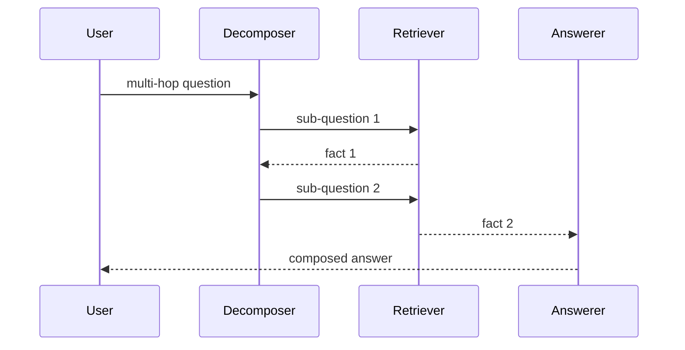

The query a user types is rarely the query your retriever wants. It carries pronouns that only make sense in the chat so far, it is phrased as a question when your corpus is written as statements, or it bundles two questions that live in different documents. Query transformation is the layer that rewrites the raw input into one or more retrieval-ready queries before anything hits the index. Interviewers probe it because it is where cheap wins and expensive mistakes both live.

## Condensing chat history into a standalone query

In a conversation, retrieval must run on a self-contained query, but the user wrote what about its pricing. Embed that and you retrieve nothing useful, its has no referent in vector space. The fix is a condensation step: give a small model the recent turns and ask it to rewrite the latest message as a standalone question, what is the pricing of the enterprise plan. This is the single highest-value transform in any multi-turn RAG system and the first one to add.

```flow
dir: LR
hist: Chat history | store
msg: Latest message | actor
rw: Rewrite to standalone | model
ret: Retriever | store
hist -> rw : prior turns
msg -> rw : its pricing?
rw -> ret : enterprise plan pricing
```

## Multi-query, HyDE, and step-back

Three transforms generate better queries rather than just cleaning the current one.

- **Multi-query.** Ask a model to produce several paraphrases of the query, retrieve for each, and fuse the result lists. It covers vocabulary the user did not use, if the corpus says automobile and the user said car, a paraphrase bridges the gap.
- **HyDE** (Hypothetical Document Embeddings; Gao, Ma, Lin, Callan, Precise Zero-Shot Dense Retrieval without Relevance Labels, 2022). Instead of embedding the question, ask the model to write a hypothetical answer, then embed that and retrieve. The generated passage shares vocabulary and shape with real answer documents, so it often sits closer to them in embedding space than the terse question does. The paper notes the document is fake and may contain false details, that is fine, because you embed it for its shape, never show it to the user.
- **Step-back prompting** (Zheng et al., Google DeepMind, Take a Step Back, 2023). For a narrow question, first ask a broader one, which school of physics governs this, retrieve the general principle, then answer. It helps reasoning-heavy questions where the specific phrasing retrieves trivia but the principle is what is needed.

## Decomposition for multi-hop questions

Some questions cannot be answered by any single chunk because they chain facts. Who succeeded the CEO who launched the Model Y needs the launcher of Model Y, then that person's successor, two retrievals, not one. Decomposition splits the question into sub-questions, retrieves and answers each, and composes the results. Attempting it as one retrieval fails quietly: the top chunks match the surface words and miss the hop.



## Routing: send the query to the right place

Routing is a classifier, often a small model or a few rules, that picks the destination for a query before retrieval. A query about last quarter's revenue goes to the finance index, a how-do-I question goes to the docs index, a greeting skips retrieval entirely and goes straight to a chat response. Routing keeps each index small and on-topic, which raises precision, and it avoids spending a retrieval round trip on queries that need none.

| Transform | What it fixes | Main cost |
|---|---|---|
| History condensation | Pronouns and context from prior turns | One small model call |
| Multi-query | Vocabulary mismatch, recall | N retrievals plus fusion |
| HyDE | Question and answer phrased differently | One generation per query |
| Step-back | Narrow phrasing retrieves trivia | One extra retrieval |
| Decomposition | Multi-hop, chained facts | Several retrievals, slower |
| Routing | Wrong index, wasted retrieval | One classification |

## When transformation hurts

Every transform adds a model call, so it adds latency and cost and introduces a new failure point, a bad rewrite retrieves worse than the raw query would have. For a short, well-formed, single-hop question against one clean index, the raw query is often best and transformation is pure overhead. Multi-query and decomposition multiply the retrieval load, so they can blow a latency budget on a path that needs an answer in under a second.

> **Interview.** Do not list transforms as a menu. Name the specific failure each one fixes, then say that for a simple single-hop query you would skip them, because the strong signal is knowing when the raw query already wins.

```recall
Q: Why must a multi-turn RAG system rewrite the user message before retrieving?
A: The raw message carries pronouns and context from earlier turns, so embedded alone it has no referent and retrieves poorly. Condensing it into a standalone query restores the meaning the retriever needs.
Q: HyDE embeds a hypothetical answer the model admits may be false. Why does that still improve retrieval?
A: You embed it for its shape and vocabulary, which match real answer documents more closely than the terse question does, so it lands nearer them in embedding space. It is never shown to the user, so its falseness is harmless.
Q: When does query decomposition beat a single retrieval, and why does the single retrieval fail?
A: On multi-hop questions that chain facts across documents. A single retrieval matches surface words and misses the intermediate fact, so no one chunk can answer it, decomposition retrieves each hop separately.
Q: What does routing buy you beyond picking an index?
A: It keeps each index small and on-topic, raising precision, and lets some queries skip retrieval entirely (greetings, chit-chat), saving a round trip and tokens.
Q: Give a case where adding a query transform makes the system worse.
A: A short, well-formed, single-hop query against one clean index. The transform adds latency, cost, and a chance of a bad rewrite that retrieves worse than the original query would have.
```

===DEEPER===

### Multi-query fusion, concretely

Multi-query only helps if you fuse the lists sensibly. The usual method is Reciprocal Rank Fusion: for each document, sum one over sixty plus its rank across every list it appears in, then sort by that sum (Cormack, Clarke, Buttcher, SIGIR 2009; sixty is their fixed constant). A document retrieved near the top by several paraphrases accumulates a high fused score, while one that appears for a single paraphrase only ranks lower. The point is that fusion rewards agreement across rewrites, which is exactly the signal that a document is robustly relevant and not an artefact of one phrasing. This is the same fusion math used to merge keyword and dense results in hybrid search.

### Why HyDE works, and when it does not

Dense retrieval compares a query vector to document vectors, but questions and documents are different kinds of text, a question is short and interrogative, a document is longer and declarative, so even a perfectly relevant document can sit far from the question in embedding space. HyDE sidesteps the mismatch by turning the question into something document-shaped before embedding. The failure mode is a domain the model knows nothing about, there, the hypothetical answer is confidently wrong in content and in vocabulary, so it steers retrieval toward the wrong neighbourhood. HyDE helps most on open-domain questions a general model can plausibly answer and least on private jargon-heavy corpora, which is often exactly where RAG is deployed, so measure it rather than assuming it helps.

### Routing as the control point

A router is a small classifier, which means it can be wrong, and a misroute sends the query to an index that cannot answer it, a silent failure that looks like bad retrieval. Two defences: give the router a fallback that searches all indexes when confidence is low, and log routing decisions so you can measure misroute rate as its own metric. In agent systems the same idea reappears as tool selection, the model routes a request to one of several tools or retrievers, and the design questions, keep the choices few and well described, measure how often the right one is picked, are identical.

### Latency budgeting across transforms

Each transform is a serial dependency before retrieval even starts, so they stack on the critical path. A condensation call plus a HyDE generation plus retrieval plus a reranker plus the final answer is five sequential model or index round trips. If your target is a sub-second response, you cannot afford all of them, you pick the one or two that your eval shows actually move recall and drop the rest. Where transforms are independent, several paraphrase retrievals in multi-query, run them in parallel so they cost one round trip of latency rather than N, even though they still cost N retrievals of work.
