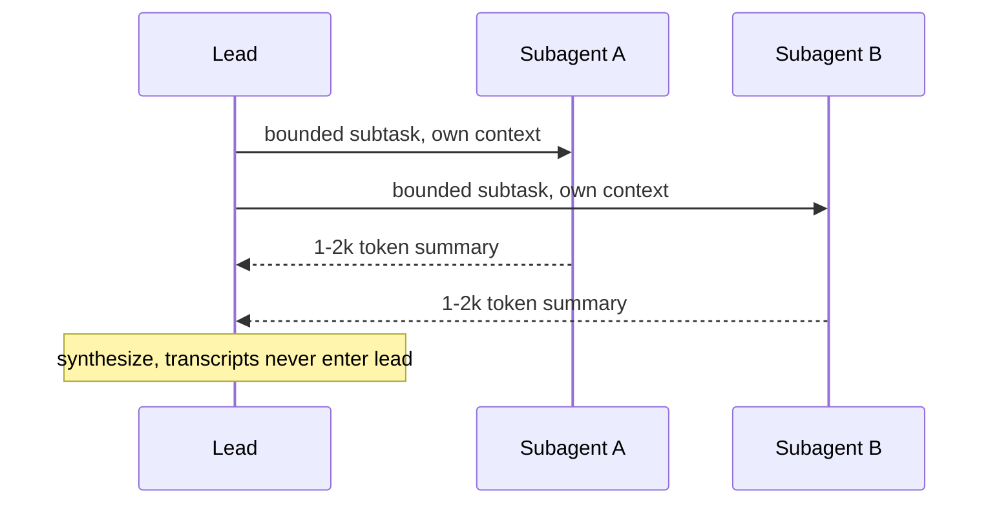

Multi-agent systems sound like the obvious next step up from one agent, and they are the easiest place to over-engineer. The decision rests on one measured trade: Anthropic's own research system beat a single agent by a large margin on breadth-first work, but at many times the token cost. Interviewers want to hear when that trade pays and, more tellingly, when quoting the headline number is the wrong move.

## The headline trade

Anthropic's Research feature uses a lead agent that spawns parallel subagents, each with an isolated context window returning only a condensed summary. On an internal eval this multi-agent setup beat a single agent by 90.2%, at roughly 15x the token cost of a normal chat (a single agent runs around 4x). Anthropic attributes most of the gain to one thing: token usage alone explained about 80% of the performance variance on the BrowseComp benchmark, with tool-call count and model choice as the other factors.

That framing is the whole lesson. The multi-agent win comes largely from spending more compute in parallel, not from emergent coordination. So the system wins when the task is breadth-first and parallelisable, and loses when it is narrow, latency-sensitive, cost-constrained, or has tightly interdependent subtasks.

```flow
dir: TB
lead: Lead agent | model
a: Subagent A | model
b: Subagent B | model
c: Subagent C | model
syn: Synthesize | model
out: Answer | step
lead -> a : bounded subtask, own context
lead -> b : bounded subtask, own context
lead -> c : bounded subtask, own context
a -> syn : 1-2k token summary
b -> syn : 1-2k token summary
c -> syn : 1-2k token summary
syn -> out : combined
```

The subagent transcripts never enter the lead's context; only the summaries do. That isolation is the real mechanism, more on it below.

## When multiple agents help

Two concrete benefits justify the cost.

- Parallel breadth. Independent sub-questions (research six competitors, check twelve files) run concurrently, so wall-clock time drops even as token cost rises.
- Context isolation. Each subagent explores in a clean window and hands back only a small digest. The lead never sees the messy intermediate work, so its own window stays high-signal and does not rot.

```bars
title: Token cost by shape (illustrative, from Anthropic figures)
unit: x chat
Single agent | 4
Multi-agent research | 15
```

## When they just multiply cost and bugs

The failure mode is interdependent subtasks. If subagent B needs subagent A's output, you have serialised them and still paid the coordination tax, which is worse than one agent. Multi-agent also multiplies the ways things go wrong: a subagent misreads its brief, two subagents duplicate work, the lead mis-synthesises partial results. For a narrow, latency-sensitive, or tightly coupled task, a single agent is both cheaper and more reliable.

> **Pitfall.** Quoting "90.2% better" to justify multi-agent on the wrong task. That number is for breadth-first, parallelisable work only. On a narrow or interdependent task you pay 15x for worse coordination, and the number does not apply.

## Coordination patterns

A 2026 Anthropic write-up names five patterns and when each fits.

| Pattern | Fits |
|---|---|
| Generator-verifier | Quality-critical output with explicit criteria |
| Orchestrator-subagent | Clear decomposition into bounded subtasks |
| Agent teams | Parallel, independent, long-running subtasks |
| Message bus | Event-driven pipelines, growing ecosystems |
| Shared-state | Collaborative work building on each other's findings |

The recommendation: start with the simplest pattern and evolve based on where it struggles, never pick one because it sounds sophisticated.

## Interview angle

The strong answer defaults to a single agent and names the specific condition that would change your mind: parallelisable breadth plus tolerance for cost and latency. If asked to judge the hype, Anthropic's own line is that true multi-agent systems are still in their infancy, which is a direct quote and a safer stance than endorsing any pattern as settled.

```recall
Q: What actually produces the multi-agent performance gain?
A: Mostly spending more tokens in parallel. Anthropic found token usage alone explained about 80% of the BrowseComp variance; it is compute scaled by parallelism, not emergent coordination.
Q: When is a single agent the right default?
A: Narrow scope, latency- or cost-sensitive tasks, or interdependent subtasks. Start here and move to multi-agent only for parallelisable breadth you can afford.
Q: Why is quoting 90.2% often a mistake?
A: It applies only to breadth-first parallelisable work. On a narrow or tightly coupled task the trade reverses: you pay around 15x for worse coordination, and the number does not transfer.
Q: What is the real benefit of context isolation across subagents?
A: Each subagent works in a clean window and returns only a small summary, so the lead's context stays high-signal and avoids rot, rather than one window bloating with every thread's raw work.
```

===DEEPER===

### Why the 15x is structural, not overhead

The cost is not inefficiency you can tune away. A lead plus N subagents means N separate context windows, each re-reading its slice of the task and doing its own tool calls, plus the lead's synthesis pass, plus the context that gets passed around and re-billed at each handoff. Anthropic measured the multi-agent research system at roughly 15x a chat and a single agent at about 4x; production bills often land higher than a per-agent spreadsheet predicts precisely because the between-agent costs (context transfer, retries, verification, orchestration) compound across every handoff. Budgeting multi-agent as "N times single-agent" systematically underestimates.

### Context isolation is the win, parallelism is the speedup

These are two different benefits and interviews reward separating them. Parallelism cuts wall-clock time: six subagents research six competitors at once. Context isolation protects quality: each subagent's messy transcript stays out of the lead's window, so the lead synthesises six clean 1 to 2k token digests instead of degrading under one bloated history. A task can want one without the other. If the sub-questions are independent but small, you may want isolation (clean synthesis) without needing much parallelism; if they are large but must share state, parallelism helps but isolation breaks down because they need each other's intermediate work.



### Worked example

"Compare our pricing against six competitors." A single agent does six web trips crammed into one window that bloats and degrades by competitor four. The multi-agent shape: the lead spawns six subagents, each researches one competitor in isolation and returns a 1.5k-token digest, and the lead synthesises six clean digests. This is exactly the breadth-first, independent-subtask shape the 90.2% figure was measured on. Change the task to "trace how a single bug propagates through our six services," where each step depends on the previous, and the same shape serialises and loses to one agent.

### Source and currency

The 90.2% gain, roughly 15x versus 4x token cost, the lead-plus-isolated-subagents architecture, and the "token usage explains about 80% of BrowseComp variance" finding are from Anthropic's multi-agent research system write-up (2025). The five coordination patterns and the "in its infancy" quote are from Anthropic's later agent-engineering writing. Patterns and tooling here are churning as of 2026, so present none as settled (fast-moving, re-check).
