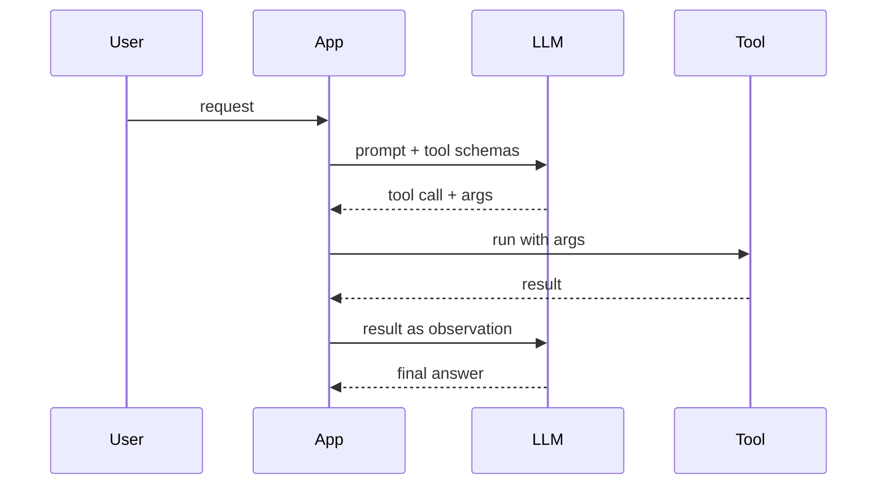

Tool calling lets a model do more than talk: it emits a structured request to run a function, your application runs it, and the result goes back into the conversation. This is the mechanism under every agent, every retrieval-augmented action, every "the model booked the meeting". Interviewers probe it because the common mistakes, treating the model as if it executes the tool, poor schema design, swallowing errors, missing idempotency, cause real production failures.

## The protocol: the app runs the tool, not the model

The model never executes anything. It only emits a structured call; your code decides whether and how to run it.



The round trip: you send the prompt plus the available tool schemas; the model replies with either a final answer or a tool call naming a tool and arguments; you validate and run it; you send the result back as a new message; the model continues, possibly calling another tool, until it answers. The model proposes, the application disposes.

```check
Q: The model returns a tool call to get_weather with the city Paris. What happens next?
- The provider runs get_weather on its servers and returns the forecast
* Your app runs get_weather and sends the result back in a message
- The model calls the weather API itself and keeps generating text
Why: A tool call is only structured output: the model names a tool and its arguments, then stops. Your application decides whether to run it, runs it, and sends the result back in the next request so the model can continue. That is why permissions, timeouts and input checks live in your code, not in the model. Hosted tools that the provider runs, such as its own web search, are the exception, and the API marks them as such.
```

## Tool schema and description design

A tool is defined by a name, a description, and a typed input schema (JSON Schema, often authored with Pydantic or Zod). The model chooses tools and fills arguments based entirely on these, so they are prompt, not just plumbing.

- Write the description for the model: say what the tool does, when to use it, and when not to.
- Name parameters clearly and type them precisely; use enums for closed sets so the model cannot invent a value.
- Keep the tool set small and non-overlapping. Two tools that could both plausibly apply make the model pick wrong.
- Return results the model can reason over: concise, structured, with the key fields, not a raw dump.

> **Interview.** Tool and schema design is called the agent-computer interface. The quality of your tool descriptions and return shapes drives tool-selection accuracy as much as the model does. Design them like an API you are documenting for a careful but literal reader.

## Parallel calls

Modern models can emit several independent tool calls at once (for example, look up three cities' weather together). Run independent calls concurrently to cut latency; keep dependent calls sequential, where one call's output feeds the next. Your executor should handle a batch of calls, not assume exactly one.

```flow
dir: LR
model: Model | model
plan: Independent calls? | gate
par: Run in parallel | tool
seq: Run in sequence | tool
back: Results to model | step
model -> plan : tool calls
plan -> par : independent
plan -> seq : dependent
par -> back : all results
seq -> back : chained results
back -> model : observations
```

## Errors as observations

When a tool fails, do not crash the loop, feed the error back to the model as an observation. A clear error message ("City not found. Valid inputs are IATA codes.") lets the model correct its arguments and retry. Swallowing the error, or returning a bare stack trace, wastes the model's ability to recover.

> **Pitfall.** Treating a tool error as a fatal exception that kills the turn. The model can often fix a bad argument if you return the error as a readable observation. Bound the retries so it cannot loop forever.

## Idempotency and permissions

Tools that change the world (send an email, charge a card, delete a record) need two protections.

- Idempotency: a model may retry or duplicate a call. Make write tools idempotent (an idempotency key, an upsert) so a repeat does not double-charge or double-send.
- Permissions and approval: scope each tool to least privilege, and gate high-risk actions behind a human approval checkpoint. Read tools can run freely; irreversible write tools should not. The human-in-the-loop lesson covers risk tiers and approval policy.

```python
# Sketch: one round of a tool-calling loop
msgs = [system, user]
for _ in range(MAX_STEPS):                 # step budget
    resp = client.generate(msgs, tools=TOOLS)
    if not resp.tool_calls:
        return resp.text                   # model answered
    for call in resp.tool_calls:           # may be several
        try:
            out = run_tool(call.name, validate(call.args))
        except ToolError as e:
            out = {"error": str(e)}         # error as observation
        msgs.append(tool_result(call.id, out))
```

```recall
Q: Who executes a tool call, and why does the distinction matter?
A: The application, not the model. The model only emits a structured request; your code validates, applies permissions, and runs it. Thinking the model executes leads to missing validation and approval.
Q: Why are tool descriptions and return shapes considered part of the prompt?
A: The model selects tools and fills arguments based solely on their names, descriptions, and schemas, and reasons over their returned results. Vague descriptions or raw dumps cause wrong tool choice and bad reasoning.
Q: What should happen when a tool call fails?
A: Return the error to the model as a readable observation so it can correct and retry, within a bounded retry limit, rather than crashing the turn.
Q: Why do write tools need idempotency and permission gating?
A: The model may retry or duplicate a call, so a non-idempotent write can double-charge or double-send; and irreversible actions should be least-privilege and gated behind human approval.
```

===DEEPER===

### The schema is a constrained-decoding contract

Tool-call arguments use the same constrained-decoding machinery as structured outputs: with strict schema enforcement the emitted arguments are guaranteed to match the tool's input schema shape (OpenAI's strict function calling, 2024; see the structured-outputs lesson). That removes argument parse errors but, exactly as with structured outputs, does not guarantee the argument values are sensible, the model can pass a well-typed but wrong city, id, or amount. So validate argument values before executing a tool, especially for write tools, and treat a syntactically valid call to a destructive tool as still requiring your checks.

### Designing the tool set for an agent

A good tool set is small, orthogonal, and composable. Prefer a few general tools (search, read, run) over dozens of narrow ones that overlap and confuse selection. Each tool should do one thing, return a result the model can act on, and fail loudly with a correctable message. Group related capability under clear names, document the when-to-use in the description, and reserve destructive operations for explicit, permissioned tools behind approval. For a coding agent, for example, read-file and search tools run freely while apply-patch, run-command, and push are gated or sandboxed. The agent-loop and coding-agent lessons build this out; the principle to carry: design tools as the interface a careful, literal collaborator will use, because that is exactly what the model is.

### Where tool calling meets MCP

Model Context Protocol (MCP) standardises how tools, resources, and prompts are exposed to a model host, so you can plug in a tool server without bespoke wiring per application. Under the hood it is the same propose-execute-observe loop described here; MCP governs the discovery and transport of tools rather than changing the calling mechanism. The MCP lesson covers host, client, server, transports, auth, and the security risks of connecting untrusted tool servers.
