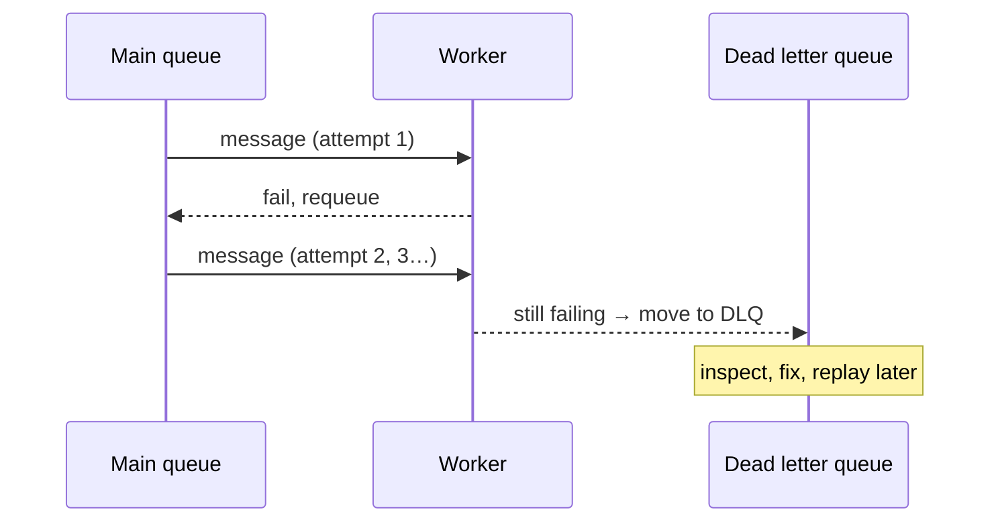

Async messaging introduces two failure modes you must answer for.

**Backpressure** — what happens when producers outpace consumers? Messages pile up. A little buffering is the *point* of a queue (it absorbs bursts), but unbounded growth means rising latency and eventual memory/disk exhaustion. Handling it: let the queue buffer bursts, **scale consumers** when depth grows (autoscale on queue length), and if the source is synchronous, **shed load** — reject or slow producers rather than fall over. The anti-pattern is pretending the queue is infinite.

```flow
dir: LR
prod: Producers | actor
q: Queue depth | store
check: Depth rising? | gate
scale: Autoscale consumers | step
shed: Shed load | gate
prod -> q : enqueue
q -> check
check -> scale : yes
scale --> shed : still growing
shed --> prod : reject or slow
```

**Dead letter queue (DLQ)** — what happens to a message that keeps failing? A consumer that can't process a message (bad data, downstream is down) shouldn't retry it forever and block the queue, nor drop it silently. After N failed attempts the message is moved to a **dead letter queue** — a side queue for poison messages.



The DLQ turns "a bad message silently wedges the pipeline" into "a bad message is set aside for a human to inspect and replay" — which is why it's a standard part of any serious queue design. Pair it with idempotent consumers, since at-least-once delivery means the same message can arrive twice.

```recall
Q: Why is "the queue will buffer it" an unsafe answer to backpressure?
A: Buffering absorbs bursts, but unbounded growth raises latency and eventually exhausts memory or disk; you must scale consumers on depth and, for synchronous sources, shed load rather than treat the queue as infinite.
Q: What problem does a dead letter queue solve that endless retries do not?
A: A poison message retried forever blocks the queue and burns capacity; moving it to a DLQ after N attempts sets it aside for inspection and replay without wedging the pipeline or dropping it silently.
Q: Why must DLQ-based designs pair with idempotent consumers?
A: At-least-once delivery and retries mean the same message can be processed more than once, so consumers must produce the same effect on a duplicate as on the first delivery.
```
