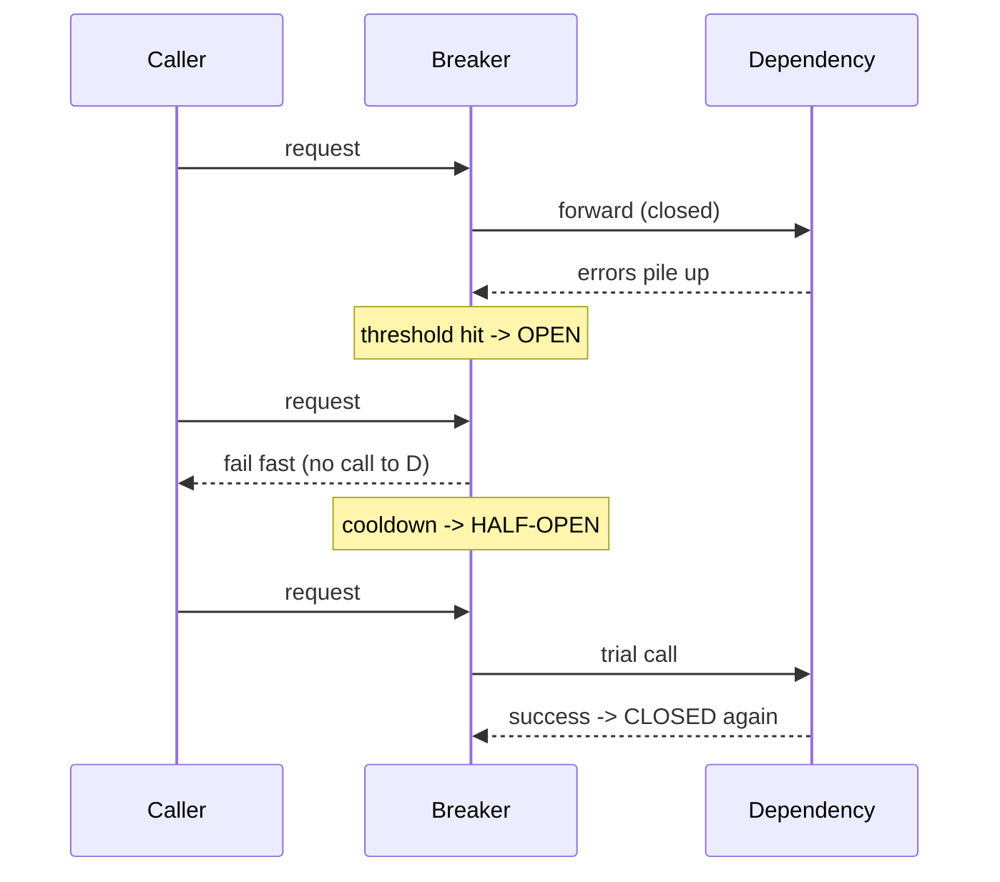

Wrap calls to a dependency in a state machine: **closed** (calls pass through), **open** (after enough failures, fail fast without calling the dependency), **half-open** (after a cooldown, let one trial request through to test recovery).



**When it wins:** it stops a caller from wasting threads and connections hammering a dependency that is already down, and it prevents **cascading failure** — one slow dependency taking down every service that calls it by exhausting their resources waiting.

**Pitfall:** tuned too aggressively, it trips on transient blips and makes a healthy system look down; too loosely, it doesn't protect you in time. It must be paired with a sane fallback (cached data, degraded response) — "fail fast" alone just moves the outage to the caller.

**One recency note:** Netflix's Hystrix popularised this pattern but has been in maintenance mode since 2018 and was dropped from Spring Cloud. The current reference implementation is resilience4j (JVM), Polly (.NET), or opossum (Node). Citing Hystrix as your *current* tool in 2026 is a stale-knowledge signal.

```recall
Q: What does the open state do, and why is that the point of the breaker?
A: It fails fast without calling the dependency after failures cross a threshold, so the caller stops wasting threads and connections on a dependency that is already down and cannot cascade its failure upward.
Q: Why must a circuit breaker be paired with a fallback?
A: "Fail fast" alone just relocates the outage to the caller as instant errors; the value comes from what the open state serves instead, such as cached data, a degraded response, or a queued async path.
Q: What does the half-open state prevent?
A: Flapping straight back into a still-broken dependency; after cooldown it admits only a few trial calls and reopens on any failure, so full traffic resumes only once the dependency is actually healthy.
Q: Why should slow calls, not just errors, count toward tripping the breaker?
A: A dependency at very high latency is not returning errors but is still exhausting your thread pool just as effectively, so counting slow calls catches the resource exhaustion a status-code check would miss.
```

===DEEPER===
**The state machine, with the thresholds that actually matter.** Three states, and the transitions are threshold-driven, not vibes:

```mermaid
sequenceDiagram
    participant C as Caller
    participant B as Breaker
    Note over B: CLOSED — count failures in a rolling window
    C->>B: call fails past threshold
    Note over B: failure rate >= 50% over >= 20 calls -> OPEN
    C->>B: call while OPEN
    B-->>C: fail fast instantly
    Note over B: cooldown 30s elapses -> HALF-OPEN
    C->>B: limited trial calls
    Note over B: trials succeed -> CLOSED; any fail -> OPEN
```

- **Closed:** calls pass through; the breaker counts failures over a *rolling window* — the key config is a **failure-rate threshold over a minimum call volume** (e.g. resilience4j default: open when ≥50% of the last ≥20 calls fail — the volume floor stops one bad call in a quiet period from tripping it).
- **Open:** every call fails fast (no downstream call) for a fixed **cooldown** (e.g. 30s), giving the dependency room to recover.
- **Half-open:** after cooldown, admit a small number of *trial* calls; if they succeed, close; if any fail, re-open and restart the cooldown. This is what prevents flapping straight back into a still-broken dependency.

Also count **slow calls** as failures (resilience4j does): a dependency at p99 = 10s isn't erroring, but it's exhausting your thread pool just as effectively as one returning 500s.

**Concrete scenario.** A checkout service calls a fraud-scoring API with a 200ms budget. The fraud API degrades to 8s latency. Without a breaker, checkout threads block on those 8s calls, the thread pool saturates, and checkout — a healthy service — goes down because of a *dependency's* slowness. With a breaker configured on slow-call rate, it opens after the fraud API's slow-call rate crosses 50%, and checkout instantly falls back to "approve with async review," staying up.

**The failure mode people get wrong: a breaker with no fallback.** "Fail fast" without a fallback just relocates the outage — the caller now errors instantly instead of slowly. The breaker's value is realised by what happens in the open state: serve cached/stale data, a degraded response, or a queued async path. Second common mistake: tuning too tight (trips on transient blips, false outages) or too loose (never protects in time). Tune against real traffic, not guesses.

**Common follow-ups**

- *"Circuit breaker vs retry — when each?"* — Retry handles *transient* single-call failures; the breaker handles *sustained* dependency failure. Pair them, but never retry while open (that defeats the point). Retries feed the breaker's failure count.
- *"What thresholds do you set?"* — A failure-rate % over a minimum call volume, a cooldown before half-open, and a slow-call duration threshold. Numbers come from the dependency's SLO and your latency budget, not defaults.
- *"How does it prevent cascading failure?"* — By capping resources spent on a down dependency, so one failing service can't exhaust the thread/connection pools of everything calling it.
- *"Why is Hystrix a red flag now?"* — Maintenance mode since 2018, dropped from Spring Cloud. Current tools: resilience4j, Polly, opossum.
