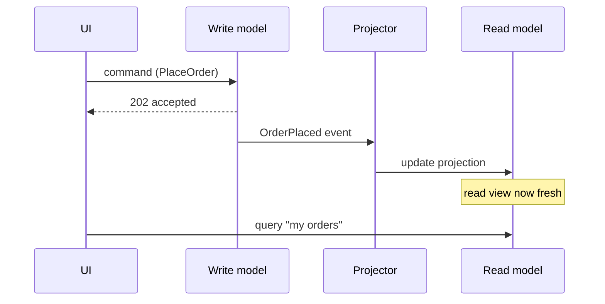

Command Query Responsibility Segregation: use a different model to *update* data than the model you use to *read* it. Separate write and read paths, sometimes separate datastores entirely.

Fowler's own bliki is the load-bearing quote: "you can use a different model to update information than the model you use to read information. For some situations this separation can be valuable, but beware that for most systems CQRS adds risky complexity."

**When it wins:** read and write workloads have genuinely different shapes — writes are normalised and transactional, while reads need heavily denormalised, pre-joined views for dashboards — or read and write scale independently by orders of magnitude.

```bars
title: Read vs write load that justifies CQRS (illustrative)
unit: ops/sec
Writes | 200
Reads | 50000
```

**When it hurts:** most systems should not use it. It is a targeted tool for a specific asymmetry, not a default architecture. It introduces eventual consistency between the write model and the read model that every caller and every UI now has to account for. If you can't name the read/write asymmetry that forces it, you don't need it.

```recall
Q: What specific asymmetry justifies CQRS?
A: Read and write workloads with genuinely different shapes or scale, such as normalised transactional writes versus heavily denormalised dashboard reads, or reads outscaling writes by orders of magnitude.
Q: Where does the eventual-consistency lag in CQRS come from?
A: The write side emits a change that a projector consumes asynchronously to update the read model, so there is a propagation window during which the read view is stale.
Q: What read-after-write bug do teams ship when they ignore that lag?
A: A user edits data, the command returns, the UI re-queries the read model and shows the old value because the projector has not caught up; fixes include returning the new value directly or reading the write model for that screen.
Q: Is CQRS the same as event sourcing?
A: No; CQRS is separate read and write models, event sourcing is storing state as an event log. They pair well because events can feed projections, but each stands alone.
```

===DEEPER===
**The mechanism: two models, and how the read side stays fresh.** The write model is normalised and validation-heavy — it accepts commands (`PlaceOrder`, `CancelOrder`), enforces invariants, and persists the change. The read model is one or more denormalised *projections* shaped exactly for a query ("orders per customer with totals", "today's revenue by region"), often in a different store (Postgres for writes, Elasticsearch/Redis for reads). The link between them is a *propagation* step: the write side emits a change (a domain event or a CDC stream), a projector consumes it and updates the read views. That propagation is asynchronous, which is precisely where the eventual-consistency lag lives.



**Concrete scenario.** An e-commerce catalog takes ~200 writes/sec (price and stock edits) but serves ~50,000 reads/sec on product pages, many with complex filters. Writes go to a normalised Postgres schema; a projector consumes change events and maintains a flattened Elasticsearch index with pre-computed facets. Reads never touch Postgres. Read and write scale on completely independent hardware — the exact asymmetry that justifies CQRS.

**The failure mode people get wrong: assuming read-after-write consistency.** A user edits their profile, the command returns 202, the UI immediately re-queries the read model — and shows the *old* value because the projector hasn't caught up (typically tens to hundreds of ms). Teams that don't design for this ship confusing "my change didn't save" bugs. Fixes: return the new value from the command directly, read from the write model for that one screen, or show an optimistic UI. You cannot pretend the lag is zero.

**Common follow-ups**

- *"CQRS vs event sourcing — same thing?"* — No. CQRS is separate read/write models; event sourcing is storing state as an event log. They pair well (events feed projections) but each stands alone.
- *"Do you need two databases?"* — No. CQRS can be two models against one store. Separate stores is an optimisation for the scaling/shape asymmetry, not a requirement.
- *"How do you handle the eventual-consistency window?"* — Bound it and make it visible: measure projection lag, and on write-then-read screens either read the write model or echo the command result.
- *"When is CQRS the wrong call?"* — Any CRUD app where reads and writes share the same shape and scale. It adds a projector, a second model, and consistency reasoning for zero payoff.
