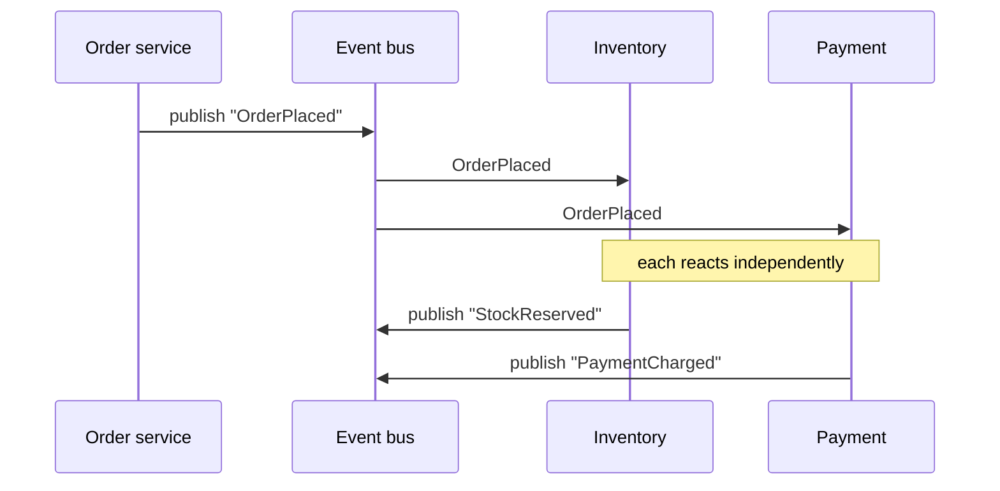

Components communicate by producing and consuming events rather than calling each other directly. Martin Fowler distinguishes several styles — the simplest is **event notification** ("a change happened; I don't care what you do with it"), where the source system genuinely doesn't care about the response.

A typical async workflow, where one event triggers a chain of independent reactions:



**When it wins:** it naturally decouples producers from consumers and supports fan-out — many services react to one event without the producer knowing they exist. It fits workflows with real async/batch semantics.

**When it hurts:** debugging is materially harder. There is no linear call stack to follow, so "why did X happen?" needs correlation IDs and good tracing. Eventual consistency becomes a first-class problem every caller must reason about, and it is easy to build an untraceable "distributed monolith" where every service depends on every event.

```recall
Q: Why does event notification decouple a producer from its consumers so well?
A: The source publishes "a change happened" and does not care who reacts, so consumers can be added or removed without the producer knowing they exist, enabling fan-out.
Q: What is the main debugging cost of going event-driven, and how do you mitigate it?
A: There is no linear call stack to follow "why did X happen"; you mitigate it with correlation IDs and distributed tracing to reconstruct the chain of reactions.
Q: When is event-driven the wrong choice?
A: When the workflow is inherently synchronous and request/response, or when the team cannot absorb eventual consistency and the tracing burden; it then just hides a distributed monolith behind a bus.
```
