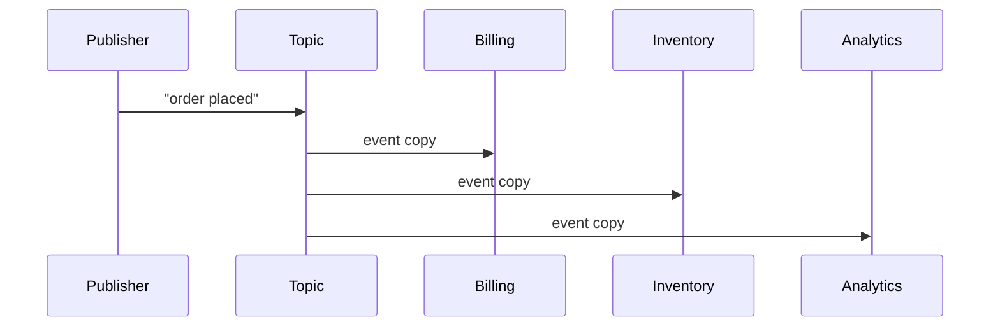

Both decouple a sender from a receiver so work happens asynchronously, but they differ in *who gets the message*.

A **message queue** (point-to-point) delivers each message to exactly **one** consumer. Many workers can read from the same queue, but a given message is processed once — this is **work distribution**. Use it to spread a backlog of tasks (send email, resize image) across a worker pool. SQS, RabbitMQ.

```flow
dir: LR
prod: Producer | actor
q: Task queue | store
w1: Worker 1 | step
w2: Worker 2 | step
w3: Worker 3 | step
prod -> q : enqueue tasks
q -> w1 : msg to one
q -> w2 : msg to one
q -> w3 : msg to one
```

**Pub/sub** (publish-subscribe) delivers each message to **every** subscriber. The publisher doesn't know who's listening; N independent consumers each get their own copy. Use it for **event fan-out** — one "order placed" event feeds billing, inventory, and analytics, each reacting independently. Kafka topics, SNS, Google Pub/Sub.



The interview distinction: "one consumer does this work" → queue; "many systems need to know this happened" → pub/sub. Kafka blurs the line — it's a durable log where **consumer groups** give you queue semantics (one group = one logical consumer) while multiple groups give you pub/sub.

```recall
Q: What is the one-sentence rule for choosing a queue versus pub/sub?
A: If one consumer should do the work, use a queue (each message to exactly one worker); if many systems need to know the event happened, use pub/sub (each subscriber gets its own copy).
Q: How does Kafka provide both semantics with consumer groups?
A: Within one consumer group the partitions are split so each message is handled once (queue semantics); adding more independent groups makes each group receive its own full copy (pub/sub fan-out).
Q: Why does pub/sub decouple the publisher from scaling consumers?
A: The publisher does not know who is listening, so you can add or remove subscribers without changing the producer, each reacting independently to the same event.
```
