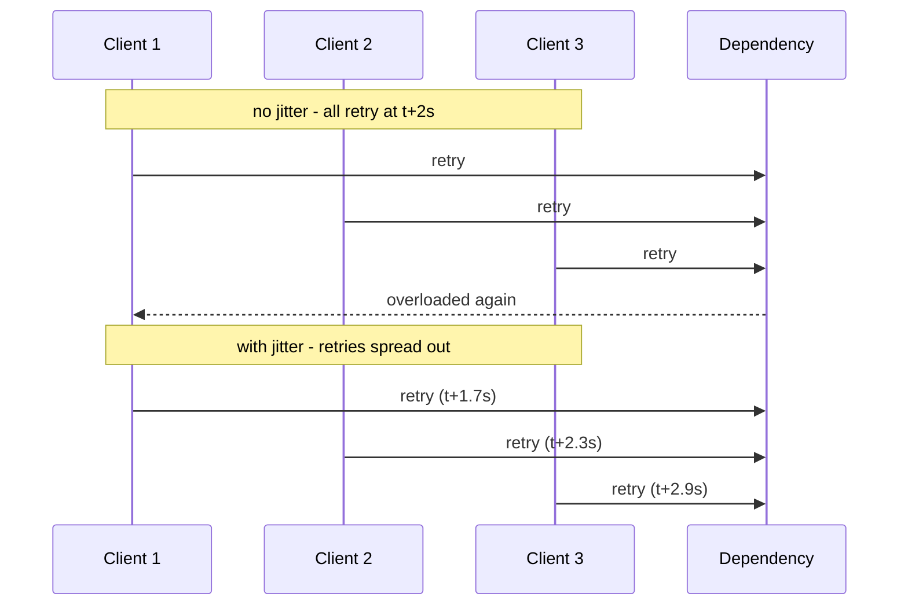

On a transient failure, retry after a delay that grows exponentially (1s, 2s, 4s, 8s), with randomised **jitter** added so many clients retrying at once don't all hit the dependency at the same instant. AWS's own Builders' Library guidance is the primary source here.

Without jitter, synchronised retries turn a brief blip into a **retry storm**: the dependency recovers for a moment, every client retries in the same instant, and it falls over again.



**Two hard rules.** First, retrying a *non-idempotent* operation (e.g. "charge the card") without an idempotency key can double-charge — so make the operation idempotent before you retry it. Second, retries must always be bounded (max attempts) and paired with a timeout; an unbounded retry loop against a dead dependency never gives up.

```steps
Attempt | Call the dependency with an explicit timeout
Classify | Retry only transient failures; fail fast on 4xx and permanent errors
Backoff | Wait an exponentially growing delay: 1s, 2s, 4s, 8s
Jitter | Add randomness to the delay so clients do not retry in the same instant
Bound | Stop after max attempts and surface the failure instead of looping forever
```

```recall
Q: What is a retry storm and how does jitter prevent it?
A: Synchronised clients all retry at the same instant and knock a recovering dependency back over; jitter randomises each client's delay so retries spread out instead of landing together.
Q: Why must you make an operation idempotent before retrying it?
A: Because at-least-once retries can re-send a non-idempotent operation like "charge the card," double-applying the effect; an idempotency key lets the server recognise and ignore the duplicate.
Q: Why must retries always be bounded and paired with a timeout?
A: An unbounded retry loop against a dead dependency never gives up, wasting resources and hiding the outage; a max-attempt cap plus per-call timeout forces the failure to surface.
```
