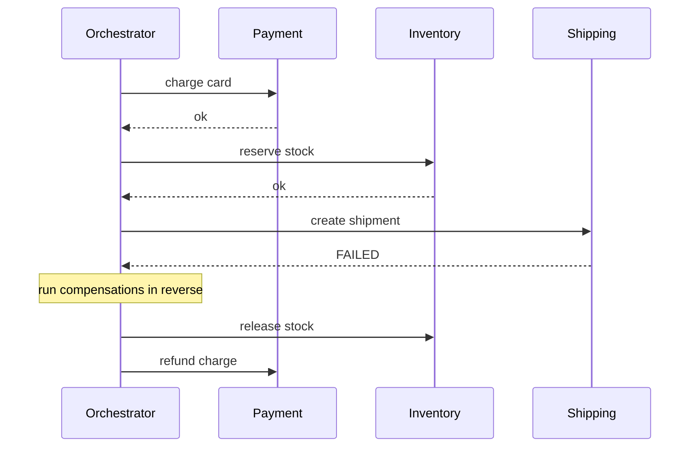

A business transaction that spans multiple services can't use a distributed two-phase commit in practice. A **saga** models it as a sequence of local transactions, each with a **compensating transaction** that undoes it if a later step fails.

The failure path is the whole point — a later step fails, and you walk *backwards*, compensating each completed step:



Two implementation styles:
- **Orchestration** — a central coordinator tells each service what to do next and triggers compensations on failure. Easier to reason about and debug (one place holds the state machine), but the coordinator becomes a critical dependency.
- **Choreography** — each service publishes events and reacts to others' events, with no central coordinator. More decoupled, but the flow is implicit: to understand it end-to-end you have to read every service's event handlers.

**The hard part:** compensations are not free rollbacks. "Refund the payment" is a different operation from "the charge never happened," with its own edge cases (what if the money was already spent downstream?). Choreographed sagas are notoriously hard to debug without strong distributed tracing.

```recall
Q: Why can a cross-service business transaction not use two-phase commit in practice?
A: 2PC needs a blocking coordinator holding locks across every service for the whole transaction; it does not scale and stalls everything if the coordinator dies mid-commit, so sagas trade isolation for availability.
Q: What property do sagas give up that a single ACID transaction provides, and why does it bite?
A: Isolation; other transactions can observe intermediate states (money charged before the order is confirmed, stock held mid-flight), which is where subtle saga bugs live.
Q: When do you choose orchestration over choreography?
A: For complex flows with four or more steps or conditional branches, because a central coordinator holds the state machine in one readable place; choreography fits two or three loosely-coupled steps.
Q: What must be true of every saga step and compensator for retries to be safe?
A: They must be idempotent, keyed on the saga ID, so a retried charge or a retried refund recognises it already ran and does not double-apply the effect.
```

===DEEPER===
**The mechanism, spelled out.** A saga is a state machine over local ACID transactions. Each forward step `Tᵢ` has a compensator `Cᵢ` that semantically undoes it. On failure at step `k`, you run `C₍ₖ₋₁₎ … C₁` in reverse. The non-obvious requirements: every step must be **idempotent** (the coordinator may retry after a lost response, so `chargeCard` must not double-charge — key it on the saga ID), and every compensator must be **commutative-safe** and able to run even if the forward step's result was ambiguous. Sagas give you *atomicity* (all-or-nothing eventually) but explicitly **not isolation** — other transactions can observe the intermediate states, which is where the subtle bugs live.

**Orchestration vs choreography, concretely.** In *orchestration*, an `OrderSaga` object holds the state (`AWAITING_PAYMENT`, `AWAITING_STOCK`, `COMPENSATING`) and issues commands; the compensation flow is one readable method. In *choreography*, `Payment` emits `PaymentCharged`, `Inventory` listens and emits `StockReserved`, `Shipping` listens — and on failure `Shipping` emits `ShipmentFailed`, which `Inventory` and `Payment` must each listen for to trigger their own compensation. No single place holds the flow.

**Concrete scenario.** Order fulfilment: charge €50, reserve one unit of SKU-123, book a courier. The courier API returns 503. The orchestrator runs `releaseStock(SKU-123)` then `refund(€50)`. The isolation gap: between "stock reserved" and "stock released," a second customer saw the item as out of stock — a real, observable intermediate state a 2PC transaction would have hidden.

**The failure mode people get wrong: unreliable compensation and lost isolation.** Teams assume `refund` always succeeds — but the payment provider can be down exactly when you need to compensate, so compensators themselves need retries, a dead-letter queue, and an alert for stuck sagas. And they forget the isolation gap: money is charged before the order is confirmed, stock is held mid-flight. You mitigate with *semantic locks* (mark the record `PENDING` so others treat it carefully) and by ordering steps so the reversible/cheap ones run first.

**Common follow-ups**

- *"Orchestration or choreography — which do you pick?"* — Orchestration for complex flows (4+ steps, conditional branches) because the state machine is explicit and debuggable; choreography for 2–3 loosely-coupled steps where a central coordinator is overkill.
- *"Why not two-phase commit?"* — 2PC needs a blocking coordinator holding locks across services for the whole transaction; it doesn't scale and it stalls everything if the coordinator dies mid-commit. Sagas trade isolation for availability.
- *"What if a compensation itself fails?"* — Retry with backoff, then dead-letter and alert a human. Compensators must be idempotent so retries are safe; a permanently stuck saga is an operational, not silent, failure.
- *"How do you make steps idempotent?"* — Key every operation on the saga/transaction ID so a retried `charge` or `reserve` recognises it already ran and returns the prior result instead of repeating the effect.
