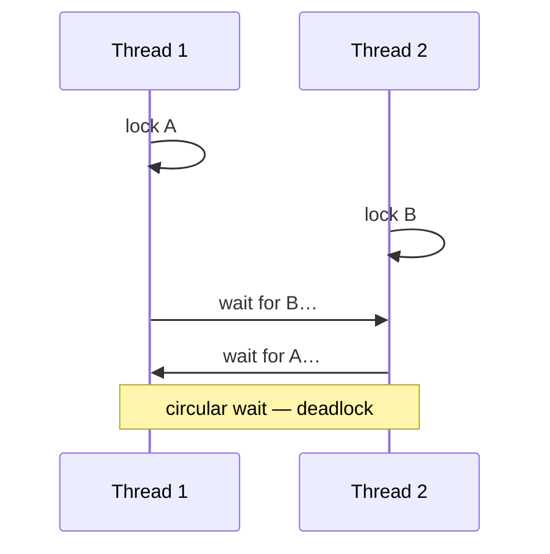

Two runtime hazards a reviewer may probe once your locking works.

**Deadlock** — two threads each hold a lock the other needs, so both wait forever. It needs four conditions to occur (mutual exclusion, hold-and-wait, no preemption, circular wait); break any one and it can't happen. The practical fixes:

- **Lock ordering** — always acquire multiple locks in the same global order (e.g. always the lower seat-id first). Breaks the circular wait; this is the fix you'll actually name in an LLD round.
- **Lock timeouts** — try-acquire with a timeout and back off instead of blocking forever.
- **Avoid holding two locks** — often you can restructure so only one lock is ever held at a time, sidestepping the problem entirely.



**Memory leaks** — memory that's no longer needed but never released. In garbage-collected languages (Java, Python, Go) this isn't manual-free bugs but **unintended references**: objects still reachable from a long-lived collection (a cache/map that only grows, listeners never unregistered, a static list). The GC can't collect what's still referenced. The fixes: bounded caches (LRU with a cap — exactly the LRU lesson), weak references for listeners, and unregistering observers when done.

**Garbage collection** itself: the runtime periodically reclaims unreachable objects. You rarely design around it in an LLD round, but know the one operational cost — a GC pause can add **tail latency** — which is why the truly latency-sensitive path minimises allocations. That connects to the p99/tail-latency point in System Design.

```recall
Q: A deadlock needs four conditions to occur. Which fix do you actually name in an LLD round, and why?
A: Lock ordering: always acquire multiple locks in the same global order (lower seat-id first). It breaks the circular-wait condition, and breaking any one of the four conditions makes deadlock impossible, so this is the practical one to state.
Q: In a garbage-collected language, what does a memory leak actually mean?
A: Not a missing free but an unintended reference: an object still reachable from a long-lived collection (a cache that only grows, a listener never unregistered, a static list). The GC cannot reclaim what is still referenced, so it accumulates.
Q: What are the fixes for that kind of leak?
A: Bound the retained set and drop references you no longer need: a capped LRU cache, weak references for listeners, and unregistering observers when they are done. Each removes the lingering strong reference that keeps the object alive.
Q: Why does garbage collection matter for a latency-sensitive path?
A: A GC pause reclaims unreachable objects while the program is stopped, which adds tail latency (a slow p99). So the latency-critical path minimizes allocations to reduce how often and how long the collector must run.
```
