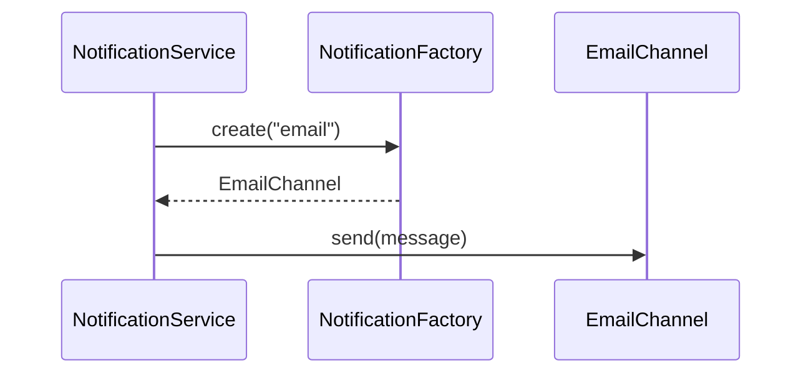

**Factory** — define an interface for creating an object and let a factory decide the concrete class, so callers don't know or care which they get. Earns its place when the prompt says "support multiple types of X"; skip it for two hardcoded types with no growth signal. (What most people call "Factory" in an interview is technically *Simple Factory*; the distinction rarely matters to the interviewer.)

The **Notification Service** is the textbook **Factory + Strategy combo**, explicitly called out as a common pairing:



Factory creates the right `NotificationChannel` by type; Strategy is each channel implementing `send()` differently.

**Facade** — a unified interface over a subsystem. The honest take: you're already writing one in every LLD round without naming it. Your top-level orchestrator — `ParkingLot`, `ElevatorController`, `LibraryManagementSystem` — that coordinates several collaborators behind a clean public API *is* a facade. No need to announce the name unless it helps communicate the shape.

```recall
Q: When does a Factory earn its place, and what is Simple Factory?
A: It earns its place when the prompt says "support multiple types of X"; for two hardcoded types with no growth signal, skip it. Simple Factory is the single method that returns the right concrete class by input, which is what most interviews mean by "Factory".
Q: In the notification service, how do Factory and Strategy divide the work?
A: The factory creates the right NotificationChannel by type ("email" -> EmailChannel); each channel then implements send() its own way, which is Strategy. The factory decides which object; the strategy decides how it behaves.
Q: Why do you rarely need to announce a Facade in an LLD round?
A: Your top-level orchestrator (ParkingLot, ElevatorController) that coordinates collaborators behind a clean public API already is a facade. Naming it adds nothing unless it helps communicate the shape; the structure is what is scored.
```
