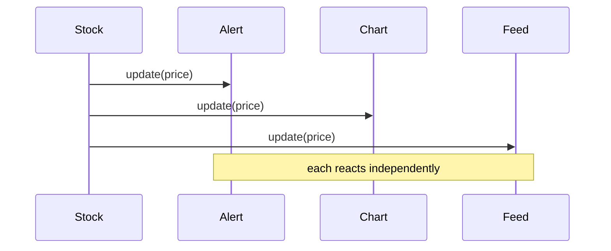

**Intent:** a one-to-many dependency — when one subject changes state, all its dependents are notified automatically, without the subject knowing their concrete types. Signal words: "notify", "subscribe", "update multiple components".

```python
class Stock:
    def attach(self, obs): self._observers.append(obs)
    def set_price(self, price):
        self.price = price
        for obs in self._observers:
            obs.update(self.symbol, price)
```

The fan-out at the heart of it:



**Where it maps:** the **Logging** framework is the sharp one. Routing a message to *one* destination is Strategy (pick a `ConsoleAppender` or a `FileAppender`). But wanting console **and** file **and** network *simultaneously* is Observer/fan-out — the `Logger` notifies every attached appender. Recognising which shape the requirement actually calls for is the scored signal. Also: stock tickers, price alerts, an "order placed" event fanning out to inventory + notifications + analytics.

```recall
Q: What is the core of Observer, and what does the subject deliberately not know?
A: A one-to-many dependency: when the subject changes state it notifies all its dependents automatically. It does not know the observers' concrete types, only that each honors an update interface, so new observers attach without changing the subject.
Q: Logging to one destination vs to console and file and network at once: which is Strategy and which is Observer?
A: Picking a single appender is Strategy (one interchangeable behavior). Sending to console and file and network simultaneously is Observer fan-out, where the logger notifies every attached appender. Recognizing which shape the requirement needs is the scored signal.
Q: What breaks if observers are never detached from a long-lived subject?
A: They stay reachable from the subject's list, so the garbage collector cannot reclaim them, which is a memory leak, and the subject keeps paying to notify observers that no longer care. Unregister observers when they are done.
```
