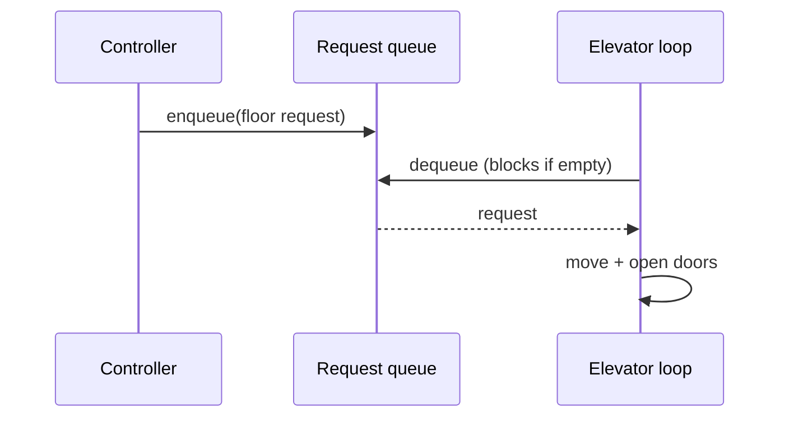

Reach for the smallest tool that fixes the problem type.

**Locks (mutexes)** — the default for protecting shared state. Coarse-grained (one lock guards everything: simple, but serialises unrelated work) vs. fine-grained (one lock per resource, e.g. per-seat: better throughput, but deadlock risk if threads acquire multiple locks in different orders). Read-write locks let many readers *or* one writer — good when reads vastly outnumber writes.

**Atomics** — lock-free ops on a *single* variable (compare-and-swap). Good for counters and flags; the moment you must update two related fields together, you need a lock. (Python has no real atomics — use a `Lock` even for a counter; Java has `AtomicInteger`, Go `sync/atomic`.)

**Immutability** — the strongest correctness tool: an object that can't change after construction can't be corrupted, because there's no modify step to race on. Prefer immutable value objects (a `Money` or `TimeSlot`) for anything passed between threads.

**Blocking queue (producer-consumer)** — hands work between threads safely: producers block when full, consumers block when empty, neither burns CPU polling. This is the **Elevator** shape — a controller thread (producer) enqueues floor requests, each elevator's control loop (consumer) drains its queue:



**Semaphores** — a counting lock with N permits, for Scarcity: at most 5 elevators moving, at most 10 concurrent downloads. Always release in a `finally`.

```recall
Q: When is an atomic enough and when do you need a lock instead?
A: An atomic is enough for a single variable (a counter, a flag) via compare-and-swap. The moment an invariant spans two or more related fields that must stay consistent, atomics do not compose, so you need a lock around the whole update.
Q: Why is immutability the strongest correctness tool?
A: An object that cannot change after construction has no modify step to race on, so it needs no lock at all. Passing immutable value objects (Money, TimeSlot) between threads removes the data race rather than guarding it.
Q: What does a blocking queue give you that a bare lock does not?
A: Safe handoff with built-in waiting: producers block when the queue is full and consumers block when it is empty, so neither burns CPU polling. It packages the condition-variable wait/notify that producer-consumer otherwise needs by hand.
Q: When do you pick a semaphore over a lock?
A: When more than one thread may proceed concurrently against a capped resource, such as 5 connections or 10 downloads. A lock is just a semaphore with one permit (mutual exclusion); a semaphore with N permits models scarcity.
```

===DEEPER===
The choice among these follows from the problem *type*, not taste. Correctness on one variable → atomic; correctness across two related fields → lock; handoff/waiting → blocking queue or condition variable; a capped resource → semaphore. The commonest live-coding bug is scope: too coarse and you serialise unrelated work (throughput dies), too fine and you invite deadlock. The right granularity is "lock the smallest unit that must change together."

The atomic-vs-lock boundary is where people slip. A single counter is atomic-safe; two fields that must agree are not:

```python
# WRONG — two atomics don't compose: the pair can be observed mid-update
balance = AtomicInt(); count = AtomicInt()
balance.add(-100); count.inc()   # another thread can read between these

# RIGHT — one lock guards the invariant "balance and count move together"
class Account:
    def __init__(self): self._lock = Lock(); self._balance = 0; self._count = 0
    def withdraw(self, amt):
        with self._lock:                 # atomic across BOTH fields
            if self._balance < amt: raise Insufficient()
            self._balance -= amt; self._count += 1
```

**The subtle point that trips people up:** atomicity does not compose. Two individually-atomic operations are *not* atomic together — a reader can observe the state between them. The moment an invariant spans more than one variable, atomics are insufficient and you need a lock (or a CAS loop on a single immutable snapshot object). Also: in CPython the GIL makes many ops *look* atomic, but `+=` on a shared int is still a read-modify-write race — use a `Lock`.

**Common follow-ups**
- Q: When do you pick a semaphore over a lock? A: A lock is a semaphore with one permit (mutual exclusion). Use a semaphore when N > 1 things may proceed concurrently — a pool of 5 connections, 10 concurrent downloads.
- Q: Coarse vs fine-grained locking — how do you decide? A: Start coarse for correctness, then split locks only where profiling shows contention. Fine-grained buys throughput at the cost of deadlock risk (multiple locks) and complexity.
- Q: Why prefer immutability over locking? A: An object that can't change after construction has no modify step to race on, so it needs no lock at all — the cheapest correctness. Pass immutable value objects between threads.
- Q: A blocking queue vs a lock + condition variable? A: The blocking queue *is* that pattern packaged: it hides the condition variables and the empty/full waits, so you get producer-consumer safety without hand-rolling wait/notify.
