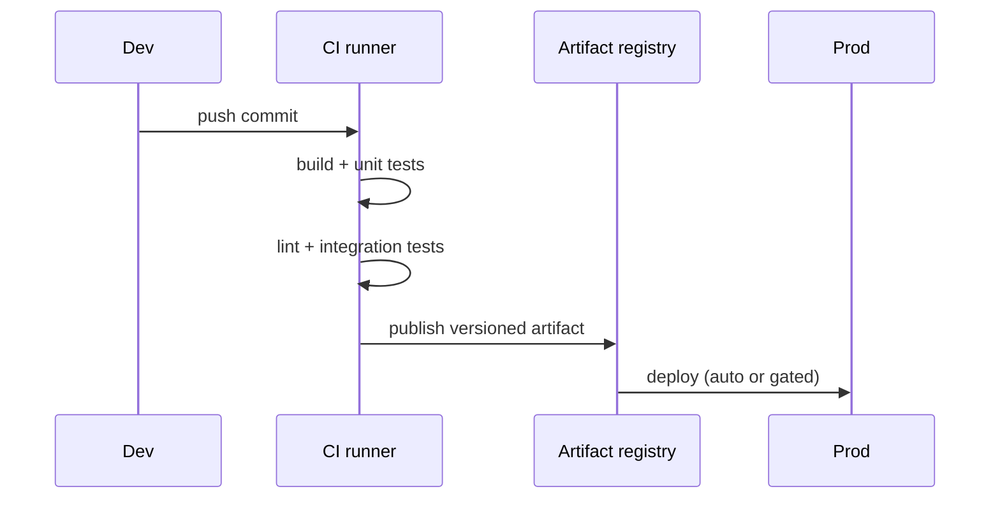

Continuous Integration (CI) and Continuous Delivery/Deployment (CD) turn "it works on my machine" into "it works, verifiably, every time we merge."

**CI** means every push is automatically built and tested against the shared mainline. The point is to catch integration problems within minutes of introducing them, while the change is still small and fresh in your head — not weeks later during a painful merge.

**CD** is the extension: an artifact that passes CI is automatically prepared for release. *Continuous Delivery* keeps a deployable build ready at all times and ships on a button press; *Continuous Deployment* removes the button and ships every green build to production automatically.

A typical pipeline runs stages in order, and a failure at any stage stops the line:



Principles that make it work: keep the pipeline **fast** (developers won't wait 40 minutes), keep it **trustworthy** (a red build must mean a real problem, or people start ignoring it), and make every build produce **one immutable, versioned artifact** that is promoted unchanged through environments — you test the exact thing you ship.

```recall
Q: Why is catching integration problems within minutes the point of CI?
A: The change is still small and fresh in the author's head, so it is cheap to fix. Catching it weeks later forces a painful merge after many changes have piled on top.
Q: What distinguishes Continuous Delivery from Continuous Deployment?
A: Continuous Delivery keeps a deployable build ready and ships on a button press; Continuous Deployment removes the button and ships every green build to production automatically.
Q: Why must a red build mean a real problem?
A: If red builds are often false alarms, people start ignoring them and a genuine failure slips through. A trustworthy pipeline is one whose red state always warrants stopping.
Q: Why promote one immutable versioned artifact unchanged through environments?
A: So you test the exact thing you ship. Rebuilding per environment risks differences, whereas promoting the identical artifact guarantees prod runs what passed the tests.
```
