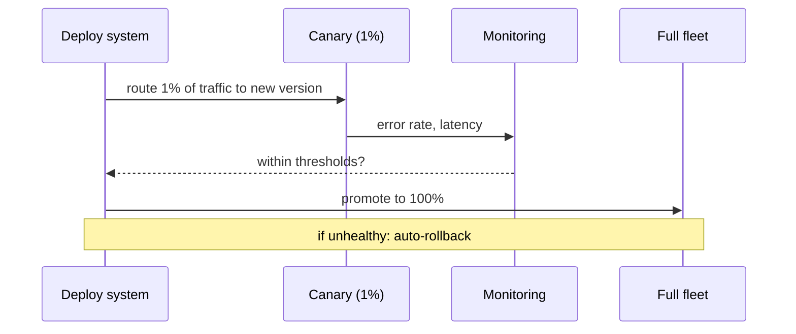

A deploy is a moment of risk: the new version might be broken in a way tests missed. Deployment strategies exist to **shrink the blast radius** and make going back easy.

- **Rolling** — replace instances a few at a time. Old and new run side by side during the transition; no extra fleet needed. Simple and common, but rollback is slow (you have to roll *back* the same way), and both versions serve traffic at once.
- **Blue-green** — stand up a full second environment (green) alongside the live one (blue), test it, then flip all traffic at once. Rollback is instant — flip back. The cost is running two full environments during the cutover.
- **Canary** — release to a small slice of traffic (say 1%), watch the metrics, and only widen if it's healthy. This catches problems real tests can't, with minimal user impact.

A canary with an automated health gate:



**Rollback** is the safety net under all of this. The rule: you should always be able to get back to the last known-good version *fast* and without thinking. This is far easier when releases are **immutable versioned artifacts** (roll back = redeploy the previous artifact) and when database changes are **backward compatible** — a schema the old code can't read makes rollback impossible.

```recall
Q: Why is blue-green rollback faster than rolling rollback?
A: Blue-green keeps the previous full environment live, so rollback is a single traffic flip. Rolling must replace instances a few at a time in reverse, so going back is as slow as the original deploy.
Q: What does a canary catch that pre-prod tests cannot?
A: Problems that only show up under real production traffic and data. A small slice is exposed while metrics are watched, so a bad version is caught with minimal user impact before it is widened.
Q: Why do immutable versioned artifacts make rollback safe?
A: Rolling back is just redeploying the previous known-good artifact unchanged, instead of trying to reverse mutations in place, so you return to a state you have already run.
Q: How can a database change make rollback impossible?
A: If the schema changes so the old code can no longer read it, flipping back to the old version breaks. That is why schema changes must stay backward compatible during a deploy.
```
