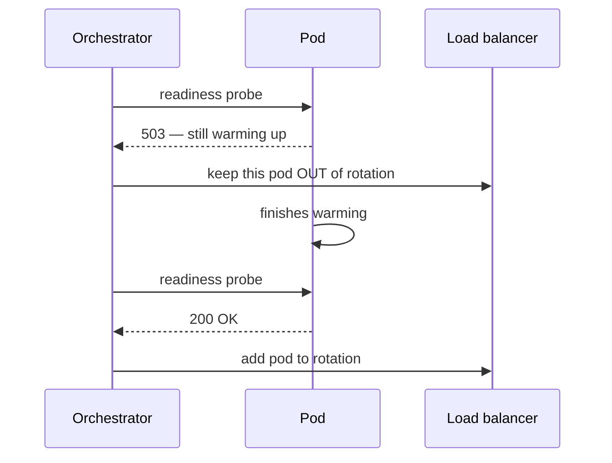

An orchestrator and a load balancer need to know two *different* things about your instance, and conflating them causes outages.

- **Liveness** — "is this process alive, or is it wedged and needs a restart?" A failing liveness check tells Kubernetes to **kill and restart** the container. Use it for unrecoverable states like a deadlock.
- **Readiness** — "is this instance ready to *serve traffic right now*?" A failing readiness check tells the system to **stop sending requests** to this instance, but leave it running. Use it during startup (still loading a cache, warming a connection pool) or when a dependency is temporarily unavailable.

Why the distinction matters:



The classic mistake is using a liveness probe that checks a downstream dependency: when that dependency has a blip, *every* instance fails liveness, gets **restarted at once**, and you turn a small dependency hiccup into a full self-inflicted outage. Liveness = "am I healthy?"; readiness = "can I serve *right now*?"

```recall
Q: Why should a liveness probe not check a downstream dependency?
A: A blip in that dependency fails liveness on every instance at once, so the orchestrator restarts the whole fleet simultaneously and turns a small hiccup into a self-inflicted outage.
Q: An instance is still warming its cache. Which probe should fail, and what happens?
A: Readiness should fail. The load balancer takes the pod out of rotation but leaves it running, so no traffic is sent until it reports ready.
Q: What goes wrong if you only have a liveness probe and no readiness probe?
A: Traffic is routed to instances that are up but not yet able to serve, so users hit errors during startup or while a dependency is temporarily unavailable.
Q: When is killing and restarting the container the right response?
A: For unrecoverable states like a deadlock, where the process is wedged and only a restart recovers it. That is what liveness is for.
```
