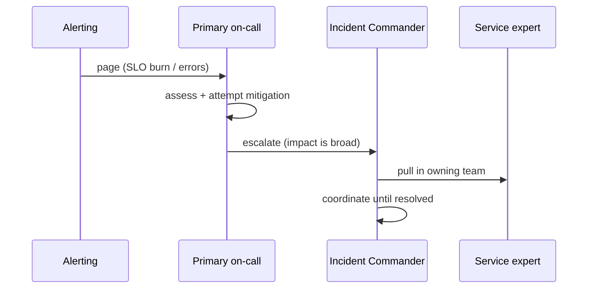

An incident is any unplanned disruption that needs an urgent response. How a team handles the live event — and what it does afterward — is the clearest signal of operational maturity.

**During the incident**, structure beats heroics:

- **Roles.** An **Incident Commander (IC)** coordinates and decides — they don't fix, they run the response. Others investigate and mitigate. This prevents ten people debugging in ten directions.
- **Mitigate first, diagnose later.** The priority is stopping user pain — roll back, fail over, flip a feature flag — *before* hunting the root cause. Recovery is the goal; understanding can wait.
- **Communicate.** Keep a running timeline and update stakeholders; a silent incident channel breeds a dozen "is it fixed yet?" interruptions.

Escalation when the first responder is stuck:



**On-call** is the rotation that makes someone responsible for responding. Healthy on-call is *sustainable*: reasonable rotations, alerts that are actually actionable (see the alerting lesson), and enough runbooks that the responder isn't starting from zero.

**Postmortems** are how you convert an outage into a permanent improvement. The non-negotiable principle is **blameless**: the goal is to fix the *system and process*, never to punish a person — because in a blameful culture people hide mistakes and the same failure recurs. A good postmortem records the timeline, the real (often multi-layered) root cause, the customer impact, and — most importantly — **action items with owners** that make this class of failure less likely or less severe. Human error is almost never the root cause; it's a symptom of a system that made the error easy to make and hard to catch.

```recall
Q: Why does the Incident Commander coordinate rather than fix?
A: A single person deciding and directing prevents ten people debugging in ten directions. The IC runs the response while others investigate and mitigate, keeping the effort coherent.
Q: Why mitigate before diagnosing the root cause?
A: The priority is stopping user pain. Rolling back, failing over, or flipping a flag restores service now, whereas hunting the root cause first prolongs the outage. Understanding can wait.
Q: Why must postmortems be blameless?
A: In a blameful culture people hide mistakes, so the same failure recurs. A blameless postmortem fixes the system and process, which is what actually prevents recurrence.
Q: Why is human error almost never the real root cause?
A: It is usually a symptom of a system that made the error easy to make and hard to catch. Fixing the system, not punishing the person, is what reduces the chance of the failure class returning.
```
