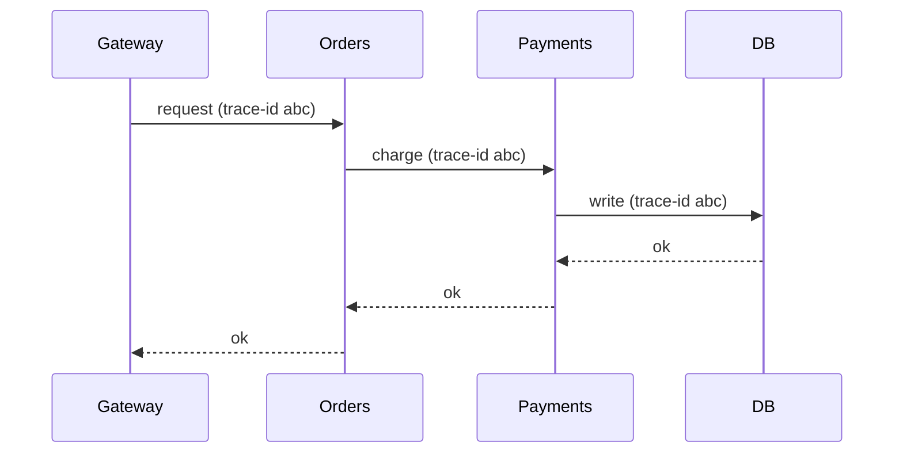

In a monolith, a slow request is one stack trace. In a system of many services, a single user action fans out into a chain of internal calls, and "the checkout is slow" could be any hop. **Distributed tracing** reconstructs that chain.

The mechanism: when a request enters the system it's assigned a **trace id**; every service it touches records a **span** (its own slice of work, with start/end time) tagged with that trace id and its parent span. Propagating the trace id across every service call is what lets you stitch the spans back into one timeline.



The result is a waterfall view: you see each span's duration and can point at the exact service and call that dominated the latency or threw the error. This is the pillar that answers **"where"** in a microservice system, and it's why teams standardize on a propagation format (OpenTelemetry) — a trace is only as good as its weakest, un-instrumented hop.

```recall
Q: What is the role of the trace id versus a span?
A: The trace id identifies one request across the whole system; each service records a span for its own slice of work tagged with that trace id and its parent span, so the spans can be stitched into one timeline.
Q: Why does an un-instrumented hop degrade the whole trace?
A: If a service does not propagate the trace id, its spans are lost and the timeline has a gap, so you cannot see where the time went or the failure occurred at that hop. A trace is only as good as its weakest hop.
Q: What question does distributed tracing answer that a monolith stack trace does not?
A: Where in a chain of many services a request spent its time or failed. In a monolith one stack trace suffices, but a fanned-out request needs spans stitched across services to localize the slow or failing hop.
Q: Why do teams standardize on a propagation format like OpenTelemetry?
A: So every service passes the trace context the same way, ensuring spans from different services and languages can be correlated into a single coherent trace.
```
