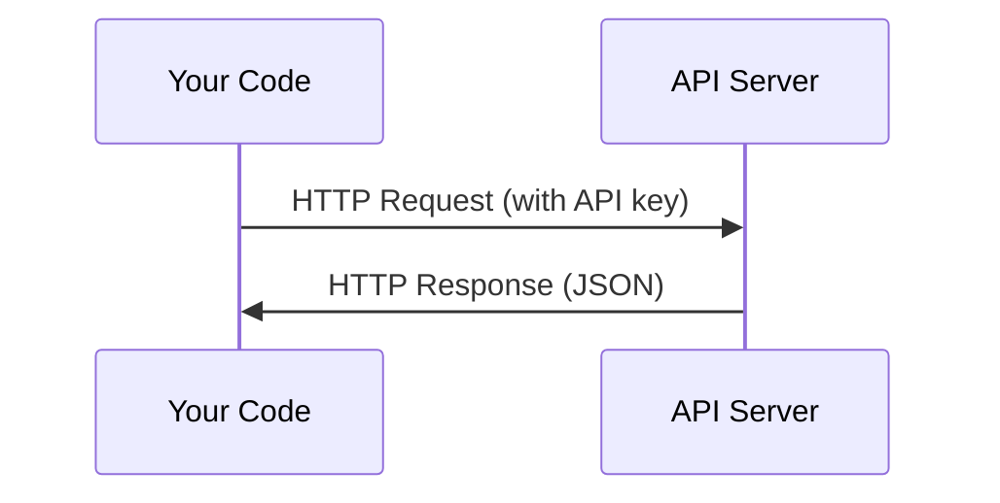

> Every AI API works the same way: send a request, get a response. The details change, the pattern doesn't.

**Type:** Build
**Languages:** Python, TypeScript
**Prerequisites:** Phase 0, Lesson 01
**Time:** ~30 minutes

## Learning Objectives

- Store API keys securely using environment variables and `.env` files
- Make an LLM API call using both the Anthropic Python SDK and raw HTTP
- Compare SDK-based and raw HTTP request/response formats for debugging
- Identify and handle common API errors including authentication and rate limits

## The Problem

Starting from Phase 11, you'll call LLM APIs (Anthropic, OpenAI, Google). In Phase 13-16 you'll build agents that use these APIs in loops. You need to know how API keys work, how to store them safely, and how to make your first API call.

## The Concept

Every API call has:
1. An endpoint (URL)
2. An API key (authentication)
3. A request body (what you want)
4. A response body (what you get back)

## Build It

### Step 1: Store API keys safely

Never put API keys in code. Use environment variables.
```bash
export ANTHROPIC_API_KEY="sk-ant-..."
export OPENAI_API_KEY="sk-..."
```
Or use a `.env` file (add it to `.gitignore`):
```
ANTHROPIC_API_KEY=sk-ant-...
OPENAI_API_KEY=sk-...
```
### Step 2: First API call (Python)
```python
import os

import anthropic

client = anthropic.Anthropic()

MODEL = os.environ.get("LLM_MODEL", "claude-sonnet-5")

response = client.messages.create(
    model=MODEL,
    max_tokens=256,
    messages=[{"role": "user", "content": "What is a neural network in one sentence?"}]
)

print(response.content[0].text)
```
`LLM_MODEL` selects the Anthropic model id, and the default is the un-dated Sonnet alias. Other providers (OpenAI, Google, and others) follow the same pattern of a key plus a model id, but each has its own SDK, endpoint, and request/response schema.

### Step 3: First API call (TypeScript)
```typescript
import Anthropic from "@anthropic-ai/sdk";

const client = new Anthropic();

const MODEL = process.env.LLM_MODEL ?? "claude-sonnet-5";

const response = await client.messages.create({
  model: MODEL,
  max_tokens: 256,
  messages: [{ role: "user", content: "What is a neural network in one sentence?" }],
});

console.log(response.content[0].text);
```
### Step 4: Raw HTTP (no SDK)
```python
import os
import urllib.request
import json

url = "https://api.anthropic.com/v1/messages"
headers = {
    "Content-Type": "application/json",
    "x-api-key": os.environ["ANTHROPIC_API_KEY"],
    "anthropic-version": "2023-06-01",
}
body = json.dumps({
    "model": os.environ.get("LLM_MODEL", "claude-sonnet-5"),
    "max_tokens": 256,
    "messages": [{"role": "user", "content": "What is a neural network in one sentence?"}],
}).encode()

req = urllib.request.Request(url, data=body, headers=headers, method="POST")
with urllib.request.urlopen(req) as resp:
    result = json.loads(resp.read())
    print(result["content"][0]["text"])
```
This is what the SDKs do under the hood. Understanding the raw HTTP call helps when debugging.

## Use It

For this course:

| API | When you need it | Free tier |
|-----|-----------------|-----------|
| Anthropic (Claude) | Phases 11-16 (agents, tools) | $5 credit on signup |
| OpenAI | Phase 11 (comparison) | $5 credit on signup |
| Hugging Face | Phases 4-10 (models, datasets) | Free |

You don't need all of them right now. Set them up when the lesson requires it.

## Ship It

This lesson produces:
- `outputs/prompt-api-troubleshooter.md` - diagnose common API errors

Source: [AI Engineering from Scratch, phase 0, 04-apis-and-keys](https://github.com/rohitg00/ai-engineering-from-scratch/tree/3f9715c62a3bedcffb68a260f1a65ee2dd9cc10a/phases/00-setup-and-tooling/04-apis-and-keys), with its code and notebook. MIT licence, (c) Rohit Ghumare and contributors.

## Check yourself

```recall
Q: What is an API key used for when calling an LLM service?
A: Authenticating your identity and authorizing requests. An API key is a unique string that identifies your account, authorizes your requests, and allows the provider to track usage and billing.
Q: Why should API keys never be hardcoded directly in source code?
A: They can be accidentally committed to git and exposed publicly. Hardcoded keys in source code risk being committed to version control and pushed to public repositories, where they can be scraped and abused by others.
Q: What is the recommended way to store API keys for local development?
A: In a .env file that is listed in .gitignore. A .env file stores keys as environment variables and should be added to .gitignore so it is never committed to version control. SDKs read keys from environment variables automatically.
Q: In the raw HTTP API call to Anthropic, which header carries the API key?
A: x-api-key: sk-ant-.. Anthropic's API uses the 'x-api-key' header for authentication, not the more common 'Authorization: Bearer' pattern. This is specific to their API design.
Q: What happens when you exceed an API's rate limit?
A: The server returns an error (typically HTTP 429) and you must wait before retrying. Rate limiting returns HTTP 429 (Too Many Requests). You need to wait and retry, typically with exponential backoff. Rate limits prevent abuse and ensure fair usage.
```

===DEEPER===
## Exercises

1. Get an Anthropic API key and make your first API call
2. Try the raw HTTP version and compare the response format to the SDK version
3. Intentionally use a wrong API key and read the error message

### Hints

**Exercise 1.** Create a key in the Anthropic Console, put it in `ANTHROPIC_API_KEY` as shown in the lesson, and run `code/first_api_call.py`. The call works when the script prints the model reply and no error.

**Exercise 2.** Both functions in `code/first_api_call.py` print only the text and the token counts. Add `print(response)` in `call_with_sdk()` and `print(result)` in `call_raw_http()`, then run the script to see both full responses. Compare the field names: the raw JSON has the same `content`, `usage`, and `stop_reason` fields that the SDK turns into object attributes.

**Exercise 3.** Set `ANTHROPIC_API_KEY` to a fake value in one terminal only, then run the script again. Find the HTTP status code and the error type in the output; an authentication failure returns a 401 status.

## Key Terms

| Term | What people say | What it actually means |
|------|----------------|----------------------|
| API key | "Password for the API" | A unique string that identifies your account and authorizes requests |
| Rate limit | "They're throttling me" | Maximum requests per minute/hour to prevent abuse and ensure fair usage |
| Token | "A word" (in API context) | A billing unit: input and output tokens are counted and charged separately |
| Streaming | "Real-time responses" | Getting the response word by word instead of waiting for the full response |
