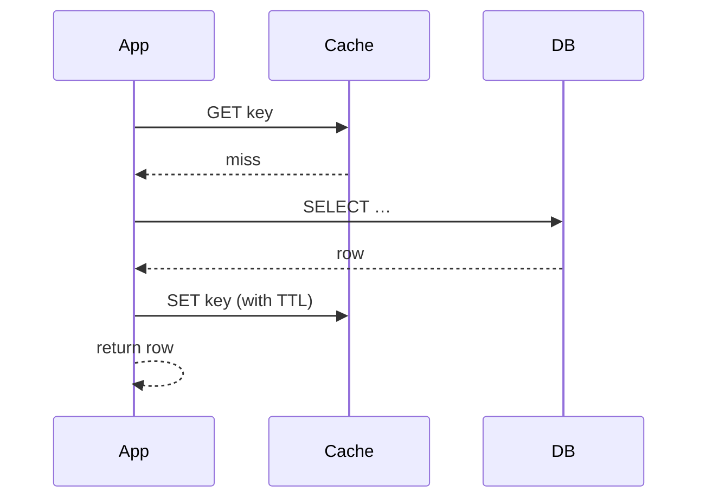

A cache trades memory for latency by keeping hot data close to the reader. The three questions an interviewer will probe: **where**, **what strategy**, and **how do you invalidate**.

**Where:** client → CDN (static/media) → application-tier cache (Redis/Memcached) → database buffer pool. Each layer catches what the layer above missed.

```flow
dir: LR
client: Client cache | actor
cdn: CDN edge | store
app: App cache | store
buf: DB buffer pool | store
db: Database | store
client -> cdn : miss
cdn -> app : miss
app -> buf : miss
buf -> db : miss
```

**Strategy — cache-aside** is the default. The app checks the cache, and on a miss loads from the DB and populates the cache:



Alternatives: **write-through** (write to cache and DB together — consistent, slower writes), **write-back** (write to cache, flush later — fast, risks loss on crash).

**Invalidation is the hard part.** Two real options: a **TTL** (simple, but serves stale data until it expires) or **explicit invalidation** on write (fresh, but easy to miss a path and leak stale entries). Most systems use TTL plus explicit invalidation on the paths that matter.

Watch for the **thundering herd**: when a hot key expires, thousands of requests miss simultaneously and stampede the DB. Mitigate with a short lock on repopulation or slightly randomised TTLs.

```recall
Q: Why is cache-aside the default strategy?
A: The app reads the cache, and on a miss loads from the DB and populates the cache, so only requested data is cached and the cache never blocks writes. It is simple and resilient: a cache outage just means more DB reads.
Q: After a write, why delete the cache key instead of updating it?
A: A concurrent read could repopulate a stale value if you write the cache directly. Deleting forces the next read to reload fresh from the DB, bounding staleness and avoiding a race that leaves a wrong value cached.
Q: What is a thundering herd and how do you mitigate it?
A: When a hot key expires, thousands of simultaneous misses stampede the DB. Mitigate with a short per-key lock so only the first request repopulates, plus jittered TTLs so keys do not all expire together.
Q: TTL versus explicit invalidation, what do you give up with each?
A: A TTL is simple but serves stale data until it expires. Explicit invalidation is fresh but easy to miss a write path and leak stale entries. Most systems combine both: TTL as a backstop plus invalidation on paths that matter.
```

===DEEPER===
**Mechanism.** Redis and Memcached are in-memory hash tables reached over the network. The win isn't just "RAM is fast" — it's skipping the DB's query planner, buffer-pool lookup, and disk seeks. A Redis GET is a single hash probe plus a network round trip; the data structure work is nanoseconds, so the cost is dominated by the network.

**Numbers an interviewer expects.**
- Redis GET, same data centre: **~0.5–1 ms** end to end (sub-ms compute, RTT dominates).
- Process-local / in-memory cache (no network): **~100 ns**.
- SSD-backed DB point read: **~1–10 ms**; a query needing disk seeks or a scan: **tens of ms to seconds**.
- A single Redis node handles **~100k+ ops/sec**; memory is the ceiling, so hit ratio is what you tune. A 90% hit ratio turns 10k QPS into 1k DB QPS.

**Worked example.** Product page at 10k QPS, each read costing the DB ~5 ms. Uncached, the DB needs ~50 concurrent busy connections just for reads — near its limit. Add cache-aside with a 90% hit ratio: 9k reads served from Redis at ~1 ms, 1k reach the DB. DB load drops 10x and p99 improves because most reads never queue behind slow DB work.

**Common follow-ups**
- *Q: How do you prevent a cache stampede on a hot key?* A: On miss, take a short per-key lock (e.g. `SET key lock NX EX 5`) so only the first request repopulates while others briefly wait or serve stale; add jittered TTLs so keys don't all expire together. For very hot keys, refresh ahead of expiry (early recompute).
- *Q: Cache and DB disagree after a write — how?* A: Update the DB, then **delete** the cache key (don't write it — a concurrent read could re-populate stale). Accept a tiny stale window bounded by TTL. Write-through only if you need the cache always warm.
- *Q: What do you evict when full?* A: LRU is the default; LFU (Redis `allkeys-lfu`) is better when a stable hot set exists. Always set `maxmemory` + a policy, or Redis OOMs.
- *Q: Cache the whole object or fields?* A: Cache the read shape you actually serve. Caching normalized fields forces re-joins on read; cache the denormalized response and invalidate on the write paths that touch it.
