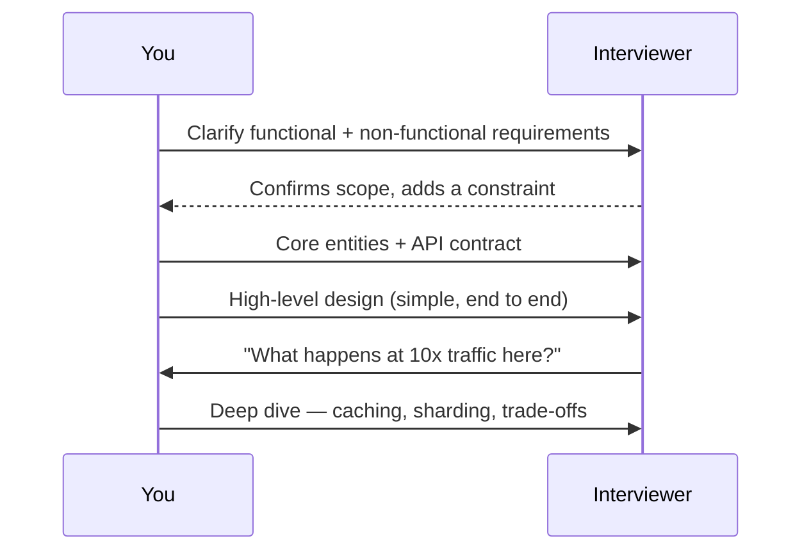

Hello Interview's delivery framework exists to stop you running out of time. For a 45–60 min round:

```steps
Requirements (~5 min) | Functional ("users should be able to..."), then non-functional, quantified: "search under 500ms" beats "fast". Prioritise; a long list hurts you.
Core entities (~2 min) | Just the nouns: User, Tweet, Follow. Don't fill columns yet.
API (~5 min) | Define the contract before the architecture. Default REST. Never take the current user id from the request body; derive it from the auth token.
Data flow, optional (~5 min) | Only for pipeline systems, such as a crawler.
High-level design (~10-15 min) | Boxes and arrows that satisfy the API, one endpoint at a time. Stay simple; note where you will add complexity later.
Deep dives (~10 min) | Harden against the non-functional requirements: scale, bottlenecks, edge cases.
```

The shape of the conversation:



A compressed mental checklist: **scope → ground in data/APIs → commit to a structure → go deep without breaking down.**

```recall
Q: Why does this framework exist, and what failure does it prevent?
A: To fit a design into 45 to 60 minutes and stop you running out of time. It prevents the common failure of going too deep too early and leaving the design incomplete.
Q: Why define the API contract before the architecture?
A: The contract fixes what the system must do, so the high-level design can be built to satisfy it one endpoint at a time. Jumping to boxes first risks a design that does not serve the actual API.
Q: Why should you never take the current user id from the request body?
A: A client can forge it, impersonating another user. Derive the user id from the authenticated token instead, so identity comes from something the client cannot tamper with.
Q: When is the optional data-flow step worth spending time on?
A: Only for pipeline systems like a crawler, where how data moves through stages is the core of the design. For a typical request-response feature it adds little, so you skip it to protect the clock.
```
