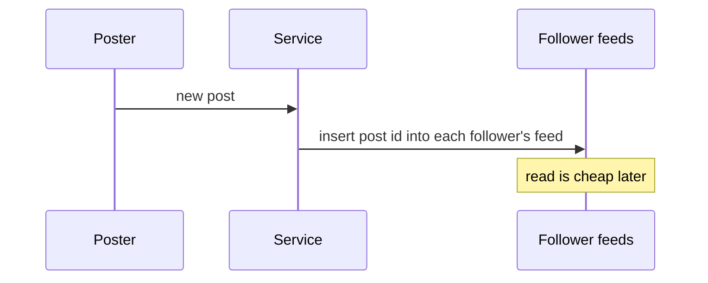

The canonical design tension behind news feeds, timelines, and notifications. When someone posts, how do their followers see it?

**Fan-out on write (push):** when you post, immediately write the post id into every follower's precomputed feed. Reads are then trivial — just read your own feed list.



Great for read-heavy timelines — until a celebrity with 50M followers posts, and one write becomes 50M writes (the **hot-key / fan-out storm** problem).

**Fan-out on read (pull):** store the post once. When a follower opens their feed, gather recent posts from everyone they follow and merge. Cheap writes, expensive reads.

**The real answer is hybrid:** push for normal users (cheap fan-out, fast reads), pull for the handful of celebrities (avoid the storm), and merge the two at read time. Naming this hybrid — and *why* — is what separates a mid-level answer from a strong one.

```flow
dir: LR
reader: Reader opens feed | actor
feed: Pushed feed list | store
cel: Celebrity timelines | store
merge: Merge by time | gate
out: Timeline | step
reader -> feed : read precomputed
reader -> cel : pull recent
feed -> merge
cel -> merge
merge -> out : sorted result
```

```recall
Q: What does fan-out on write buy, and where does it break?
A: It precomputes each follower's feed so reads are a single cheap list fetch, ideal for read-heavy timelines. It breaks when a celebrity with millions of followers posts, since one post becomes millions of writes, the fan-out storm.
Q: Why does the hybrid approach pull for celebrities instead of pushing?
A: Pushing a celebrity post means a write per follower, which storms the system. Storing it once and pulling it at read time for the few celebrities a reader follows avoids millions of writes while keeping normal reads cheap.
Q: Why is fan-out on write done asynchronously via a queue?
A: Even for normal users the writes should not block the poster's request. A queue absorbs the burst and spreads the write load, so followers see the post within seconds rather than the poster waiting.
Q: Why keep the stored feed a time-ordered candidate list rather than final ranked order?
A: So you can apply ranking, ads, and filtering at read time. Baking final ordering into the stored fan-out means you cannot re-rank later without rewriting every feed.
```

===DEEPER===
**Mechanism.** Push keeps a per-user **feed list** (a Redis sorted set or a feeds table keyed by `user_id`, scored by time). On a post, a fan-out worker reads the author's follower list and does an insert into each follower's list — reads are then a single range query. Pull stores each post once in the author's timeline; a read fetches the follower's followee list, does a top-K query per followee (or a merged query), and **k-way merges** the results by timestamp. Hybrid marks celebrities so their posts are *not* pushed; at read time you union the pushed feed with a live pull of the few celebrities you follow, then merge-sort by time.

**Numbers an interviewer expects.**
- Push cost per post = **O(followers)** writes. A user with 500 followers → 500 cheap writes, fine. A celebrity with **50M followers → 50M writes** per post — the fan-out storm.
- Read cost: push read is **~1 ms** (one range read of a precomputed list); pull read fanning over, say, 500 followees is **hundreds of queries or one big merge — tens of ms**.
- Redis sorted-set insert/range: **sub-ms**; feed lists are usually capped (keep newest ~800 entries) to bound memory.

**Worked example.** Twitter-style timeline, mostly read-heavy. Regular user posts → push to ~hundreds of follower feeds, each read is a fast list fetch. A celebrity posts → **skip push entirely**; store once. When any follower loads their timeline, the service reads their pushed feed (normal followees) *and* pulls the recent posts of the ≤ handful of celebrities they follow, merges the two by time, returns. One post from a 50M-follower account thus costs 0 fan-out writes instead of 50M, while normal reads stay cheap.

**Common follow-ups**
- *Q: What's the celebrity threshold for switching to pull?* A: A follower-count cutoff (e.g. **>~100k–1M**) or a dynamic rule based on post rate × followers; above it, pull to avoid the write storm.
- *Q: How do you bound feed storage?* A: Cap each pushed feed to the newest N entries (e.g. 800) and page older content from the source timeline on demand — the tail is rarely read.
- *Q: A user with 50M followers still posts — fan-out lag?* A: Fan-out is async via a queue, so followers see it within seconds, not instantly; the queue absorbs the burst and smooths write load.
- *Q: How do you inject ranking/ads/filtering?* A: Keep the feed a candidate list ordered by time, then apply ranking/filtering at read time; don't bake final ordering into the stored fan-out, or you can't re-rank.
