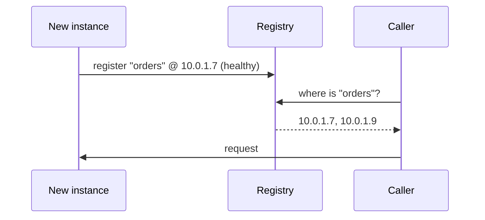

An **API gateway** is an L7 reverse proxy specialised for API traffic. It's the single front door to a set of services and centralises the cross-cutting work you don't want in every service: authentication, rate limiting, request routing, API-key checks, and request/response shaping. In a microservices system, the gateway is what the outside world hits; it fans requests out to internal services.

Don't confuse it with a **load balancer**: the LB spreads traffic across copies of *one* service; the gateway routes across *different* services and enforces policy. They're often layered — gateway behind an LB.

```flow
dir: LR
client: Client | actor
gw: API gateway | gate
orders: Orders service | step
users: Users service | step
pay: Payments service | step
client -> gw : request
gw -> gw : auth + rate limit
gw -> orders : /orders
gw -> users : /users
gw -> pay : /payments
```

**Service discovery** solves a related problem: in a dynamic system, service instances come and go (autoscaling, deploys, crashes) and their IPs change. Instead of hard-coding addresses, instances **register** themselves in a registry (Consul, etcd, or your platform's built-in DNS), and callers **look up** healthy instances by name.



Kubernetes bundles this in: a Service name resolves via cluster DNS to healthy pods, so app code just calls `http://orders`.

```recall
Q: Why not put auth and rate limiting inside every service instead of at a gateway?
A: Those are cross-cutting concerns. Centralizing them at the gateway avoids duplicating and drifting the same logic across every service, and gives one place to enforce policy at the front door.
Q: How does an API gateway differ from a load balancer?
A: A load balancer spreads traffic across copies of one service; a gateway routes across different services and enforces policy like auth and rate limiting. They are often layered, gateway behind an LB.
Q: What problem does service discovery solve that hard-coded IPs do not?
A: Instances come and go with autoscaling, deploys, and crashes, so their IPs change. A registry lets callers look up healthy instances by name instead of breaking when an address changes.
```
