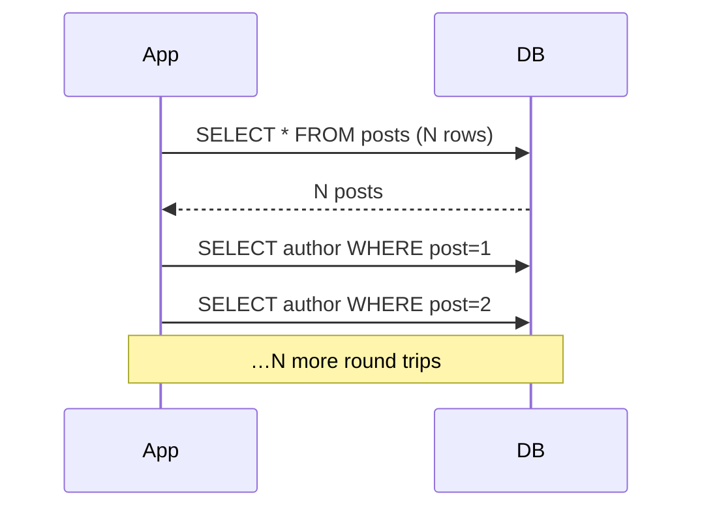

An **index** is a secondary data structure (usually a B-tree) that lets the database find rows without scanning the whole table. A query filtering on an unindexed column does a **full table scan** — fine at 1,000 rows, fatal at 100M. The interview reflex: any column you filter, join, or sort on frequently probably needs an index.

Indexes aren't free — each one slows writes (every insert/update must maintain it) and uses space, so you index deliberately, not everywhere. A **composite index** on `(a, b)` also serves queries on `a` alone (leftmost-prefix rule) but not `b` alone.

**Query optimization** starts with reading the query plan (`EXPLAIN`): is it using the index or scanning? Common wins: add the missing index, select only needed columns, avoid functions on indexed columns (they defeat the index), paginate with a cursor instead of a huge `OFFSET`.

The **N+1 query** problem is the one that bites everyone: you fetch N parent rows, then fire one more query *per row* to load its children — 1 + N round trips.



Fix it with a **join** or a single batched `WHERE id IN (…)` — turning N+1 queries into 1 or 2. ORMs cause this silently; the fix is eager-loading.

```recall
Q: Why not just index every column?
A: Each index must be maintained on every insert and update and costs storage, so write-heavy tables slow down and bloat. You index the columns you filter, join, or sort on, not every column.
Q: A composite index on (a, b) exists. Which queries does it help?
A: Queries on a alone and on a plus b, by the leftmost-prefix rule, because it is sorted by a then b. It does not help a query filtering on b alone.
Q: What is the N+1 query problem and how do you fix it?
A: You fetch N parent rows then fire one query per row for its children, so 1 + N round trips. Fix it with a join or a single batched WHERE id IN (...), collapsing it to one or two queries.
Q: Why is WHERE lower(email) = ? slow despite an index on email?
A: Wrapping the indexed column in a function defeats the plain index, so the engine cannot use it. Fix with a functional index on lower(email) or normalize the value on write.
```

===DEEPER===
**Mechanism.** A B-tree index is a balanced tree with a high **fanout** (hundreds of keys per page), so its depth stays tiny even for huge tables. A lookup walks from root to leaf — that's the **O(log n)** cost. Because fanout is ~hundreds, depth grows painfully slowly: a table of 100M rows is only **~4 levels deep**, so a point lookup is ~4 page reads (mostly cached) instead of scanning 100M rows. A **covering index** includes every column the query needs, so the engine answers from the index alone and never touches the heap ("index-only scan"). Composite `(a, b)` is sorted by `a` then `b`, which is why it serves `a` and `(a, b)` but not `b` alone.

**Numbers an interviewer expects.**
- Full scan of 100M rows: **hundreds of ms to seconds**; indexed point lookup: **~sub-ms to low ms** (a handful of cached page reads).
- B-tree depth for 100M rows ≈ **4** (fanout ~300 → 300⁴ ≈ 8B > 100M). Doubling the table adds essentially nothing to lookup cost.
- Each extra index adds **~5–15% write overhead** and storage; that's why you index the columns you filter/join/sort on, not every column.

**Worked example.** A dashboard lists 50 recent orders, then the ORM lazily loads each order's customer — 1 + 50 = **51 round trips**, each ~1 ms of network + DB, so ~50 ms wasted on chatter. Switch to a join (or `WHERE customer_id IN (…50 ids)`): **2 queries**, ~2 ms. Same data, 25× fewer round trips — the classic N+1 fix, and the reason ORMs default to eager-loading options.

**Common follow-ups**
- *Q: How do you find the missing index?* A: `EXPLAIN (ANALYZE)` — look for `Seq Scan` on a large table with a selective filter; that's the index candidate. Confirm the planner switches to `Index Scan` after adding it.
- *Q: Why can too many indexes hurt?* A: Every write must update every index, so write-heavy tables slow down and bloat; drop unused indexes (Postgres `pg_stat_user_indexes` shows zero-scan ones).
- *Q: Why is `WHERE lower(email) = ?` slow despite an index on `email`?* A: The function defeats the plain index — the engine can't use it. Fix with a **functional index** on `lower(email)` or normalize on write.
- *Q: `OFFSET 100000 LIMIT 20` is slow — why?* A: The DB still walks and discards 100k rows. Use **keyset/cursor pagination** (`WHERE id > last_seen ORDER BY id LIMIT 20`) so it seeks straight to the page.
