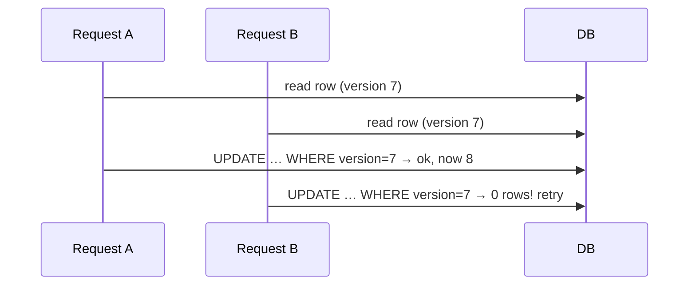

When two requests touch the same row at once, you need a concurrency-control strategy.

**Pessimistic locking** — lock the row before you touch it (`SELECT … FOR UPDATE`); others wait. Correct and simple, but locks hurt throughput and risk **deadlocks** if two transactions grab locks in different orders. Use when contention is high and conflicts are likely (e.g. decrementing scarce inventory).

**Optimistic locking** — don't lock; assume no conflict. Read a version number with the row, and on write check the version hasn't changed (`UPDATE … WHERE version = 7`). If it did, someone else won — you retry. Great when conflicts are *rare*; you pay nothing in the common case.



**Distributed locks** extend this across machines when the resource isn't a single database row (e.g. "only one worker runs this job"). Usually a key in Redis with a TTL (so a crashed holder doesn't lock forever). They're genuinely hard to get right — clock skew and lost locks cause subtle bugs — so the strong interview answer is often "avoid needing one: make the operation idempotent or partition the work so each key has a single owner."

```flow
dir: TB
start: Concurrent writes | gate
scope: Single DB row? | gate
contend: Conflicts frequent? | gate
pess: Pessimistic lock | store
opt: Optimistic version check | store
avoid: Idempotent or partition | step
start -> scope
scope -> contend : yes
scope -> avoid : no, cross-machine
contend -> pess : frequent
contend -> opt : rare
```

```recall
Q: When do you choose optimistic over pessimistic locking?
A: Optimistic when conflicts are rare, like editing a profile, because you pay nothing in the common case. Pessimistic when a hot row is contended, like last-item inventory, where optimistic retries would storm.
Q: What actually happens on an optimistic write when someone else won?
A: The conditional update matches zero rows because the version changed, so the write fails without locking. You re-read the current row and retry, paying cost only when a real conflict occurred.
Q: Why is a plain Redis distributed lock only best-effort?
A: Under GC pauses or clock skew a holder can believe it still owns an expired lock, so two workers run at once. For correctness prefer a fencing token the resource checks or a lease-based lock service.
Q: How can you avoid needing a lock at all?
A: Make the operation idempotent by deduping on a request id, or partition the work so each key has exactly one owner. Then concurrent conflicts on that key cannot arise.
```

===DEEPER===
**Mechanism.** Pessimistic `SELECT … FOR UPDATE` takes a **row-level write lock** inside a transaction; other writers to that row block until you commit. The DB detects **deadlocks** (A holds row1 wants row2, B holds row2 wants row1) by finding a cycle in its wait-for graph and aborting one transaction — which is why you acquire locks in a consistent order. Optimistic control takes no lock: it does a **compare-and-set** — `UPDATE … SET v=v+1 WHERE id=? AND version=?` — and checks the affected-row count; 0 rows means someone else committed first, so you re-read and retry. A distributed lock (Redis `SET key val NX PX 30000`) is the same idea across machines, with a **TTL** so a crashed holder auto-releases and a unique token so only the owner unlocks.

**Numbers an interviewer expects.**
- Optimistic retry cost is ~zero when conflicts are rare; it degrades badly once conflict probability is high — retries storm. Rough switch point: **pessimistic when conflicts are frequent (say >~10% of writes contend)**, optimistic when they're rare.
- Redis lock TTL: pick **> worst-case work time** (e.g. 30 s) or the lock expires mid-work and two workers run; too long and a crash blocks others for that whole TTL.
- Lock hold time is the throughput ceiling: a row locked for 50 ms caps that row at **~20 updates/sec** serialized.

**Worked example.** Selling the last concert ticket: 5,000 users click at once. Optimistic `UPDATE tickets SET sold=sold+1 WHERE id=? AND sold<capacity` — thousands retry-fail instantly, one succeeds; correct but a retry storm. Under this much contention, **pessimistic** `SELECT … FOR UPDATE` (or an atomic conditional decrement) serializes cleanly with no wasted retries. Better still: partition inventory into buckets so contention spreads, or make each purchase idempotent by a request id so retries don't double-sell.

**Common follow-ups**
- *Q: When optimistic vs pessimistic?* A: Optimistic for rare conflicts (edit-a-profile) — no lock cost in the common case; pessimistic for hot contested rows (last-item inventory, counters) where retries would storm.
- *Q: Is a Redis lock safe?* A: Not perfectly — under GC pauses/clock skew a holder can think it still owns an expired lock (the Redlock debate). For correctness prefer a **fencing token** the resource checks, or a lock service (etcd/ZooKeeper) with leases; treat plain Redis locks as best-effort mutual exclusion.
- *Q: How do you avoid deadlocks?* A: Acquire multiple locks in a **global order**, keep transactions short, and set a lock timeout so a cycle aborts fast instead of hanging.
- *Q: Can you skip locking entirely?* A: Often — make the write **idempotent** (dedupe by request id) or **partition** so each key has exactly one owner/consumer; then concurrent conflicts can't arise.
