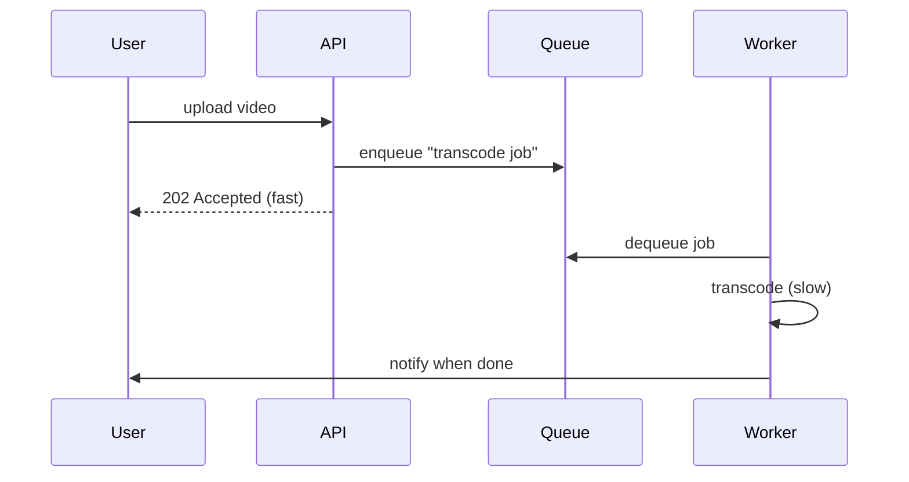

A queue decouples a producer from a consumer so slow or bursty work doesn't block the request path. The classic use: return to the user immediately, do the heavy work asynchronously.



Two flavours:

- **Task queue** (SQS, RabbitMQ) — a job is consumed once and removed. Good for work distribution: send email, resize image, process payment.
- **Log/stream** (Kafka, Kinesis) — an append-only log many consumers read independently at their own offset. Good for event pipelines, analytics, and fan-out to multiple systems.

```flow
dir: LR
prod: Producer | step
log: Append-only log | store
c1: Analytics | step
c2: Search indexer | step
c3: Audit | step
prod -> log : append event
log -> c1 : offset A
log -> c2 : offset B
log -> c3 : offset C
```

The properties to reason about: **delivery** (at-least-once is normal → your consumer must be **idempotent**), **ordering** (global ordering is expensive; per-key ordering via partitions is usually enough), and **backpressure** (what happens when producers outpace consumers — the queue absorbs the burst, which is the point).

```recall
Q: What does a queue decouple, and why does that help the request path?
A: It decouples a slow or bursty producer from the consumer, so heavy work runs asynchronously. The API can return immediately, for example 202 Accepted, instead of blocking the user while the work completes.
Q: Task queue versus log/stream, when do you pick each?
A: A task queue consumes each job once and removes it, good for distributing work like sending email. A log/stream is append-only and lets many consumers read independently at their own offset, good for event pipelines and fan-out.
Q: Why must a consumer be idempotent?
A: Delivery is normally at-least-once, so the same message can be delivered more than once. An idempotent consumer produces the same result on a repeat, so a redelivery does not double-charge or double-process.
Q: Why is per-key ordering usually enough instead of global ordering?
A: Global ordering across all messages is expensive to maintain. Partitioning by key preserves order within each key, which is what most systems actually need, like all events for one user staying in order.
```
