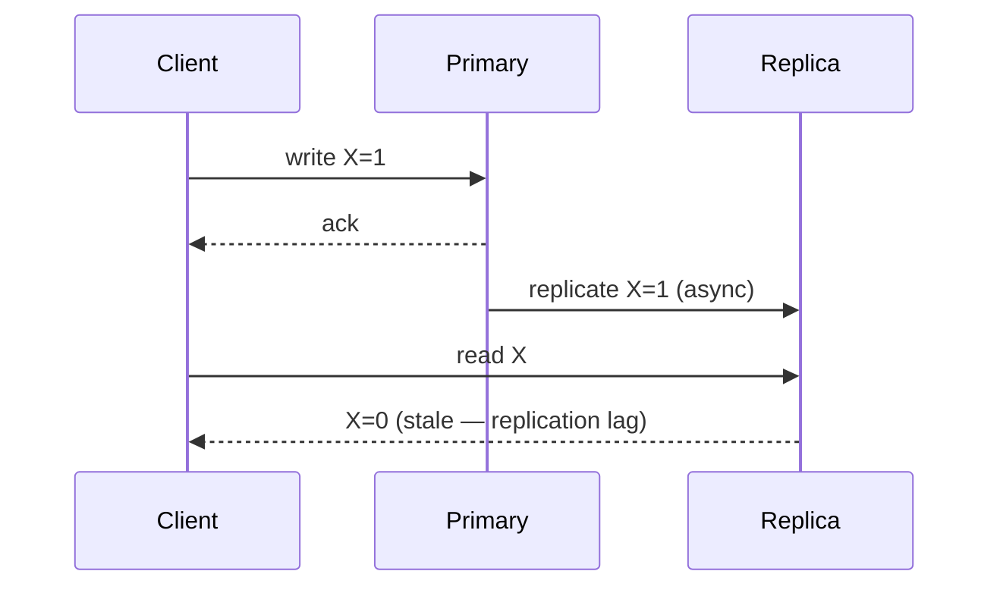

Two different tools people conflate.

**Replication** = copies of the *same* data on multiple nodes. It buys availability (a node dies, a replica serves) and read scaling (reads spread across replicas). The cost is consistency: with async replication a replica can lag, so a read right after a write may not see it.



**Partitioning (sharding)** = splitting *different* data across nodes so no single node holds it all. It buys write scaling and storage beyond one machine. The cost is that cross-partition queries and transactions get hard.

The make-or-break decision is the **partition key**. A good key spreads load evenly and keeps related data together. A bad key creates a **hot partition** — e.g. sharding by `country` when 60% of traffic is one country. When asked "what's your partition key," never answer "id" reflexively; answer with the access pattern that key serves.

```flow
dir: LR
w: Request (key) | actor
router: Hash(key) % N | gate
p1: Shard 1 | store
p2: Shard 2 | store
p3: Shard 3 (hot) | store
w -> router : key
router -> p1
router -> p2
router -> p3 : skewed key
```

```recall
Q: Replication and partitioning both use multiple nodes. What is the difference in what they buy?
A: Replication keeps copies of the same data, buying availability and read scaling. Partitioning splits different data across nodes, buying write scaling and storage beyond one machine.
Q: Why can a read right after a write return stale data with async replication?
A: The primary acks the client as soon as it commits, then streams to replicas. A read hitting a replica before the change propagates sees the old value, which is replication lag.
Q: What makes a partition key bad, and what is the symptom?
A: A key that does not spread load evenly, like country when most traffic is one country. The symptom is a hot partition that throttles while other partitions sit idle.
Q: Why does consistent hashing beat naive mod-N when adding a node?
A: Naive mod-N remaps about (N-1)/N of all keys when N changes, a massive reshuffle. Consistent hashing remaps only about 1/N, so growth moves far less data.
```

===DEEPER===
**Mechanism.** Replication ships the primary's write-ahead log to replicas. **Async** (the default) acks the client as soon as the primary commits, then streams to replicas — fast writes, but a replica can lag. **Sync** waits for a replica to confirm before acking — no data loss on primary failure, but every write pays a round trip. **Semi-sync** (wait for *one* replica) is the common middle ground.

Partitioning splits data by a function of the key. **Hash partitioning** (`hash(key) % N`) spreads evenly but makes range scans hit every node; **range partitioning** keeps ranges scannable but risks hot ranges (e.g. "today"). **Consistent hashing** places nodes and keys on a ring so adding/removing a node only remaps ~1/N of keys, not all of them.

**Numbers an interviewer expects.**
- Async replication lag: **milliseconds normally**, spiking to **seconds** under write bursts or slow replicas.
- Same-region replica round trip for sync: **~1 ms**; **cross-region: ~50–150 ms+** (US-East↔EU ~80–90 ms, US↔Asia ~150–200 ms). This is why synchronous cross-region writes are painful.
- Naïve `mod N` resharding remaps **~(N-1)/N** of keys; consistent hashing remaps **~1/N**.

**Worked example.** A messaging app partitioned by `chat_id` co-locates a conversation's messages on one node, so "load this chat" is one node's work. Partitioning by `message_id` (hash) would scatter one chat across every node — every read becomes a scatter-gather. The access pattern ("read a whole chat") dictates the key.

**Common follow-ups**
- *Q: Read-your-own-writes with async replicas?* A: Route a user's reads to the primary for a short window after their write, or pin them to a replica caught up past their write's position (LSN).
- *Q: How do you avoid resharding pain?* A: Consistent hashing, or over-partition up front (e.g. 1024 logical shards mapped onto few physical nodes) so growth is remapping virtual shards, not rehashing keys.
- *Q: Fix a hot partition after the fact?* A: Add a suffix to spread the hot key (`celebrityId#0..9`) and fan-in on read, or split that key's data into sub-partitions. Prevention via key choice beats cure.
- *Q: Cross-partition transaction?* A: Avoid it — redesign so the transaction lives in one partition. If unavoidable, two-phase commit or a saga, both of which add latency and failure modes.
