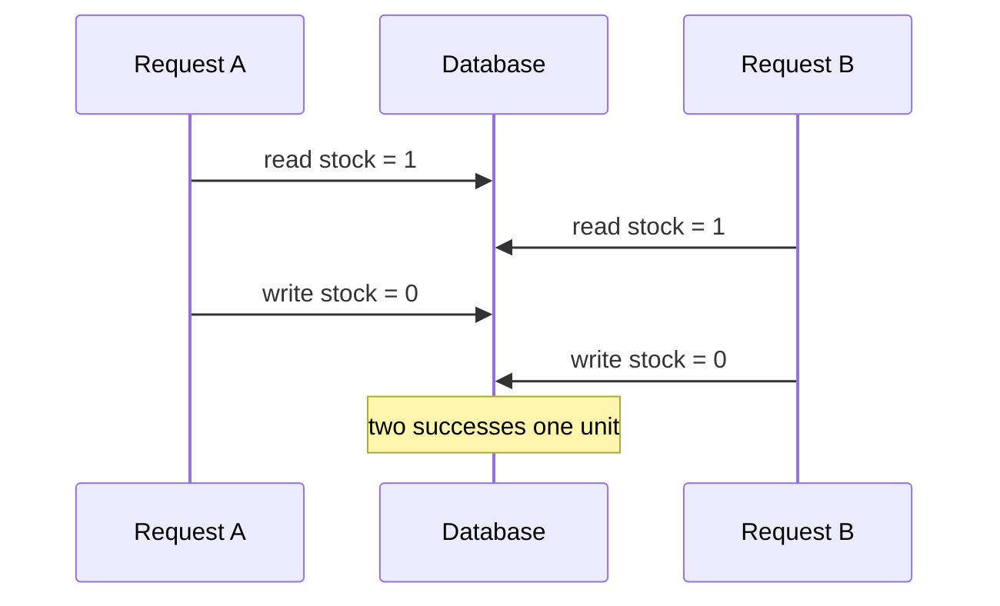

A transaction groups changes into one logical decision, but isolation determines what concurrent transactions may observe. Interview answers often stop at ACID. Strong answers name the business invariant, show the race, and choose the narrowest mechanism that protects it.

## Begin with the anomaly

Suppose one item remains. Two requests read stock as one, both decide they can reserve it, and both write zero. Each statement succeeded, yet the business sold two units. This is a lost decision caused by a read-check-write sequence that was not atomic.



The cleanest fix may be one conditional statement: decrement only where stock is greater than zero, then inspect the affected-row count. The database makes the condition and update atomic. For a multi-row invariant, lock the relevant rows with `SELECT FOR UPDATE`, use an optimistic version column, or run at serializable isolation and retry conflicts.

## Know the isolation ladder

Read committed prevents dirty reads but allows a later query in the same transaction to see a newer committed value. Repeatable read stabilizes rows already read, though exact phantom behavior depends on the database. Serializable aims to produce a result equivalent to transactions running one at a time, usually by blocking, aborting, or both.

```bars
title: Relative coordination cost
unit: level
Read committed | 1 | high concurrency
Repeatable read | 2 | more stable reads
Serializable | 4 | strongest broad guarantee
Explicit row lock | 3 | narrow protected set
Atomic update | 1.5 | narrow invariant
```

Do not choose the strongest level automatically. Broad serializable transactions reduce concurrency and can create retries under contention. Protect the invariant at the smallest correct boundary.

## Keep transactions short

Never call an external service while holding database locks. Persist the local decision, commit, then publish through an outbox or continue an idempotent workflow. Long transactions retain locks and old row versions, increase deadlock risk, and make latency unpredictable.

Deadlocks are normal when transactions acquire resources in different orders. Use a consistent order, keep work short, and retry the aborted transaction with bounded backoff. A retry must carry an idempotency key when repeating the business operation could duplicate it.

## State the complete answer

In an interview: name the invariant, draw the conflicting interleaving, pick atomic update, pessimistic lock, optimistic versioning, or serializable isolation, then cover retry and idempotency. That is more useful than reciting isolation definitions.

```recall
Q: Why does a transaction at read committed not automatically prevent overselling?
A: The read and later write can still race with another transaction unless the invariant is protected by an atomic statement, lock, version check, or stronger isolation.
Q: When is an atomic conditional update preferable to serializable isolation?
A: When one narrow row-level predicate expresses the invariant, because it protects exactly that decision with less coordination.
Q: Why keep network calls outside a database transaction?
A: They make lock duration depend on an unreliable remote system, increasing contention, deadlocks, and tail latency.
Q: What must accompany retries of a business write?
A: Idempotency or a version check, so retrying an uncertain result cannot apply the logical operation twice.
```
