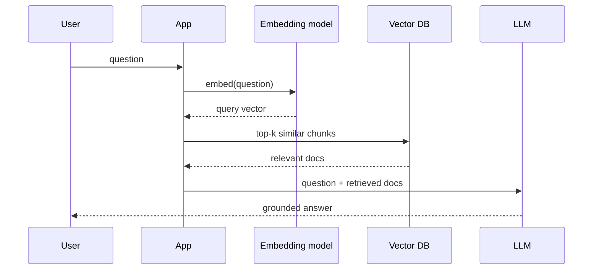

The most consistently cited *new* topic in 2025–26 system design rounds, driven by embeddings-based search and LLM retrieval-augmented generation (RAG).

A **vector database** stores high-dimensional embeddings (arrays of floats that capture meaning) and answers **"find the k most similar vectors to this one"** fast. Similarity is cosine/dot-product distance, and exact nearest-neighbour is too slow at scale, so these DBs use **approximate nearest neighbour (ANN)** indexes like HNSW.

Where it fits — semantic search and RAG:



Most interviews don't need HNSW internals. They want to see that you know **when** to reach for one (semantic similarity, not keyword match) and **how it slots in** (offline: chunk + embed + index your corpus; online: embed the query, retrieve top-k, feed an LLM). Options named in practice: Pinecone, Weaviate, pgvector (Postgres extension — a strong "don't add infra yet" answer).

```steps
Chunk | Split each document in your corpus into passages small enough to embed well
Embed | Turn every chunk into a vector with the same model you will embed queries with
Index | Store the vectors plus metadata in an ANN index like HNSW for fast top-k
```

```recall
Q: When should you reach for a vector database instead of a keyword search?
A: When you need semantic similarity, finding results close in meaning rather than sharing exact terms. Keyword match handles exact tokens; embeddings capture meaning, which is what RAG and semantic search need.
Q: Why do these databases use approximate nearest neighbour instead of exact?
A: Exact nearest-neighbour over high-dimensional vectors is too slow at scale. ANN indexes like HNSW trade a small amount of recall for a large speedup, which is the right trade for retrieval.
Q: Why must the query and the corpus use the same embedding model?
A: Similarity is only meaningful when both vectors live in the same space. Embedding queries and documents with different models makes their distances meaningless, so retrieval returns garbage.
Q: When is pgvector a strong answer over a dedicated vector DB?
A: When you already run Postgres and the scale is modest. pgvector avoids adding new infrastructure, which is a strong "don't add infra yet" choice until vector load genuinely outgrows it.
```
