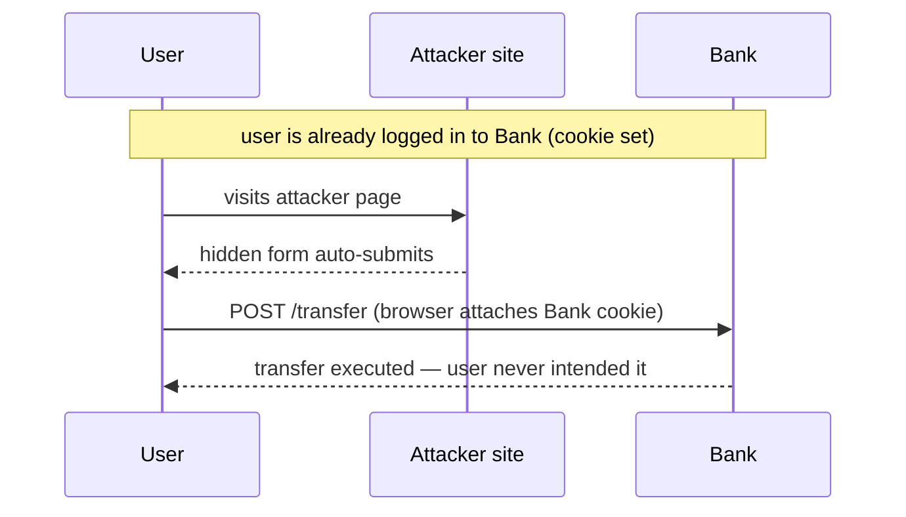

These two are constantly confused. One is a *permission model*; the other is an *attack*.

**CORS (Cross-Origin Resource Sharing)** is a browser mechanism that **relaxes** the same-origin policy. By default a page at `app.com` cannot read a response from `api.other.com` via JavaScript. CORS lets `api.other.com` opt in by sending headers like `Access-Control-Allow-Origin: https://app.com`. Key point for interviews: **CORS is not a security feature that protects your server** — it is the *server telling the browser* who may read responses. It does not stop requests from reaching your API (only the browser's reading of the response is gated), and a non-browser client ignores it entirely. The real mistake is over-permissive config: `Access-Control-Allow-Origin: *` combined with credentials effectively opens your API to every site. Fix: allow a specific, known list of origins.

**CSRF (Cross-Site Request Forgery)** is an actual attack: a malicious site tricks a *logged-in* user's browser into making a state-changing request to your app, riding along on the cookie the browser sends automatically.



Standard mitigations, used together:

- **Anti-CSRF tokens** — the server embeds a secret, unpredictable token in the form/page; a forged cross-site request can't know it, so it fails validation.
- **SameSite cookies** — set `SameSite=Lax` (or `Strict`) so the browser won't attach the session cookie to cross-site requests. This is now the primary, built-in defense.
- **Check the Origin/Referer** header on state-changing requests.

```steps
SameSite cookie | Set SameSite=Lax or Strict so the session cookie is not attached cross-site
Anti-CSRF token | Embed an unpredictable per-session token a forged request cannot know
Check Origin | Validate Origin or Referer on every state-changing request
Reject on mismatch | Fail the request when the token or origin check does not pass
```

The neat contrast: CSRF abuses that the browser *automatically sends cookies*; the defenses make the request either unforgeable (token) or cookie-less across sites (SameSite).

```recall
Q: Why is CORS not a defense that protects your server from attack?
A: CORS only tells the browser who may read a response; the request still reaches your API, and non-browser clients ignore it entirely. It gates reading, not access.
Q: What breaks when you set Access-Control-Allow-Origin to * together with credentials?
A: You effectively let every site make credentialed cross-origin reads of your API. The fix is to allow only a specific known list of origins.
Q: Why does SameSite=Lax defend against CSRF?
A: CSRF relies on the browser automatically attaching the session cookie to cross-site requests. SameSite stops that attachment, so the forged request arrives without the victim's session.
Q: When would an anti-CSRF token still be needed if you already set SameSite?
A: As defense in depth and for flows where cross-site requests are legitimately expected, since the token proves the request originated from your own page.
```
