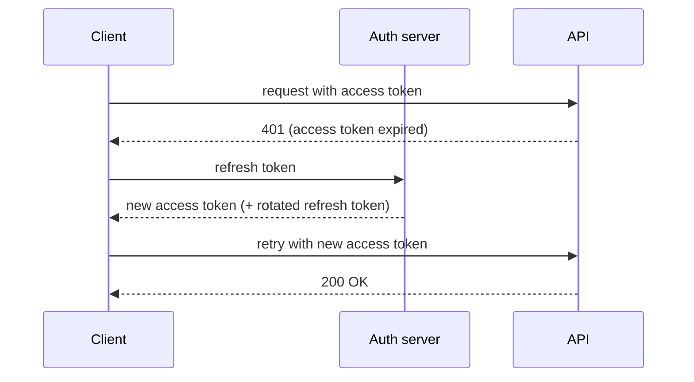

A **JWT** (JSON Web Token) is a signed, self-contained token. Three base64url parts joined by dots: a **header** (algorithm), a **payload** (claims like `sub`, `exp`, `role`), and a **signature**. The server signs the first two parts with a secret (HMAC) or a private key (RSA/ECDSA); anyone can *read* the payload, but only the holder of the key can *forge* a valid signature. That is the whole point: the resource server can verify a token locally, without a database lookup or a call back to the auth server.

```flow
dir: LR
header: Header alg | step
payload: Payload claims | step
sign: Sign header+payload | gate
sig: Signature | store
verify: Verify locally | gate
key: Signing key | store
header -> sign : algorithm
payload -> sign : claims
sign -> sig : produces
key -> sign : secret or private key
sig -> verify : check with key
key -> verify : verify signature
```

Because verification is stateless, JWTs are hard to revoke — a stolen token is valid until it expires. That drives the standard pattern: **short-lived access tokens + long-lived refresh tokens**.



**Rotation** is the discipline that limits damage:

- Keep the **access token short** (minutes to ~1 hour) so a leaked one dies fast.
- **Rotate refresh tokens** — each refresh issues a *new* refresh token and invalidates the old one. If an attacker and the real user both present the same old refresh token, the server detects reuse and revokes the whole family.
- **Rotate signing keys** and publish them via a JWKS endpoint with a `kid` header, so you can retire a compromised key without a flag-day.

Common footguns to call out: never accept `alg: none`, never confuse "readable" with "safe to store secrets in" (the payload is not encrypted), and validate `exp`, `iss`, and `aud` on every request.

```recall
Q: Why can a JWT be verified without a database lookup?
A: It is self-contained and signed, so the resource server checks the signature with the known key locally. No call back to the auth server is needed.
Q: What makes JWTs hard to revoke, and how does the pattern work around it?
A: Stateless verification means a token is valid until it expires. Short-lived access tokens plus revocable long-lived refresh tokens limit how long a stolen token is useful.
Q: Why rotate refresh tokens on every use?
A: Each refresh issues a new refresh token and invalidates the old one, so reuse of an old token signals theft and lets the server revoke the whole token family.
Q: Why must you reject alg: none and not treat the payload as secret?
A: alg: none disables signature verification, letting anyone forge tokens. The payload is only base64url-encoded, not encrypted, so anyone can read it.
```
