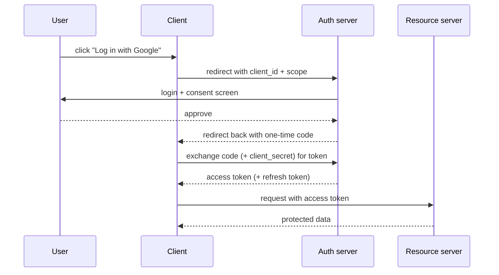

OAuth 2.0 is **delegated authorization**: it lets a user grant an app limited access to their data on another service *without handing over their password*. "Log in with Google" is the everyday case. It is not an authentication protocol itself — OpenID Connect (OIDC) is the thin layer on top of OAuth that adds "who is this user."

The four roles: the **resource owner** (the user), the **client** (the app wanting access), the **authorization server** (issues tokens, e.g. Google), and the **resource server** (holds the data, honours the token).

The flow that matters — **authorization code**, used by web and mobile apps:



Why the extra code-for-token step instead of returning the token directly? The code travels through the browser (visible in the URL), but the token exchange happens **server-to-server** where the browser and its history never see the token. Public clients (mobile, SPAs) that have no safe place for a `client_secret` add **PKCE** — a per-request code verifier/challenge — so an intercepted code can't be redeemed by an attacker.

Other grant types, briefly: **client credentials** (machine-to-machine, no user involved), and the legacy **implicit** and **password** grants, both now discouraged. **Scopes** limit what the token can do; keep them narrow — this is least privilege applied to tokens.

```recall
Q: Why is OAuth 2.0 not an authentication protocol on its own?
A: OAuth delegates authorization (what an app may access) and does not define who the user is. OpenID Connect adds the identity layer on top.
Q: Why exchange a code for a token instead of returning the token directly?
A: The code passes through the browser where it is visible, but the token exchange happens server-to-server, so the token and refresh token never touch the browser or its history.
Q: When and why is PKCE needed?
A: For public clients like mobile apps and SPAs that cannot safely store a client_secret. PKCE binds the code to a per-request verifier so an intercepted code cannot be redeemed.
Q: Why keep scopes narrow?
A: A token can only do what its scopes allow, so narrow scopes apply least privilege and limit the damage if the token leaks.
```
