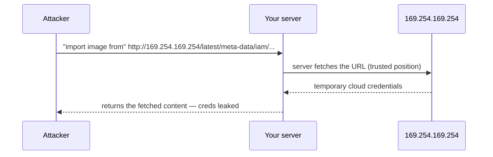

**SSRF** tricks *your server* into making a request the attacker chooses. Wherever your app fetches a URL supplied by the user — a "import from URL," a webhook, an image proxy, a PDF-from-link feature — an attacker can point it at targets they could never reach directly.

The high-value target is the internal network the server can see but the attacker cannot: internal admin panels, databases, and especially **cloud metadata endpoints**. On a cloud VM, `http://169.254.169.254/` returns instance metadata — historically including temporary IAM credentials. SSRF to that endpoint is how attackers pivot a harmless-looking "fetch this URL" into stolen cloud keys.



Standard mitigations, layered:

- **Allowlist, don't blocklist.** Permit only the specific domains/schemes the feature needs; blocklists of "bad" IPs are trivially bypassed with redirects, DNS tricks, and alternate IP encodings.
- **Block internal ranges and metadata IPs** — reject requests resolving to private (RFC 1918), loopback, and link-local (`169.254.0.0/16`) addresses, and re-check *after* DNS resolution to defeat rebinding.
- **Disable unneeded schemes/redirects** — no `file://`, `gopher://`; don't blindly follow redirects that can jump from an allowed host to an internal one.
- **Harden the metadata service** — require IMDSv2 (session-token based) so a simple GET can't harvest credentials.

SSRF is on the OWASP Top 10 in its own right precisely because a small "fetch a URL" feature can become full internal-network access if the destination isn't constrained.

```steps
Allowlist destinations | Permit only the specific domains and schemes the feature actually needs
Resolve then recheck | After DNS resolution, reject private, loopback, and link-local addresses
Block metadata IP | Deny 169.254.0.0/16 so the cloud metadata endpoint is unreachable
Constrain redirects | Do not follow redirects that jump from an allowed host to an internal one
Harden metadata | Require IMDSv2 so a plain GET cannot harvest credentials
```

```recall
Q: Why is an allowlist better than a blocklist for SSRF defense?
A: Blocklists of bad IPs are bypassed with redirects, DNS tricks, and alternate IP encodings. An allowlist permits only known-good destinations, so novel bypasses still fail.
Q: What makes the cloud metadata endpoint such a high-value SSRF target?
A: At 169.254.169.254 it historically returns temporary IAM credentials, so an SSRF turns a harmless fetch feature into stolen cloud keys.
Q: Why re-check the resolved address after DNS instead of only validating the hostname?
A: DNS rebinding can make an allowed hostname resolve to an internal address at request time. Checking the resolved IP defeats that.
Q: How does requiring IMDSv2 reduce SSRF impact?
A: IMDSv2 needs a session token obtained via a PUT, so a simple attacker-triggered GET cannot read instance metadata or credentials.
```
