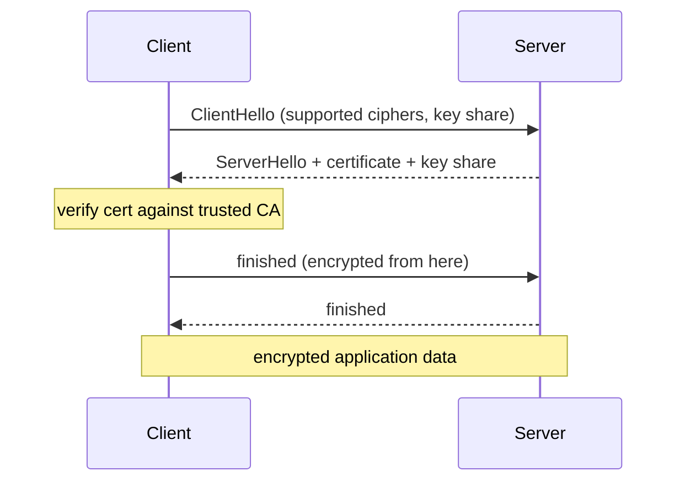

**TLS** (Transport Layer Security, the successor to SSL) is what puts the "S" in HTTPS. It gives three guarantees on a connection: **confidentiality** (traffic is encrypted), **integrity** (tampering is detected), and **authentication** (you are talking to the real server, via its certificate).

The handshake establishes a shared session key before any application data flows. At a high level (TLS 1.3, simplified):



The two ideas worth understanding:

- **Asymmetric → symmetric handoff.** The expensive public-key crypto is used only briefly to authenticate the server and agree on a key. The actual data is then encrypted with fast **symmetric** crypto using that session key.
- **Certificates and the chain of trust.** The server presents a certificate signed by a **Certificate Authority (CA)** your device already trusts. The client verifies the signature chain up to a trusted root — that is what stops a man-in-the-middle from impersonating the server. Let's Encrypt made these certificates free and automatable, which is why plain HTTP is now treated as broken.

Interview-relevant points: TLS 1.3 dropped the older, slower, less safe options and cut the handshake to one round trip; and TLS protects data *in transit only* — it says nothing about how data is stored once it arrives.

```steps
Present certificate | Server sends its certificate signed by a Certificate Authority
Check signature | Client verifies each signature up the chain to a trusted root CA
Validate identity | Confirm the cert matches the hostname and has not expired
Agree session key | Use the authenticated public key material to derive a shared symmetric key
Switch to symmetric | Encrypt all application data with the fast session key
```

```recall
Q: Why does TLS use asymmetric crypto only briefly and then switch to symmetric?
A: Public-key crypto is expensive, so it is used just to authenticate the server and agree on a key. Fast symmetric crypto then encrypts the bulk data.
Q: What does the certificate chain of trust actually prevent?
A: A man-in-the-middle impersonating the server, because the client only trusts certificates whose signature chain leads to a CA it already trusts.
Q: What does TLS not protect, and why does that matter?
A: It protects data in transit only. Once data arrives it is in the clear unless separately encrypted at rest.
Q: Why is plain HTTP now treated as broken?
A: Without TLS there is no confidentiality, integrity, or server authentication, and free automatable certificates made HTTPS the default with no cost excuse.
```
